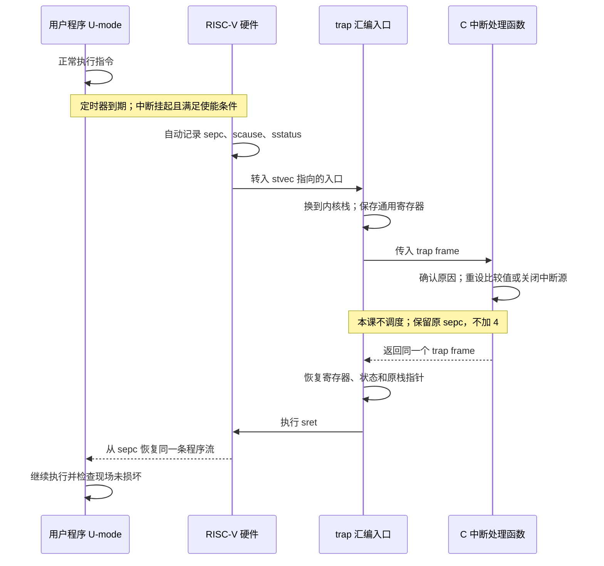

+++
title = "06. 程序被打断以后：中断、保存现场与原路返回"
date = 2026-10-22T23:20:00+08:00
slug = "interrupt-save-restore-resume"
description = "先理解同一条程序流如何被定时器中断并恢复，再进入调度；用 Mermaid 时序图区分硬件动作、汇编保存和 C 处理。"
tags = ["RISC-V", "QEMU", "中断", "trap"]
draft = false
+++

> 本篇对应代码：`xueliangliang/riscv-hello` 的 `lesson-06` 标签，固定提交 `2ed79a2f59c3328f309b330470a287571d862b4e`。前一课是 [syscall、mini-libc 与 heap](/posts/syscall-mini-libc-heap/)。

## 在讲“换一个程序运行”之前，先讲“回到原来的程序”

前两课中，用户程序主动执行 `ecall` 才进入内核。这容易让人形成一个错误印象：内核必须等应用请求服务，才能获得执行机会。

[中断（interrupt）](/terms/#interrupt)让外部于当前指令流的事件在满足条件时打断执行。例如定时器到期时，应用可能还在做加法、读内存或循环，没有调用内核，也没有主动让出执行权。

但“被打断”只解释了前半段。更重要的问题是：原来的寄存器和栈怎么办？处理完事件以后，从哪条指令继续？应用怎样知道自己的计算没有被破坏？

本课只有一个[用户模式（User mode，U-mode）](/terms/#u-mode)程序。它被三次定时器中断打断，处理程序在[监管者模式（Supervisor mode，S-mode）](/terms/#s-mode)运行，随后每次都回到同一个程序。**没有调度，也没有切换到第二个任务。**

## 先看清楚这一来一回

这张图描述的是同一个用户程序被打断，然后回到原程序流。没有切换到第二个程序。



硬件记录返回位置，不等于硬件替我们压好了所有通用寄存器；中断处理函数普通返回，也不等于已经返回用户态。汇编恢复现场与最后的 `sret` 缺一不可。

图由 Mermaid 源码在发布前渲染为可缩放矢量图形（Scalable Vector Graphics，SVG）；正文直接显示图形，可展开查看源码，窄屏可横向滚动或点击原图。图里的四列是职责划分，不是四个并行任务。

## 中断与前面讲的异常，有什么不同

[Trap（陷入/异常入口）](/terms/#trap)是总称。这里先区分两类来源：

| 情形 | 与当前指令的关系 | 本系列的例子 |
|---|---|---|
| 同步异常 | 执行某条指令所产生 | `ecall`、U-mode 非法读取 `sstatus` |
| 异步中断 | 事件并非由当前普通指令请求 | 本课的定时器到期 |

它们可以共用 trap 汇编入口和现场结构，但原因和返回策略不同。本课 S 级定时器的 `scause` 是 `0x8000000000000005`：最高位表示中断，低位原因码是 5。不能把它当成同步异常原因码 5，也不能把前两课的 `ecall` 原因码 8 当成定时器来源。

中断还涉及“挂起”和“使能”：事件可以已经到来，但是否进入 handler，要结合权限、委托与使能条件判断。处理程序如果不处理持续挂起的来源，刚返回就可能再次陷入，而不是安稳地继续用户程序。

## 硬件替我们做了什么，没做什么

进入 S trap 时，硬件把恢复地址记录在 `sepc`，把原因放进 `scause`，更新 `sstatus` 中的来源和中断使能状态，再跳到 `stvec` 指向的入口。它们属于[控制与状态寄存器（Control and Status Register，CSR）](/terms/#csr)。

这不是普通 C 函数调用，也不是处理器自动完成的一次“全寄存器压栈”：

- 硬件没有替我们选好内核栈；
- 没有把所有整数寄存器保存到内存；
- 没有替定时器重设下一次比较值；
- 更没有自动决定该换另一个程序运行。

`trap.S` 必须先交换[栈指针（stack pointer，sp）](/terms/#sp)，将用户原来的 `sp` 留在现场中，然后在可信的 S 栈建立 288 字节、16 字节对齐的 trap frame（现场结构）。其中保存 31 个可写整数寄存器，以及 `sepc/sstatus/scause/stval`。汇编保存完成后，C handler 才能放心使用寄存器。

为什么不只保存 C 调用约定要求的那几个寄存器？因为被打断的代码没有主动调用处理函数。即使是调用者应自行保存的临时寄存器，此刻也可能装着它下一条指令就要用的中间值。异步中断入口不能让用户承担一次根本没发生的普通函数调用义务。

本课处理过程中不重新打开 S 级中断，也不支持嵌套 handler。先把一次完整往返讲清楚，后面再讨论更复杂的可重入设计。

## 返回地址不能照搬 `ecall` 的加 4

前课处理已知的 32 位 `ecall` 时，把 `sepc` 加 4，是为了跳过已经被处理的调用指令；否则返回后会立刻再次执行同一条 `ecall`。

异步中断不同：保存的 `sepc` 是应该恢复的原程序位置。本课的 timer 路径**不修改 frame 中的 `sepc`**。处理结束后，汇编把它写回 CSR，恢复原来的整数寄存器、状态和栈，再执行 `sret`。

`sret` 根据保存的特权状态回到 U-mode，并从 `sepc` 继续；它不替软件恢复整个 trap frame。把 timer 的 `sepc` 也随手加 4，就可能跳过用户本该执行的一条指令。

为了让漏恢复[程序计数器（Program Counter，PC）](/terms/#pc)的错误一定暴露，本课 handler 在保留 frame 副本的同时，有意把**当前 CSR 中的 `sepc` 清零**。返回汇编必须从 frame 真正恢复它，并在 `sret` 前读回检查。这是实验中的诊断手段，不是每个内核都必须做的业务逻辑。

## 实验中的用户程序，只是在正常循环

`lessons/06/user.S` 初始化寄存器哨兵和栈中的校验值后，通过一次 START `ecall` 请求内核配置定时器。随后进入这个四指令循环：

```asm
interrupt_loop:
    addi s0, s0, 1
    addi s1, s1, 1
    ld t0, 0(t1)
    beqz t0, interrupt_loop
```

循环里没有 `ecall`、`wfi`、函数调用或 yield。两次加法表示实际程序进度，普通内存读取只观察一个完成标记，既不读取定时器，也不触发中断。第三次计时事件后，内核设置这个标记，用户结束循环并自检。

返回后不仅要有一行“已经恢复”：用户程序检查两份进度值相等且非零、原栈指针、栈哨兵和固定寄存器哨兵；调试器还会将全部 31 个可写整数寄存器与保存的 frame 逐个对照。

所以，“用户调用 START 配置一次定时器”和“定时器异步打断正在执行的循环”是两回事。宿主测试还会检查反汇编，确保这个循环确实只有上面四条普通指令。

## 本课定时器来自哪里

本课使用 [QEMU（Quick Emulator，快速仿真器）](/terms/#qemu) `virt` 的 [Sstc（Supervisor-mode Timer Interrupts，监管者模式定时器中断扩展）](/terms/#sstc)，显式指定 `-cpu rv64,sstc=true`。这样 S-mode 可以直接设置 `stimecmp`，不需要先引入固件转发的另一套处理流程。

启动配置分为两步：

1. [机器模式（Machine mode，M-mode）](/terms/#m-mode)打开 `mcounteren.TM` 和 `menvcfg.STCE`，将 S timer 的挂起位 STIP（Supervisor Timer Interrupt Pending）委托给 S-mode，即 `mideleg=0x20`；
2. S-mode 设置未来的 `stimecmp`，打开 STIE（Supervisor Timer Interrupt Enable）。当 `time >= stimecmp` 时，定时器中断挂起，在 U-mode 普通指令执行期间进入 S handler。

即使 `sstatus.SIE=0`，从较低权限的 U-mode 运行时，符合条件的 S 中断仍可进入；不能只看一个全局使能位就判断所有权限级的行为。

前两次处理中，handler 把比较值设到未来；第三次关闭 STIE、停放比较值并发布完成标记。这里不是清写 `sip`，也没有外部中断控制器的 claim/complete 操作。规范允许挂起位撤销有延迟，因此代码也容忍重设比较值后、尚未真正到期的额外进入：恢复原现场，不多计一次 tick。

这条路径没有 OpenSBI 或监管者二进制接口（Supervisor Binary Interface，SBI）定时器调用，也没有 M-mode 定时器中断转发。真实板卡是否支持 Sstc，需要重新核验，不能把本课配置当成通用固件合同。

## 获取代码并运行

本课继续使用第 03 篇的磁盘 bootloader，分别装载 kernel 和用户 payload，没有退回到由 QEMU 直接加载本课内核。原第 01–05 课和标签保持不变。

工具基线：GNU 编译器集合（GNU Compiler Collection，GCC）15.2.0、binutils 2.46、QEMU 10.2.1、Python 3.14.7，以及可选的 GNU 调试器（GNU Debugger，GDB）17.1。安装方法见[第 01 篇](/posts/environment-and-first-entry/)。

```sh
git clone https://github.com/xueliangliang/riscv-hello.git
cd riscv-hello
git checkout lesson-06
git rev-parse HEAD
# 应为 2ed79a2f59c3328f309b330470a287571d862b4e
make clean all
make inspect-lesson06
make test-lesson06
```

关键文件是 `lessons/06/start.S`、`trap.S`、`kernel.c`、`user.S` 和 `test.py`。现场布局复用第 04 课，磁盘生成器和用户链接脚本也沿用已有实现。

下面是本次真实运行中截取的正常输出，前面还有 bootloader 的装载记录：

```text
Lesson 06: direct Sstc timer, one user stream, no scheduler.
user: before interrupts; entering normal instruction loop.
timer: tick=0x0000000000000001 scause=0x8000000000000005 SPP=0 resume=0x000000008040008c progress=0x000000000058d2cd
timer: tick=0x0000000000000002 scause=0x8000000000000005 SPP=0 resume=0x000000008040008c progress=0x0000000000afd6c8
timer: tick=0x0000000000000003 scause=0x8000000000000005 SPP=0 resume=0x000000008040008c progress=0x00000000010827f2
user: after interrupts; registers, SP, stack and progress verified.
PASS: three asynchronous timers returned to the same user stream.
```

`resume` 和 `progress` 是捕获值，不是固定答案；实际中断点可以落在循环内不同指令，进度值也会变化。测试从用户[可执行与可链接格式（Executable and Linkable Format，ELF）](/terms/#elf)文件的符号取得合法循环范围，要求 PC 在指令边界内、进度递增，而不是匹配某个固定计数。

## 故意破坏返回路径，测试应该抓住它

`make test-lesson06` 还会运行三个真实故障注入镜像：

| 变体 | 故意破坏什么 | 预期拒绝 |
|---|---|---|
| `bad-context` | 恢复后把 `a3` 改错 | 用户自检失败 |
| `bad-pc` | 把恢复地址写成保存值加 4 | `FAIL: resume PC restore` |
| `omit-pc` | 省略写回 `sepc` | `FAIL: resume PC restore` |

后两个用例在返回前由诊断检查拒绝，不能把它们夸大成“任何跳过一条指令都必然能被用户末尾自检发现”。所有负向镜像都必须以预期错误和退出码 1 结束；超时不是通过。另有真正暂停的 QEMU 实例验证宿主 watchdog 确实把超时视为失败。

完整回归和[伪终端（Pseudoterminal，PTY）](/terms/#pty)验证：

```sh
make test
script -q -e -c 'make test' build/pty.log
```

每次 guest 输出保存在 `build/lesson06/disk*.img.log`。

## 用 GDB 把“保存”和“恢复”对在一起

构建完成后，第一个终端执行：

```sh
qemu-system-riscv64 -machine virt -cpu rv64,sstc=true \
  -global virtio-mmio.force-legacy=false -smp 1 -m 128M \
  -display none -serial stdio -monitor none -bios none \
  -kernel build/lesson03/bootloader.elf \
  -drive file=build/lesson06/disk.img,if=none,format=raw,id=disk,readonly=on \
  -device virtio-blk-device,drive=disk -no-reboot \
  -S -gdb tcp:127.0.0.1:12346
```

第二个终端执行：

```sh
gdb-multiarch -q -batch -x lessons/06/gdb-check.gdb
```

脚本先在 C handler 停住并保存 frame 的观察值，再在 `sret` 前逐个比较 31 个整数寄存器和恢复地址，最后在捕获的 `sepc` 放硬件断点，观察处理器实际回到 U-mode 的同一个 PC。本次验证得到：

```text
GDB: all 31 writable integer registers restored exactly before sret
GDB PASS: sret resumed U at the exact interrupted PC, no +4
```

这比只看“handler 执行完了”多验证了一层：不仅事件处理完成，旧程序的状态也确实恢复了。

## 再往前一步，才是调度

本课始终保存并恢复同一个用户现场。[下一课的调度器](/posts/timer-scheduler-process-lifecycle/)才会在某次中断处理后，选择恢复**另一个**可运行任务的现场。前者是中断往返，后者是在这个机制上增加运行策略和任务生命周期，不能把两件事揉成一个黑箱。

本课仍是单 hart、整数寄存器、无嵌套的实验；平坦的[物理内存保护（Physical Memory Protection，PMP）](/terms/#pmp)放行策略不提供内存隔离。涉及浮点/向量状态、并发任务或安全隔离时，还需要新的设计和验收。完整进度见[系列总览](/series/)。

## 参考资料

- [RISC-V Supervisor-Level ISA：中断状态、trap 与定时器比较寄存器](https://docs.riscv.org/reference/isa/v20260120/priv/supervisor.html)
- [RISC-V Sstc 1.0](https://docs.riscv.org/reference/isa/v20260120/priv/sstc.html)
- [RISC-V Machine-Level ISA：委托、计数器权限与环境配置](https://docs.riscv.org/reference/isa/v20260120/priv/machine.html)
- [QEMU v10.2.1 RISC-V 定时器实现](https://github.com/qemu/qemu/blob/v10.2.1/target/riscv/time_helper.c)
