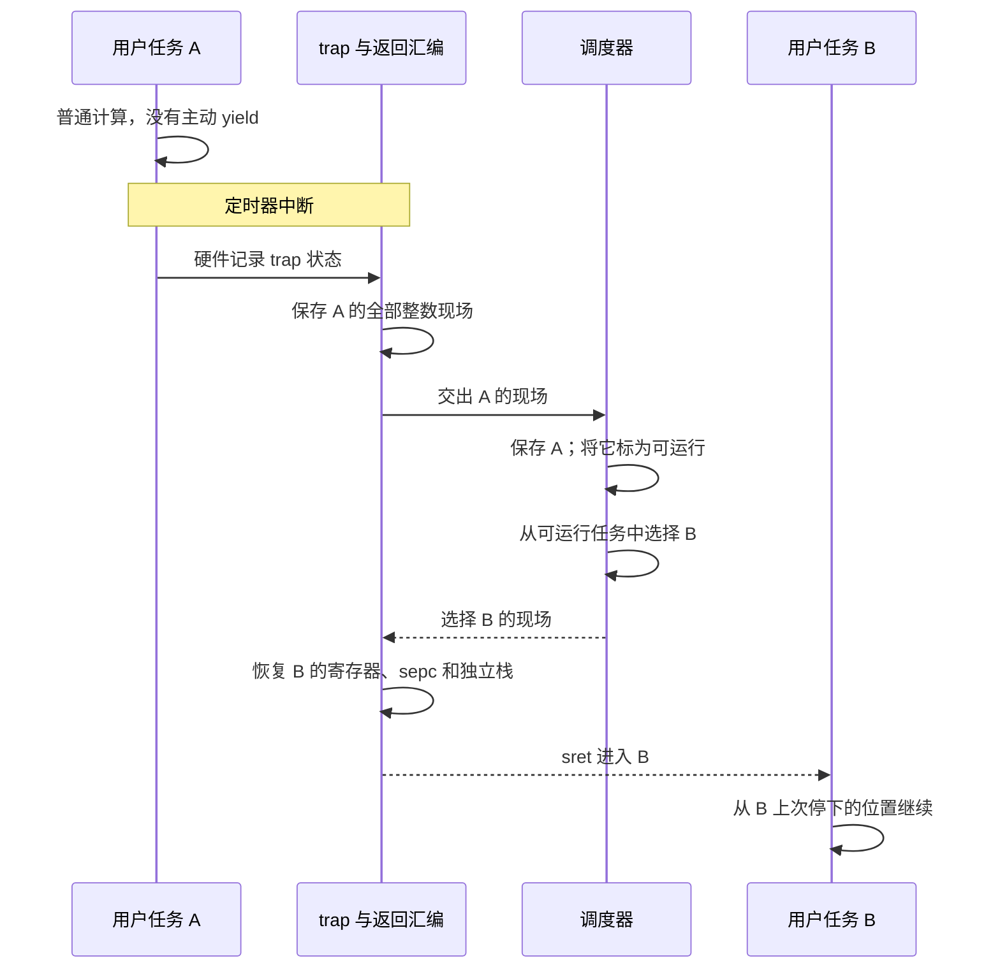

+++
title = "07. 让多个程序交替前进：定时器、上下文切换与进程生命周期"
date = 2026-10-23T09:00:00+08:00
slug = "timer-scheduler-process-lifecycle"
description = "在中断保存现场的基础上恢复另一个任务的现场，区分抢占、睡眠、退出和回收，并以真实用户程序验证生命周期。"
tags = ["RISC-V", "QEMU", "调度", "进程"]
draft = false
+++

## 从恢复原来的现场，到恢复另一个现场

[第 06 篇](/posts/interrupt-save-restore-resume/)已经讲清楚：定时器打断用户代码，入口保存寄存器，处理结束后恢复原现场，程序继续运行。

调度增加的关键一步不是“再触发一次中断”，而是**选择恢复哪个现场**。任务 A 的寄存器、继续地址和栈要先妥善保存；如果选择任务 B，就恢复 B 的那一份，而不是把 A 的返回地址改成 B 的入口却继续使用 A 的栈。



这仍然可以发生在单个[硬件线程（hardware thread，hart）](/terms/#hart)上：两个程序获得交替推进的机会，不等于它们同一时刻在两个执行核心上运行。负责选择下一任务的部分叫[调度器（scheduler）](/terms/#scheduler)。

本课的验收结果是一套从磁盘启动、运行在用户态的实验：两个不会主动让出处理器的计算任务被定时器轮流抢占；另一个任务睡眠时，它们继续前进；控制程序随后验证退出、终止、等待、回收和重新启动。不是只打印两次“任务正在运行”。

## 先固定代码，再复现

本课对应代码标签 `lesson-07`，提交：

```text
7c12ab4215ff68b1af39449e3fed28f318e9ef80
```

[阅读该版本的实现与接口文档](https://github.com/xueliangliang/riscv-hello/tree/lesson-07/lessons/07)。已经具备[第 01 篇](/posts/environment-and-first-entry/)工具链的读者，可以新建工作副本：

```sh
git clone https://github.com/xueliangliang/riscv-hello.git
cd riscv-hello
git switch --detach lesson-07
git rev-parse HEAD
make clean all test inspect
make test-lesson07-gdb
```

最后一个目标需要 [GNU 调试器（GNU Debugger，GDB）](/terms/#gdb)的 `gdb-multiarch`。只重跑本课可用 `make test-lesson07`；它包含真实[伪终端（Pseudo Terminal，PTY）](/terms/#pty)运行，不只是管道捕获输出。

启动链仍沿用[第 03 篇](/posts/virtio-bootloader-from-disk/)：[QEMU（Quick Emulator，快速仿真器）](/terms/#qemu)的 `-kernel` 只接收 `build/lesson03/bootloader.elf`，引导程序从 `build/lesson07/disk.img` 装载内核和用户镜像。没有把新内核直接塞给 QEMU 来绕过磁盘读取。完整手动命令在本课代码 README 中。

## 一个任务需要保存什么

`lessons/07/process.h` 给每个任务持久保存一份 `TrapFrame`，同时记录进程标识、父任务、状态、唤醒时刻和退出状态。临时入口现场与持久进程现场不是同一块内存：

| 保存位置 | 所有者 | 作用 |
|---|---|---|
| 内核 trap 栈上的临时 `TrapFrame` | 当前 hart | 接收这一次中断或系统调用的现场，下一次入口可以覆盖 |
| `processes[slot].frame` | 某个进程实例 | 等待未来恢复，不能随着入口函数返回就消失 |
| 每任务独立用户栈 | 某个进程实例 | 保留局部变量、调用链与用户栈指针 |
| 显式 `UserData` 数据块 | 某个进程实例 | 放置计数器和验证标记，不假设编译器全局变量自动私有 |

本课有 8 个任务槽：一个控制程序、最多七个工作任务。它们共享一份用户代码；每槽分配独立的 4096 字节用户栈和 256 字节数据块。任务槽数量不是 hart 数量。

链接脚本限制用户代码、静态数据和 BSS 的上界，数据块及各用户栈也有固定范围。这里的 BSS 是[Block Started by Symbol，未初始化静态存储区](/terms/#bss)。具体地址与链接断言见 `user.ld`，而不是运行时等撞上别人的栈才发现空间不足。

### 真正切换现场的是这条返回路径

按以下顺序读 `kernel.c` 与 `trap.S`：

1. `supervisor_trap` 用 `sscratch` 交换到内核栈，保存整数寄存器及 trap 状态。硬件没有替软件保存全部通用寄存器，也没有自动换用户栈。
2. `trap_dispatch` 把临时入口现场复制到当前进程自己的 `frame`。
3. 真正达到定时器期限时，`schedule(1)` 把当前任务从 `RUNNING` 改为 `READY`，循环扫描后继槽位，选择另一个就绪任务。
4. 调度器返回的不是“任务编号”，而是所选任务 `&processes[slot].frame` 的地址。
5. 汇编 `restore_frame` 执行 `mv sp, a0`，之后从新选中的现场取值，恢复它的 `sepc`、状态与寄存器，最后 `sret`。

这里暂时让汇编的 `sp` 指向进程表中的现场，是为了按固定偏移加载寄存器，不意味着那块内存成了下一次 trap 的内核栈。恢复代码仍把 `sscratch` 设回专门的内核栈顶，最后才加载新任务的用户 `sp`。

一个常见错误是把“新内核栈顶”推导成 `frame + sizeof(frame)`。这在现场位于进程表时完全不成立。

本课的 [ABI（Application Binary Interface，应用程序二进制接口）](/terms/#abi)只保存整数上下文，不包含浮点和向量状态。异步定时器返回保持原 `sepc`；主动发出的 32 位 `ecall` 才把保存的指令地址前移 4 字节。

## 为什么这叫抢占，而不是程序自己配合

`user-start.S` 的 `spin_loop` 实际只有三条操作：递增 `s0`，把计数保存到本实例数据块，跳回循环。循环里没有 `ecall`、`sleep` 或主动 `yield`。

测试先从编译后的 [ELF（Executable and Linkable Format，可执行与可链接格式）](/terms/#elf)取得循环标签，再反汇编核对指令。日志中每次 `preempt-loop` 的保存地址必须落在实际循环范围内，两任务计数必须多次增加，且调度方向必须包含 A→B 和 B→A。

因此证据链是：没有主动让出的用户循环 → 保存地址确在循环内 → 不同任务的现场被恢复 → 各自计数持续增加。只让两个程序打印不同名字，不能得出同样结论。

定时器继续使用 [Sstc（Supervisor-mode Timer Compare，监督模式定时器比较扩展）](/terms/#sstc)：机器模式授权访问和委托，监督模式更新 `stimecmp`。处理器可能稍晚才撤销旧的 pending 状态，所以早到的重复入口不算一个新逻辑时钟，也不凭空增加一次抢占。

## 睡眠不是在内核里忙等

如果 `sleep` 的实现是在系统调用处理函数里不断检查时间，当前任务看似睡了，整个内核却可能被它占住。更合理的做法是记录唤醒条件，把当前任务移出可运行集合，再选择另一个任务。

本课 `sleep(ticks)` 记录绝对唤醒时刻，把调用者设为 `SLEEPING`，然后返回调度路径。后续调度检查期限，到时改回 `READY`；可运行只表示有资格被选中，不意味着它已经开始执行。

实验中控制程序和一个工作任务睡眠，两个计算任务仍持续获得定时器。随后终止长睡眠任务，它不能再打印 `worker: woke`；另起一个短睡眠任务则应该真正醒来，以状态 23 退出。

还有一个需要诚实说明的实现细节：如果所有任务都睡眠，当前单 hart 内核会在监督模式关闭中断、轮询期限，直到有任务可运行。这不是省电的 `wfi` 空闲线程；但只要仍有就绪用户任务，用户的 `sleep` 就不会把整个系统拖在一个等待循环中。双 hart 的空闲与锁规则在下一篇重新处理。

## 退出不等于立即复用任务槽

一个任务不再执行之后，父任务还可能需要取得它的退出状态。因此“已经退出但尚未回收”和“完全空闲、可重新分配”必须区分。否则旧的进程标识可能意外指向新任务，或退出状态在父任务读取前就被覆盖。

### 状态转换与回收

```text
FREE → READY → RUNNING
               ├─ timer → READY
               ├─ sleep → SLEEPING → READY
               ├─ wait  → WAITING  → READY
               └─ exit  → ZOMBIE  → wait/reap → FREE

READY / SLEEPING ── kill ──→ ZOMBIE
```

`ZOMBIE` 不是空闲槽：它保留退出状态，继续占用容量。父任务 `wait(pid)` 如果遇到活子任务，会登记等待并让出执行机会；子任务终止时，内核把状态放进父任务保存的返回寄存器，唤醒父任务并回收子任务。遇到已退出子任务则立即取得状态并回收。重复等待同一个已回收实例要失败。

这里的 [PID（Process Identifier，进程标识）](/terms/#pid)包含代数与槽位：`generation * 16 + slot`。回收保留代数，重新分配再递增；查找核对完整 PID。因此一个旧 PID 不能在槽位复用后误杀新任务。代数耗尽时拒绝继续分配，不绕回旧标识。

### 本课的系统调用合同

系统调用以 `a7` 传编号、`a0/a1` 传参数、带符号 `a0` 返回结果。接口在 `abi.h`、`syscall.h` 和 `syscall.c`，不要求用户程序包含内核内部结构。

| 调用 | 本课含义 |
|---|---|
| `write(pointer, length)` | 最多 256 字节；完整范围必须属于共享用户镜像、自己的数据块或自己的栈 |
| `spawn(entry, argument)` | 仅控制程序可启动已知内置入口，返回新 PID |
| `sleep(ticks)` | 允许 1–1000 个教学时钟单位，唤醒后返回 0 |
| `exit(status)` | 工作任务以 0–255 的状态退出，不再正常返回 |
| `kill(pid)` | 只能终止自己的活子任务，留下状态 137 的 zombie |
| `wait(pid)` | 等待并回收自己的子任务，返回退出状态，不经用户指针写回 |
| `state(pid)` / `hits(pid)` | 查询自己的子任务状态与已计入的定时器次数 |

错误分成无效/过期 PID、无所有权、没有可复用槽、非法参数四类，分别为 `-1`、`-2`、`-3`、`-4`。状态 137 只是本课约定，不意味着实现了 POSIX 信号系统。

为控制本课的孤儿进程问题，只有槽 0 控制程序可以创建子任务，而且它不能退出；工作任务不能再派生后代。单 hart 上，调用 `kill` 时被杀的计算任务已经被抢占，表内状态为 `READY`，并非另一个核心正在同时执行的 `RUNNING` 任务。后者必须在下一篇单独处理，不能偷换成已经验证。

## 实测：让成功和失败都可解释

发布前复验运行了全系列 `make clean all test inspect` 和本课 GDB 目标，均返回 0。本课测试包含三次普通磁盘启动、一次真实 PTY 启动、一次破坏寄存器恢复的负向镜像，以及对暂停 QEMU 超时的拒绝。

正常运行的稳定检查点如下；各个计数和中断地址不应该写死成黄金输出：

```text
check: invalid inputs rejected
check: preemption sleep kill statuses
check: wait ownership generation stacks
check: live and zombie exhaustion
check: reap relaunch complete
PASS: lesson07 preemptive scheduler and lifecycle.
```

其中容量测试会填满控制程序之外的七个槽；即使七个工作任务都已经退出但尚未 `wait`，再次 `spawn` 仍必须失败。逐个核对状态并回收后，重新启动才应成功，并获得新的完整 PID。

测试不只寻找 `PASS`：`test.py` 解析完整日志，维护独立的生命周期模型，核对标识代数、回收顺序、状态、终止后无进展、等待状态以及最后没有泄漏子任务。

每次有效等待都有 `wait-call`，同时记录父 PID 与目标子 PID。模型按目标关联 `zombie`、返回状态与唯一一次回收，并要求阻塞和立即返回两条路径都实际出现。只比较一串返回状态与另一份退出状态集合，不能证明每个孩子的状态返回正确。发布前审查正好发现了这个测试缺口，补入关联规则后，还加入 14 类真实成功日志的变异拒绝测试，例如删掉所有阻塞记录、交换两孩子的退出/回收状态却保留返回值、把返回提前到孩子退出之前。这些是测试判定器的坏日志，不冒充实际故障系统的运行。

日志记录了启动入口，没有记录全部启动参数；因此主机模型关联每个孩子观察到的退出状态，用户控制程序则另行断言参数对应的精确退出结果，两者并非同一层证据。

另一个负向镜像实际在汇编恢复 `a3` 时加一，必须得到：

```text
FAIL: spin context restore
```

该启动的 QEMU 退出码为 1，不能出现成功行。另一个测试让真实 QEMU 以 `-S` 保持暂停，超时必须失败；超时结束本身不能冒充验收成功。

### 用 GDB 看见“不是原来的任务”

`make test-lesson07-gdb` 不只是打印预设寄存器。它等到 B 已运行过，再抓住 A 的定时器 trap，检查 C 返回的 B 现场以及 `sret` 前的真实寄存器。

本次发布前运行节选如下：

```text
A interrupted: pid=17 pc=0x80400024 sp=0x8040a000
B selected: pid=18 frame=0x802032f8 pc=0x80400024 sp=0x8040b000
PASS: GDB observed A timer trap -> B frame -> B SP/sepc at sret.
```

两任务执行同一份代码，所以 `pc` 相同并不奇怪；不同的栈与进程现场才是关键。每次实际保存位置取决于时序，应该由符号与断点动态核验，而不是要求读者复现这次运行的每个地址。完整日志位于 `build/lesson07/`。

## 本课必须记住的边界

独立任务栈和 PID **不等于内存隔离**。当前[物理内存保护（Physical Memory Protection，PMP）](/terms/#pmp)仍为平坦全地址放通，没有每进程页表；普通可写全局变量仍共享。内核检查 `write` 的参数范围，不能阻止用户代码绕过系统调用直接读写别人的内存。

`spawn` 也不是任意 ELF 装载器，只能选择镜像中已知的内置入口。本课先闭合调度与生命周期，不借此声称实现了一个安全的通用进程系统。

## 留给自己和 agent 的复述题

1. 为什么入口的临时现场必须复制到进程表？只保留内核栈指针会发生什么？
2. `restore_frame` 恢复了 B，为什么下一次 trap 仍能找到正确内核栈？
3. 为什么同一段 `spin_loop` 的两个任务可以有相同 PC，却不是同一条程序执行流？
4. 为什么退出后不立即把槽标为 `FREE`？旧 PID 如何避免误指新实例？
5. 只把命令行改成 `-smp 2`，哪些从启动栈开始的假设就不成立了？

[下一篇增加第二个 hart](/posts/second-hart-shared-state-locks/)，先解决启动与共享状态发布，再处理锁、任务归属和远程终止；全系列安排见[总览](/series/)。
