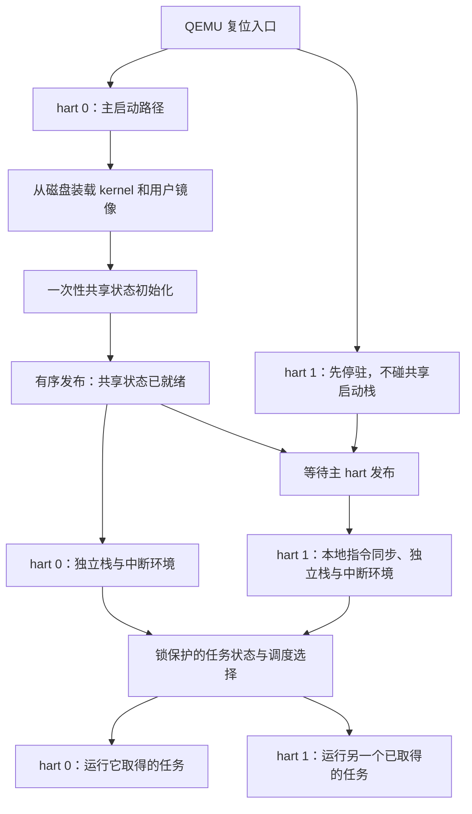

+++
title = "08. 第二个 hart：并行、共享状态与锁"
date = 2026-10-23T09:01:00+08:00
slug = "second-hart-shared-state-locks"
description = "从两个硬件线程的真实启动与内存发布开始，为每个 hart 配置独立内核栈和中断环境，再验证任务归属与共享状态。"
tags = ["RISC-V", "QEMU", "多核", "并发"]
draft = true
+++

## 同一时刻，可能真的有两个执行者

单 hart 的抢占调度让多个任务交替前进。再增加一个硬件线程（hardware thread，hart），问题不只是“轮到谁”，还包括“另一个 hart 此刻会不会也在改这份状态”。

不能把命令行改成 `-smp 2` 就宣布多核支持完成。两个执行者如果同时使用同一个启动栈、同时清零 BSS、同时初始化块设备队列，会在打印第一行成功之前就破坏彼此的现场。

图描述职责与先后关系，不代表所有操作都必须收敛成一个函数。共享数据初始化一次，而栈、trap 入口和本地中断环境要按 hart 准备。

## 一份现场，不能同时交给两个 hart

“可运行”与“正在某个 hart 上运行”要有明确区分。一个 hart 选中任务后，应在共同的同步规则内将它占有，另一个 hart 才不会同时恢复同一份用户寄存器和栈。

任务被移出运行状态之前，也必须先完整保存它的现场。先把状态标成可运行、再慢慢保存寄存器，会让另一 hart 看到一份写到一半的上下文。

## 锁保证什么，不保证什么

锁保护共享状态修改的互斥和约定的发布顺序；它不自动把全局串行调度器变成高扩展性的设计。本课应先验证正确性，再区分锁争用、并行执行和性能收益。

本课的具体实现、接口和真实测试证据待代码验收后补齐。
