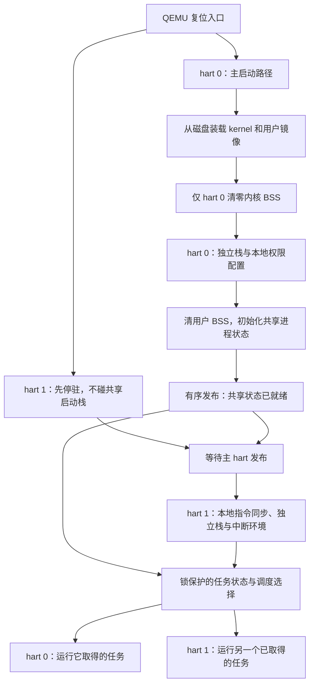

+++
title = "08. 第二个 hart：并行、共享状态与锁"
date = 2026-10-23T09:01:00+08:00
slug = "second-hart-shared-state-locks"
description = "从两个硬件线程的真实启动与内存发布开始，为每个 hart 配置独立内核栈和中断环境，再验证任务归属与共享状态。"
tags = ["RISC-V", "QEMU", "多核", "并发"]
draft = false
+++

## 同一时刻，可能真的有两个执行者

单 hart 的抢占调度让多个任务交替前进。再增加一个[硬件线程（hardware thread，hart）](/terms/#hart)，问题不只是“轮到谁”，还包括“另一个 hart 此刻会不会也在改这份状态”。

不能把命令行改成 `-smp 2` 就宣布多核支持完成。两个执行者如果同时使用同一个启动栈、同时清零 [BSS（Block Started by Symbol，未初始化静态存储区）](/terms/#bss)、同时初始化块设备队列，会在打印第一行成功之前就破坏彼此的现场。

本课从两个 hart 的启动顺序开始，随后验证两边真实执行用户任务、独立定时器现场、共享临界区，以及“另一个 hart 还在运行它时，为什么不能立刻回收进程”。这是对[第 07 篇](/posts/timer-scheduler-process-lifecycle/)单 hart 假设的一次逐层拆解。



图描述职责与先后关系，不代表所有操作都必须收敛成一个函数。共享数据初始化一次，而栈、trap 入口和本地中断环境要按 hart 准备。

## 代码版本与复现

本课代码标签为 `lesson-08`，对应提交：

```text
01f9be39623426c3182d7b0fd36ddfdd212af86c
```

[阅读固定版本的实现、接口与证据说明](https://github.com/xueliangliang/riscv-hello/tree/lesson-08/lessons/08)。在具备[第 01 篇工具链](/posts/environment-and-first-entry/)的环境中：

```sh
git clone https://github.com/xueliangliang/riscv-hello.git
cd riscv-hello
git switch --detach lesson-08
git rev-parse HEAD
make clean all test inspect
make test-lesson08-gdb
```

只重跑本课可用 `make test-lesson08`。最后一个目标需要 [GNU Debugger（GDB，GNU 调试器）](/terms/#gdb)的 `gdb-multiarch`。

本课选择 [QEMU（Quick Emulator，快速仿真器）](/terms/#qemu)的 `virt` 平台、两个 hart、`rv64,sstc=true`，并显式使用 `-accel tcg,thread=multi`。这里 [TCG（Tiny Code Generator，微型代码生成器）](/terms/#tcg)是 QEMU 的动态翻译执行后端；它不是实体芯片的双核性能测试。

## 启动第一步：谁有权碰共享内存

### 旧的 loader 为什么不能直接增加 hart

第 03 篇的入口默认只有一个执行者：设置一份栈，清理一份 BSS，再进入 C 语言磁盘驱动。两个 hart 都照做，会同时使用同一个栈和块设备队列；即使最后偶然看到两个成功横幅，也不能证明这个启动过程可靠。

因此本课保留原课程文件不变，新增 `lessons/08/boot.S`：

- hart 0 才建立 loader 的栈和全局指针，清 BSS，并进入原有第 03 篇的 C/virtio 装载器。
- hart 1 在接触栈、BSS 和 C 代码之前，轮询自己的启动释放寄存器。
- 更高编号的 hart 停驻；当前实现不是任意核心数量的发现框架。

`-kernel` 现在接收 `build/lesson08/bootloader.elf`：这是“新入口汇编 + 原装载器 C”的引导镜像，而不是直接交给 QEMU 的内核。内核与用户代码仍从 `build/lesson08/disk.img` 读取。启动汇编变化是为了解决双 hart 安全性，不是绕过已经学过的磁盘链。

### 发布之后，另一个 hart 才可以执行

主 hart 装载两个镜像，进入内核，完成一次内核/用户 BSS 初始化与初始控制程序建立，然后执行内存与设备访问的 fence，再向 hart 1 的 [MSIP（Machine Software Interrupt Pending，机器软件中断挂起位）](/terms/#msip)寄存器 `0x02000004` 写入释放值。

本课**把它作为显式轮询启动握手**，没有建立一个监督模式核间中断服务。次 hart 观察到释放值后做相应 fence、清位，并在跳进刚加载的内核前执行本地 `fence.i`。

普通数据的可见顺序和指令流同步是两个问题。hart 0 做过一次 `fence.i`，不代表 hart 1 的指令执行环境已经同步；两个 hart 在进入用户镜像前也分别执行本地指令同步。以后增加迁移或动态装载时，这份契约还要重新检查。

### 哪些是每个 hart 各有一份

| hart 私有资源 | 本课用途 |
|---|---|
| 4 KiB 机器模式 trap 栈 | 接收本 hart 的机器模式故障 |
| 16 KiB 监督模式栈 | trap 保存现场、C 处理器与调度路径；栈顶保留可信元数据 |
| `Hart.slot` 与 deadline | 当前拥有哪个任务、自己的下一次定时器期限 |
| `stvec`、`sscratch` 与中断使能 | 自己的入口与下一次 trap 的内核栈 |
| 特权访问与定时器授权 | 每个 hart 分别设置，而非主 hart 设置一次就全局生效 |

任务表与已退出状态是共享资源；用户任务自己的现场和用户栈仍按进程实例划分。不要把两个 hart 误理解成只能创建两个任务。

定时器延续 [Sstc（Supervisor-mode Timer Compare，监督模式定时器比较扩展）](/terms/#sstc)：时间源共享，但 `stimecmp` 比较值与本地中断授权按 hart 配置。不是让 hart 0 的定时器在后台统一替两个 hart 切换任务。

## 进入内核后，不能相信用户 tp

`mhartid` 是机器模式寄存器，监督模式不能直接照搬机器模式的读法。更不能把用户寄存器 `tp` 当成可信 hart 编号：用户程序本来就可能使用或改写它。

本课在独立内核栈顶保留 `Hart *`。用户 trap 先保存全部用户整数寄存器，再从可信栈元数据取到内核身份；退出时先用内核身份恢复 `sscratch`，最后才恢复用户 `tp`。

两个计算任务特意把 `tp` 设为 `0xdeadbeef`。如果内核偷用它保存 hart 编号而忘记恢复，测试就会失败。本课没有保存浮点、向量上下文，也没有启用内核嵌套中断。

## 一份现场，不能同时交给两个 hart

“可运行”与“正在某个 hart 上运行”要有明确区分。一个 hart 选中任务后，应在共同的同步规则内将它占有，另一个 hart 才不会同时恢复同一份用户寄存器和栈。

任务被移出运行状态之前，也必须先完整保存它的现场。先把状态标成可运行、再慢慢保存寄存器，会让另一 hart 看到一份写到一半的上下文。

本课进程表由一把全局[自旋锁（spinlock）](/terms/#spinlock)保护，使用原子 acquire exchange 获锁和 release store 放锁。`volatile` 不能替代这些互斥与内存顺序。

这条路径有四个不能颠倒的动作：

1. 在当前 hart 的内核栈上完整保存入口现场。
2. 获锁后，保存到所属进程的持久现场，更新旧任务状态。
3. 在锁内为所选任务标记 `RUNNING` 与 `owner`，预留给本 hart。
4. 解锁，再由汇编恢复寄存器并 `sret`。

为什么最后要先解锁？恢复后用户程序可能长时间不进内核，不能把全局锁带到用户态。为什么解锁后又不会被另一个 hart 抢走现场？因为 `RUNNING/owner` 的预留仍然有效，另一个调度器不能再选择它，也不能直接回收它。

### 这一课有意不实现迁移

当前亲和性（affinity）规则固定为 `hart = slot & 1`：控制程序槽 0 位于 hart 0，奇数工作槽位于 hart 1，偶数工作槽位于 hart 0。八个槽仍然容纳控制程序和最多七个工作任务。

这个规则支持两个执行者真正运行用户代码，但不提供负载均衡、迁移或工作窃取。某个 hart 空闲时，也不会擅自执行绑定另一 hart 的就绪任务。教学上先把归属和现场寿命讲清楚，不把这一步称为可扩展的 [SMP（Symmetric Multiprocessing，对称多处理）](/terms/#smp)调度器。

没有合适任务时，hart 进入放锁、轮询、重新获锁的持久空闲路径。它不会持有全局锁等别人产生工作，也不会因为暂时无任务就自动关机。这仍是忙轮询，不是省电的 [WFI（Wait for Interrupt，等待中断）](/terms/#wfi)空闲实现。

## 另一个 hart 还在用这份栈，能直接 kill 吗

第 07 篇在单 hart 上，控制程序执行时，被终止的工作任务已经停止执行。现在目标可能正由另一个 hart 运行，甚至另一个 hart 已经在恢复它的寄存器。

这时把目标直接改成 `FREE`，接着允许新任务覆盖它的栈，就是一个真正的并发生命周期错误。

本课区分两种 `kill` 结果：

| 目标状态 | 动作与返回值 |
|---|---|
| `READY` / `SLEEPING` 等未执行状态 | 同步形成退出状态 137 的 zombie，返回 0 |
| 远程 `RUNNING` | 只设置 `kill_pending`，保留现场、owner、标识和栈，返回 1（`KILL_DEFERRED`） |

目标 hart 下次进入 trap，先保存完整现场，再确认终止请求，形成 zombie，最后按正常的精确子任务 `wait` 规则完成回收。返回 1 不是“已停止”，不能立刻把目标内存当成无人使用。

日志必须出现 `kill-deferred → kill-complete → zombie` 的顺序；`wait` 返回后再检查旧实例计数不继续增加。这里没有给出跨核终止的严格实时上界，日志和全局锁本身也会影响延迟。

[PID（Process Identifier，进程标识）](/terms/#pid)继续包含代数；zombie 仍占任务槽。`wait-call(parent,target)` 与对应孩子的退出状态、返回和回收逐个关联，不退回“状态总数恰好一样”的弱验证。

## 锁保证什么，不保证什么

锁保护共享状态修改的互斥和约定的发布顺序；它不自动把全局串行调度器变成高扩展性的设计。本课应先验证正确性，再区分锁争用、并行执行和性能收益。

本课有两把不同层次的锁：内核全局锁保护调度与生命周期；用户测试锁保护一份刻意共享的计数结构。用户临界区可以被定时器抢占，监督模式持内核锁时则保持本地中断关闭。把它们混成同一把锁，会掩盖真正要观察的并发。

### 用共享计数，而不是横幅，验证临界区

`workers.c` 中两个工作任务先会合，分别从两个 hart 进入同一个用户临界区，各更新 4000 次共享计数。测试检查：

- 参与掩码为 3，内核记录两个不同 hart 都执行了该工作入口。
- 最终值为 8000，临界区占用数回到 0，重叠违规数为 0。
- 锁争用计数确实非零，不是两个工作任务碰巧完全顺序运行。

这验证的是本次虚拟平台上的互斥与可见结果，不是对所有交错情况的形式化证明，更不是双核加速比。

负向镜像使用相同用户 payload，但由内核设置测试专用的锁旁路开关：两个任务首次读取计数后都必须到达屏障，才能继续写回。这样确定性地暴露至少一次丢更新，而不是赌一次竞态刚好出现。实际负例必须输出：

```text
shared counter lost update
FAIL: user assertion
```

QEMU 必须退出 1。屏障只固定错误交错，不替代被移除的临界区锁；不能把超时当成发现竞态的成功证据。

## 本次运行证据

发布前复验运行 `make clean all test inspect test-lesson07-gdb test-lesson08-gdb`，退出码为 0。本课测试包含五次独立磁盘启动、真实[伪终端（Pseudo Terminal，PTY）](/terms/#pty)启动、损坏上下文和损坏锁两个实际负例，以及超时拒绝和日志变异测试。

本次普通启动的关键检查点节选：

```text
check: dual-hart preemption sleep remote-kill completion
check: wait ownership generation stacks idle
check: shared counter 8000, two harts, contention, no overlap
check: live and zombie exhaustion
check: reap relaunch complete
PASS: lesson08 dual-hart execution, locking and lifecycle.
```

两个 spinner 仍然没有主动 `ecall/yield` 的循环。测试对实际 [ELF（Executable and Linkable Format，可执行与可链接格式）](/terms/#elf)反汇编，并核对两个 hart 保存的指令地址都位于循环范围内。睡眠任务不妨碍其他用户代码获得定时器；填满与未回收槽不能复用，精确状态、过期 PID、回收后重启也通过真实系统调用运行。

### GDB 要检查两个 hart，而不是两个名字

本课调试目标分别启动两个磁盘虚拟机，分别在 hart 0 与 hart 1 的用户定时器恢复处检查：用户 `tp`、所选用户栈、监督栈元数据、`sepc`、本地权限和定时器条件。随后 detach，虚拟机仍要完成整套用户实验。

本次两个调试日志均得到：

```text
PASS: GDB hart=0 timer restoration, user tp, own SP/sscratch, unlocked sret and local privilege configuration.
PASS: GDB hart=1 timer restoration, user tp, own SP/sscratch, unlocked sret and local privilege configuration.
```

“本 hart 已解锁”不意味着断点时全局锁的数值一定是 0：另一个 hart 可能已经获得它。正确断言是锁的 owner 不能仍是当前 hart。实测 hart 0 停在 `sret` 前时，全局锁就可以是 1。

当前 QEMU 的 GDB 寄存器描述未导出 `stimecmp`，脚本没有伪造这项读取，而是核对实际本地定时器 trap 与记录期限。磁盘尚未装载时设置需要解码内核指令的断点、以及对 `sret` 的软件 step-over，也可能制造调试器假象；`README.md` 与 `switch.gdb` 记录了先等装载完成、刷新缓存，再按线程筛选断点的方法。

发布前还复现了一个更隐蔽的调试问题：即使软件断点按线程筛选，断点指令仍可能被另一个 hart 遇到，导致 GDB 暗中只单步那个 hart，等待 `sret` 不会到达的 `pc+4`。这次证据里的调度锁没有被持有，并非内核运行死锁。脚本因此只在**已经放锁的直线寄存器恢复尾声**启用 GDB 的 scheduler locking，检查完再 detach，让两个 hart 一起继续；不是把运行时调度锁带到用户态。修正后连续十组双 hart 调试检查通过，超时日志也保留实际部分输出，不靠扩大超时或重试掩盖问题。

## 怎样读这份实现

| 文件 | 重点 |
|---|---|
| `boot.S`、`start.S` | 共享初始化一次，次 hart 停驻/发布，每 hart 特权配置 |
| `process.h`、`trap.S` | hart 身份、临时与持久现场、独立栈、用户 tp 保存恢复 |
| `kernel.c` | 锁、owner、亲和性、空闲、远程 kill、等待回收 |
| `workers.c`、`user.c` | 两种用户循环、共享计数临界区、控制程序断言 |
| `test.py`、`switch.gdb` | 动态地址与 hart 证据、完整生命周期模型、实际负例 |

路径均相对 `lessons/08/`。本课仍是平坦的 [PMP（Physical Memory Protection，物理内存保护）](/terms/#pmp)放通，不提供进程内存隔离；普通编译器全局变量仍共享，正如共享计数实验所利用的那样。

## 自己能解释，才算完成

1. 为什么次 hart 需要在设置启动栈之前就分流？
2. 数据发布 fence 与每 hart 的 `fence.i` 分别解决什么？
3. 为什么从用户 `tp` 直接找 hart 身份不可靠？
4. 为什么调度锁要先放开，所选任务又仍然不能被别人回收？
5. `kill` 返回 1 以后，调用者还不能假设什么？
6. 8000 次正确更新，为什么不是双核性能提升的证明？

下一篇把等待串口字符接入任务状态与唤醒。届时必须重新审查空闲时中断怎样到达，不能在这把全局锁里忙等输入。其余安排见[系列总览](/series/)。
