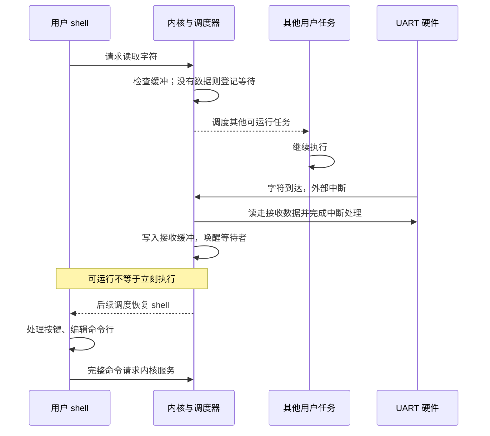

+++
title = "09. 从轮询终端到交互式 shell：输入中断、等待与唤醒"
date = 2026-10-23T09:02:00+08:00
slug = "uart-interrupt-interactive-shell"
description = "把串口收到字节、内核缓冲与用户命令行拆开，让 shell 等待输入时其他任务仍能运行，并实际验证编辑、历史和命令执行。"
tags = ["RISC-V", "QEMU", "UART", "shell"]
draft = true
+++

## 等待一个字符，不能让整个系统停下来

最早的串口输出只要确认发送寄存器可写，再写入一个字符。输入则多了一层时间关系：下一个字符可能马上到来，也可能几秒钟都没有。

如果内核在系统调用里一直等待字符，而且还持有调度锁，那么再好的调度器也无法让其他任务前进。终端输入要把“硬件收到字节”和“用户程序需要这个字节”分开。

中断处理程序负责尽快取走数据和发布事件，不应该承担整个命令解析器，也不应该为了等下一次按键而留在中断里面。

## 唤醒不是多写一个状态字段

检查缓冲为空、登记等待者、以及中断到来后写缓冲和唤醒，必须服从同一套同步约定。如果检查后、登记前恰好来了一个字符，处理不当就会出现“数据已经在缓冲里，shell 却继续睡着”的丢失唤醒。

同样，接收环形缓冲也要有容量、满时策略和可观察的丢弃计数。有限内存不是自动可靠的流控。

## 命令编辑要测到执行，不只测到回显

看到终端回显字符，不代表命令行编辑正确。历史召回后在中间插入、删除，再按回车，最终执行的命令应该与屏幕上看到的一致；Tab 补全和未知命令也应该回到可继续输入的提示符。

本课的具体实现、命令合同与端到端测试证据待代码验收后补齐。
