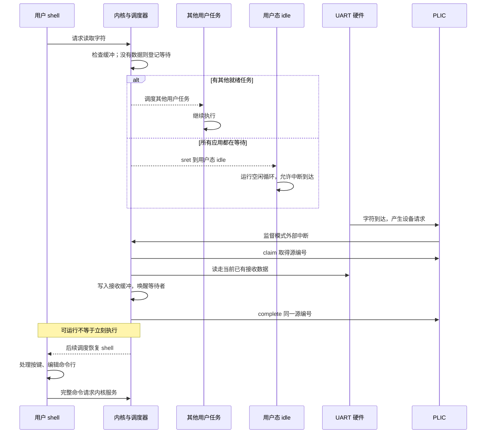

+++
title = "09. 从轮询终端到交互式 shell：输入中断、等待与唤醒"
date = 2026-10-23T09:02:00+08:00
slug = "uart-interrupt-interactive-shell"
description = "把串口收到字节、内核缓冲与用户命令行拆开，让 shell 等待输入时其他任务仍能运行，并实际验证编辑、历史和命令执行。"
tags = ["RISC-V", "QEMU", "UART", "shell"]
draft = true
+++

## 等待一个字符，不能让整个系统停下来

最早的串口输出只要确认发送寄存器可写，再写入一个字符。输入则多了一层时间关系：下一个字符可能马上到来，也可能几秒钟都没有。

如果内核在系统调用里一直等待字符，而且还持有调度锁，那么再好的调度器也无法让其他任务前进。终端输入要把“硬件收到字节”和“用户程序需要这个字节”分开。

这一次实现的是磁盘镜像里的用户态 shell，不是宿主机脚本模仿的终端。输入从[通用异步收发器（Universal Asynchronous Receiver-Transmitter，UART）](/terms/#uart)到达，通过[平台级中断控制器（Platform-Level Interrupt Controller，PLIC）](/terms/#plic)送入内核；命令编辑与解析留在用户程序中。



中断处理程序负责尽快取走数据和发布事件，不应该承担整个命令解析器，也不应该为了等下一次按键而留在中断里面。

## 固定版本与最短复现路径

本课固定代码标签 `lesson-09`，提交：

```text
04581e0158a8811373cbb9ae95396d77592d9fb5
```

[该版本的代码、命令合同与完整说明](https://github.com/xueliangliang/riscv-hello/tree/lesson-09/lessons/09)。工具链要求见[第 01 篇](/posts/environment-and-first-entry/)：

```sh
git clone https://github.com/xueliangliang/riscv-hello.git
cd riscv-hello
git switch --detach lesson-09
git rev-parse HEAD
make clean all test inspect
make test-lesson09-gdb
make run-lesson09
```

最后一个命令进入交互提示符 `09> `，输入 `help` 看命令，输入 `shutdown` 显式结束。[QEMU（Quick Emulator，快速仿真器）](/terms/#qemu)正常配置没有教学演示自动关机计时器。`test-lesson09-gdb` 则需要 [GNU Debugger（GDB，GNU 调试器）](/terms/#gdb)的 `gdb-multiarch`。

仍然沿用[第 08 篇](/posts/second-hart-shared-state-locks/)的双 hart 安全启动方式：只有引导镜像通过 `-kernel build/lesson09/bootloader.elf` 提供，内核与用户 shell 都由引导程序从 `build/lesson09/disk.img` 的真实块设备读取。默认运行与测试都把这份生成的盘以只读方式挂载，不触碰旧原型磁盘。

## 先解决一个容易忽略的死角：大家都睡了，谁接中断

第 08 篇的内核空闲路径是在监督模式中放锁、轮询，保持本地中断关闭。在那条循环上只增加 UART 的使能位，并不能让外部中断真的打断它。

如果 shell 正在等字符，其他任务也全都阻塞，系统可能再也没有机会进入原本只处理用户来源 trap 的入口。这不是在 `read` 多写一个 `READING` 状态就能解决的问题。

本课选择**每个 hart 一个真正的用户态 idle 上下文**，而不是顺便引入监督模式来源的嵌套中断处理：

1. 每个 hart 额外准备一个固定整数现场和一份 256 字节空闲栈，入口是磁盘用户镜像中的 `idle_loop`。
2. 没有适合本 hart 的就绪任务时，记录 `Hart.slot = -1`，设置本地定时器，放锁，再 `sret` 到这个用户态空闲循环。
3. 字符到达时仍是用户来源的外部 trap；原本的可信监督栈切换、寄存器保存、hart 身份恢复可以继续使用。
4. 分发器识别 `slot = -1`，处理设备请求并重新挑选已被唤醒的 shell，不会访问 `processes[-1]`，也不会把 idle 当成需要回收的子任务。

两份 idle 现场和栈属于调度维护资源，不占用八个任务槽：仍然可以同时拥有一个 shell 和七个工作实例。

代价也要说清楚：`idle_loop` 是用户态忙循环，不是 [WFI（Wait for Interrupt，等待中断）](/terms/#wfi)低功耗空闲。内核仍不允许监督模式嵌套 trap，持锁时也不打开本地中断。后续要做真正低功耗与核间通知，需要另一套验收。

## 设备请求如何变成一次可处理的事件

本课针对实测 QEMU `virt` 设备图：UART 基址 `0x10000000`，中断源为 10，PLIC 基址 `0x0c000000`。这些是平台地址和编号，不是 RISC-V 指令集对所有板卡的约定。

测试中的 `board.py` 对当前命令行生成真实[设备树二进制（Devicetree Blob，DTB）](/terms/#dtb)，独立解码 UART 类型、范围、源编号、PLIC 上下文顺序和时间基准。寄存器细节再对照固定 QEMU 源码与 PLIC 规范，不能只从旧原型复制一个地址就当作已经核验。

### 中断使能有多个层次

这里的 [IRQ（Interrupt Request，中断请求）](/terms/#irq)路径包括：

- UART 清除[除数锁存访问位（Divisor Latch Access Bit，DLAB）](/terms/#dlab)、配置接收 [FIFO（First In, First Out，先进先出队列）](/terms/#fifo)，打开接收数据中断。
- PLIC 将源 10 的优先级设为 1，启用 hart 0 的监督模式上下文，阈值为 0。
- 机器模式委托监督外部中断；各 hart 设置本地使能，只有 hart 0 的 PLIC 上下文实际启用 UART 源。
- 通过 `sret` 回到用户上下文后，按特权规则接收中断，而不是在内核持锁区间打开中断。

`console_interrupt` 是唯一读取 UART 接收数据寄存器的位置：先 claim，读出当前已有字节，写入接收环形缓冲，必要时唤醒 shell，最后以同一个源编号 complete。claim 返回 0 可以是无源或重复到达，不冒充一次成功收到 UART 中断。

PLIC 的 claim/complete 与 [Sstc（Supervisor-mode Timer Compare，监督模式定时器比较扩展）](/terms/#sstc)的本地定时器比较值更新是不同路径。不能用“写了定时器”当成已完成设备中断，也不能用 PLIC complete 确认 Sstc。

## 唤醒不是多写一个状态字段

检查缓冲为空、登记等待者、以及中断到来后写缓冲和唤醒，必须服从同一套同步约定。如果检查后、登记前恰好来了一个字符，处理不当就会出现“数据已经在缓冲里，shell 却继续睡着”的丢失唤醒。

同样，接收环形缓冲也要有容量、满时策略和可观察的丢弃计数。有限内存不是自动可靠的流控。

本课把两边放到同一把调度锁下：

- `SYS_READ` 看到环形缓冲非空，就取一个无符号字节返回。
- 为空时，在锁内把 shell 设为 `READING`，随后走调度返回路径，而不是留在系统调用里忙等。
- IRQ 入队同样持锁；如果 shell 正在等待，把一个已接收字节填进它保存的 `a0`，然后发布 `READY`。

这样，检查“空”与登记“我正在等”之间，不存在一个没有同步保护的缝隙。后续恢复 shell 的现场时，原来的 `read` 得到这个字节并继续执行。本课只允许 shell 读取输入，不隐藏一个尚未设计好的多读者策略。

### 满了怎么办，必须写进合同

接收[环形缓冲区（ring buffer）](/terms/#ring-buffer)容量为 128 字节，满时丢弃新到字节，不覆盖未读数据。统计记录接收、已消费、排队、丢弃和读写位置回绕。

这是有限缓冲，不是粘贴事务：溢出可能连换行符一起丢掉。因此测试会在突发输入后另发一个新换行，结束或丢弃残余行，再检查下一条新命令确实可以执行。不能声称任意长度高速粘贴都无损。

硬件 FIFO 溢出和软件环形缓冲的计数也不是一回事；当前证据验证 QEMU 下的软件缓冲策略，不证明物理串口不会丢字节。

## 命令编辑要测到执行，不只测到回显

看到终端回显字符，不代表命令行编辑正确。历史召回后在中间插入、删除，再按回车，最终执行的命令应该与屏幕上看到的一致；Tab 补全和未知命令也应该回到可继续输入的提示符。

用户 `user.c` 中的行编辑器明确区分缓冲长度、插入光标和历史位置：

| 操作 | 当前合同 |
|---|---|
| 普通可打印字符 | 在光标处插入，移动右侧后缀 |
| 左/右方向键 | 移动插入位置，不修改内容 |
| Backspace、DEL 字节 127 | 删除光标前一个字符 |
| 终端 Delete 序列 `ESC [ 3 ~` | 删除光标处字符 |
| 上/下方向键 | 浏览四条历史，并能恢复浏览前的草稿 |
| Tab | 只对唯一的命令名前缀补全，不补程序参数 |
| CR、LF、CRLF | 提交命令；CRLF 即使跨两次阻塞读取，也只提交一次 |

最大命令行为 95 个字符，超出的可打印字符忽略；只处理 [ASCII（American Standard Code for Information Interchange，美国信息交换标准代码）](/terms/#ascii)，不提供 Unicode、多行编辑、引号、管道、重定向或环境变量展开。这里的 [CR/LF 分别是 Carriage Return（回车）与 Line Feed（换行）](/terms/#crlf)。

测试不止看屏幕：先执行 `echo old`，用上方向键召回，删掉 `old` 并输入 `new`，按回车后必须得到实际执行结果 `echo: new`。另有中间插入、退格后再插入、前向删除、上下历史恢复草稿和 Tab 后执行的检查。

## shell 提供哪些命令

| 命令 | 含义 |
|---|---|
| `help` | 列出命令 |
| `echo text` | 输出文字，不做变量展开 |
| `ps` / `jobs` | 同一份带 PID、状态、定时器次数和计算进度的占用槽快照 |
| `run spin` | 启动不会主动让出的计算循环 |
| `run sleep [ticks]` | 启动睡眠任务，默认 10 个教学时钟单位，醒来以状态 23 退出 |
| `run exit [status]` | 启动一个以指定状态退出的任务，默认状态 0 |
| `kill pid` | 请求终止自己的子任务；远程正在执行时可能返回 1，表示尚待确认 |
| `wait pid` | 等待该子任务并取得退出状态，随后回收槽位 |
| `sleep ticks` | 阻塞 shell，不停住其他任务和输入中断 |
| `stats` | 读取接收、中断、缓冲与等待唤醒统计 |
| `shutdown` | 显式请求 QEMU 测试设备结束运行 |

[PID（Process Identifier，进程标识）](/terms/#pid)仍包含代数，zombie 未被父任务 `wait` 之前不能复用。七个子任务加 shell 的预算不因双 hart 缩成两个任务。亲和性仍是槽位奇偶绑定，不增加迁移或负载均衡的主张。

例如，下面是一次真实[伪终端（Pseudo Terminal，PTY）](/terms/#pty)测试记录中的返回值节选，不是输入脚本伪造的 guest 输出：

```text
run target=1 result=17
run target=2 result=18
wait target=18 result=23
kill target=17 result=1
wait target=17 result=137
wait target=17 result=-1
```

`run` 的 target 是内置入口编号，result 才是新 PID；`wait` 和 `kill` 的 target 是进程 PID。这里第一个计算任务在远程 hart 上执行，所以终止返回 1；等待 137 才确认生命周期完成，再等同一个旧 PID 返回无效标识错误。

所有程序入口都编译在磁盘用户 payload 中。这证明了从磁盘装入的用户程序与真实调度/系统调用闭环，不是文件系统里的任意可执行文件装载；存储与文件系统是后续课程。

## 真实终端与失败路径

`make test-lesson09` 通过真实 PTY 把按键送给 QEMU 串口，盘镜像只读，超时始终是失败。验收包含：

1. 没有工作任务时，让 shell 等待一段时间，再发送字符，核对真实外部 IRQ 与唤醒计数增加。
2. 检查每条命令、未知命令后提示符恢复、历史/编辑/补全后的实际执行结果。
3. shell 等待睡眠子任务期间，另一个计算任务的定时器次数与计数继续增加。
4. 七个计算实例同时推进，加上 shell 填满八槽；活任务和未回收 zombie 都不能被新启动覆盖。
5. 逐 PID 核对等待状态、终止、回收、重复等待和代数变化后的重新启动。
6. shell 睡眠期间输入 800 字节突发，核对缓冲满时丢新、回绕、计数守恒，以及补新换行后的命令恢复。

`oracle.py` 把内核的 `wait-call(parent,target)`、阻塞、对应孩子的退出状态、返回和回收关联起来，再与用户 shell 打印的 `wait target=… result=…` 对照。它还要求预期的 `echo:` 执行输出；改错目标/状态、删除阻塞或执行结果、追加失败记录的日志变异都必须被拒绝。

独立审查还运行了额外的延迟唤醒、95 字节行边界、历史回绕、拆开发送的 CRLF、多代 PID 回收和系统调用参数检查。在一次单独的 2176 字节突发中，核对最先 128 字节保持顺序、其余 2048 个新字节计为丢弃，并验证计数守恒和之后的命令恢复。这是该次虚拟设备实验的观察，不推广成物理串口无损保证。

负向磁盘镜像真正关闭 UART 接收中断使能。它专用的测试 watchdog 在发现 reader 阻塞且没有收到外部 IRQ 时输出：

```text
FAIL: UART IRQ delivery disabled: blocked reader watchdog
```

QEMU 必须退出 1，不接受“等到超时所以算测出了问题”。正常镜像没有这个测试 watchdog，也不会因为终端暂时安静就自动关机。

### GDB：从真实 idle IRQ 到 shell 收到字节

`make test-lesson09-gdb` 等待磁盘装载完成，在 shell 已登记读取、两个 hart 都空闲时，延迟发送字符 `e`。断点检查用户来源、idle 指令地址、用户 `tp`、可信内核栈元数据和锁状态；随后核对 IRQ/唤醒计数、返回字节与所选 shell 的现场。

本次运行节选：

```text
IRQ idle epc=0x80400040 user-tp=0x1d1e trusted-hart=0 reader-state=6
IRQ count=1 read-wakes=1 return-byte=101 lock-owner=-1
PASS: GDB real idle UART IRQ -> blocked read wake -> U return sp=0x80408ed0 tp=0 sscratch=0x80208ff0
```

101 是此次收到的 `e` 字节。调试器 detach 后，测试继续输入 `cho gdb-woke`，必须真正执行出 `echo: gdb-woke`，再以显式 `shutdown` 结束。检查不是停在一个“即将成功”的断点就算完成。地址与具体时序以这次构建/运行的符号为准，不作为所有机器的固定值。

审查曾观察到旧版调试脚本偶发超时；由于当时没有保存部分输出，不能把那一次断言成已经查明的内核死锁。发布版本补齐超时证据保存，并针对第 08 篇已证实的跨 hart 软件断点风险，仅在已放锁的直线恢复尾声约束 GDB 执行线程，随后 detach 恢复所有 hart。它不扩大超时、不把重试当通过，也不修改 guest 的锁或中断行为。

## 按职责阅读代码

| 文件 | 重点 |
|---|---|
| `kernel.c` | UART/PLIC 初始化、唯一接收读取点、环形缓冲、等待唤醒、idle 上下文和调度 |
| `trap.S`、`process.h` | 用户整数现场、可信 hart 身份与每 hart 栈 |
| `user.c` | 有界行编辑、历史、命令解析与用户程序入口 |
| `abi.h`、`syscall.c` | 读取字节、进程快照、统计、原有生命周期调用 |
| `board.py` | 对实际 QEMU 设备树做独立检查 |
| `test.py`、`oracle.py`、`irq.gdb` | 真实 PTY、逐任务结果模型、负向设备路径和调试证据 |

路径相对 `lessons/09/`。本课仍然没有进程内存隔离：[PMP（Physical Memory Protection，物理内存保护）](/terms/#pmp)放通物理空间，普通全局数据共享。系统调用参数检查不能把这套内核变成能安全运行不可信程序的系统。

## 自己解释一遍

1. 为什么第 08 篇的监督模式忙轮询 idle 不能直接接上这次 IRQ？
2. 用户 idle 为什么不占一个可被 shell 启动/回收的任务槽？
3. 空检查与登记等待之间丢失唤醒，具体会发生在哪两个动作之间？
4. `kill` 返回 1 与 `wait` 返回 137 分别证明什么？
5. 为什么必须检查编辑后的 `echo:` 输出，而不是串口回显？
6. 环形缓冲溢出以后，为什么要补一个新换行再测恢复？

下一步把程序和数据放到真正可管理的文件结构里，学习重启以后哪些内容还能留下来。[系列总览](/series/)继续记录已完成和计划中的内容。
