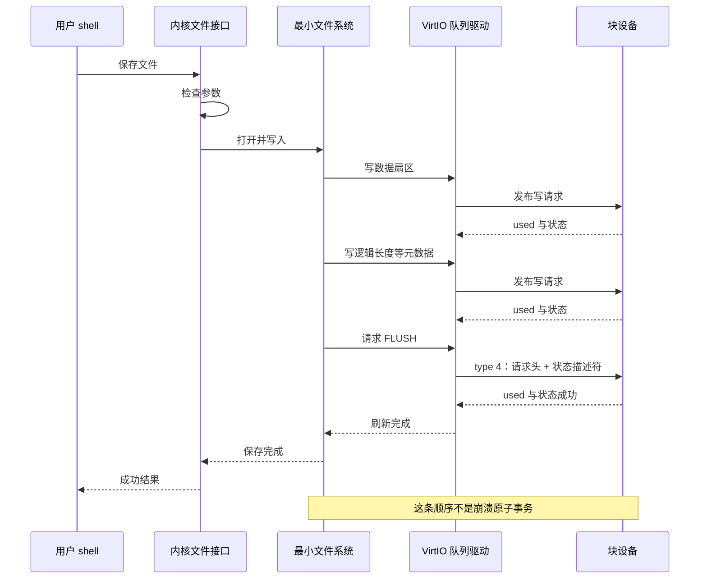
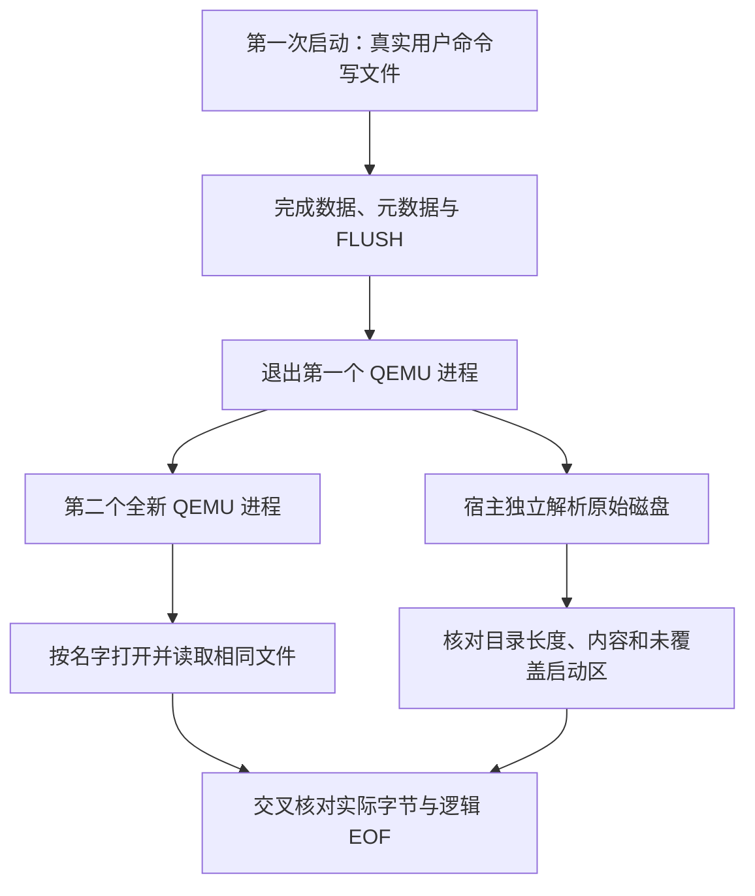

+++
title = "10. 块设备到最小文件系统：先把数据放对位置"
date = 2026-10-23T14:45:00+08:00
slug = "block-device-minimal-filesystem"
description = "把扇区读写接到文件名、长度与句柄，区分内存顺序与设备 FLUSH，用重启和独立磁盘检查验证数据真的留了下来。"
tags = ["RISC-V", "QEMU", "VirtIO", "文件系统"]
draft = false
+++

## 上一篇的命令，为什么一重启就什么也没留下

[上一课的 shell](/posts/uart-interrupt-interactive-shell/)已经可以等待输入、运行多个任务、结束并回收子任务。但它的命令编辑历史、工作计数器和任务表都放在内存里。关掉模拟器，再启动一次，初始化代码会重新建立这些状态。

磁盘明明已经存在：第 03 课就靠它把内核和用户程序装进内存了。为什么仍然没有一个能保存笔记的文件？

因为**块设备只认识地址和字节，不认识文件名，也不知道哪个字节才是文件结尾**。

[文件系统（File System，FS）](/terms/#fs)要在设备之上补上这些约定：名字怎样映射到一段数据，长度存在哪里，打开后的读取位置由谁记录，什么时候可以说一次保存成功。它不是在 `read_sector` 外面换个函数名。

本篇先用一张有界线性目录和固定大小的数据区建立最小闭环，不提前引入树、块链或恢复日志。实现的格式、接口与限制见[本课代码目录](https://github.com/xueliangliang/riscv-hello/tree/lesson-10/lessons/10)里的 [FORMAT.md](https://github.com/xueliangliang/riscv-hello/blob/lesson-10/lessons/10/FORMAT.md) 与 [README.md](https://github.com/xueliangliang/riscv-hello/blob/lesson-10/lessons/10/README.md)。

## 固定版本与最短复现路径

本课固定标签为 `lesson-10`，提交在独立审查完成后冻结：

```text
ef430008b8996b5c23e58bfa418ffa99b84f008d
```

以下命令从累计仓库复现本课。工具链准备见[第 01 篇](/posts/environment-and-first-entry/)，本课不增加运行期软件包依赖：

```sh
git clone https://github.com/xueliangliang/riscv-hello.git
cd riscv-hello
git switch --detach lesson-10
git rev-parse HEAD
make clean all test inspect
make test-lesson10-gdb
make run-lesson10
```

最后进入 `10> ` 提示符。`test-lesson10-gdb` 是可选的 [GNU Debugger（GDB，GNU 调试器）](/terms/#gdb)验收，需要 `gdb-multiarch`。真正提供给 [QEMU（Quick Emulator，快速仿真器）](/terms/#qemu)的 `-kernel` 仍然是引导镜像；本课内核与用户 shell 仍从磁盘加载，不绕过第 03 篇的装载链。

先输入这些命令，再用 `shutdown` 正常退出：

```text
fwrite first hello persistent disk
fwrite second a different file
cat first
fwrite first short
cat first
rm second
ls
fsinfo
shutdown
```

再次执行 `make run-lesson10`，然后输入 `cat first`、`cat second`：前者应只返回 `short`，后者应报告不存在。作者用同一张可写盘、两个不同的 QEMU 进程执行了这组命令。下面摘自第二次启动的真实输出，省略了逐按键重绘和无关调度记录：

```text
fs: mounted FlatFS10 READ WRITE FLUSH
short
cat target=0 result=0
cat target=0 result=-10
file: first size=0x0000000000000005
```

这里 `cat ... result=0` 表示读到了逻辑文件结尾，而不是文件长度为零。`ls` 列出的长度是 5 字节；`-10` 是本课的“不存在”，不是宿主机的 errno 编号。

## 先分开三个容易混在一起的地址

假设用户要读取 `note.txt` 中字节偏移为 600 的位置。这件事至少有三种不同的位置：

1. **文件内偏移**：从文件开头数到第几个字节，属于文件接口。
2. **设备位置**：文件数据位于哪一个[逻辑块地址（Logical Block Addressing，LBA）](/terms/#lba)，扇区内偏移是多少。
3. **内存地址**：这次设备请求把读到的数据放进哪个缓冲区。

这里的文件偏移和设备扇区都从零编号；单个扇区是 512 字节。若一个文件的数据从某个固定扇区开始，偏移 600 就落在后一个扇区的偏移 88。真正的代码要检查加法和范围，不能让越界的文件偏移变成另一个文件甚至启动镜像的扇区。

名字也不是地址。目录把 `note.txt` 关联到数据位置与逻辑长度；打开记录则保存这次访问的游标和权限。本课故意限制同一个文件同时只有一个打开句柄，不顺便引入并发写者的一致性规则。

[句柄（handle）](/terms/#handle)是本课内核管理的一条打开记录，不直接等于文件目录下标，也不是用户可以随意构造的物理地址。句柄关闭后，旧值不应突然获得另一个文件的访问权。

## 磁盘上不只有文件：先保护启动链

同一张盘里已经保存了启动记录、内核和用户程序。文件系统不能因为自己需要一个“元数据扇区”，就把它写进前面用来启动的范围。

设计布局时，先给整个启动载荷预算留足空间，再划出目录与文件数据区。文件表、单文件容量、盘总容量都要同时检查。总盘有空闲，并不意味着某个固定文件区可以继续增长。

这一课的取舍是**固定长度目录 + 每个文件独占一段有界连续区**。这种数据区常称为[连续区段（extent）](/terms/#extent)。它容易画清楚、独立检查，也会浪费空间：一个很短的文件仍占用自己的固定区段。

这正是下一课值得改进的地方。但在改进之前，要先回答：这一版能否把两个不同名字的文件放对位置，重启后还能按名字读回来？

格式还要明确字节序、字段宽度、有效标志和空记录内容。不能把某个 C 结构体随手写到磁盘，再把编译器的填充和对齐当作永久格式。

实际的 FlatFS10 格式把这些位置固定下来，所有整数都显式按小端编码：

| 区域 | 包含的 LBA | 作用 |
|---|---|---|
| 启动保留区 | 0–256 | 启动记录，以及最多各 128 个扇区的内核和用户载荷 |
| 文件系统头与目录 | 512–514 | 一扇区格式头、十六条 64 字节目录记录 |
| 文件区段 | 1024–1151 | 十六个各 4096 字节的固定区段 |
| 其他扇区 | 上述范围之外 | 本课文件系统不分配 |

构建基线盘共 4096 个扇区，即 2 MiB。头部包括 `FLATFS10` 标记、版本和布局常量；每条有效记录包括 32 字节名称区、有效标志、逻辑长度、该槽位唯一的数据起始 LBA 和保留字节。未用记录必须全部为零；名称的终止零以后也必须补零。

这是一份独立、可检查的教学格式，不与旧原型的 LBA 80 格式兼容。旧 `fs.c` 和旧磁盘仍然保留，没有拿旧盘来试格式化。格式化工具只在构建新的基线镜像时使用，内核挂载不调用它。

遇到不认识的 magic、越界长度、重复名字或非法记录时，应当拒绝挂载，而不是“方便地”自动清空磁盘。**格式化是破坏性的显式操作，不是读取失败的默认补救。**

## 逻辑长度不是物理容量

文件占据一个 4 KiB 区段，不代表读取它就应该返回 4096 字节。目录里的逻辑长度才决定有效内容范围。

读取从句柄游标开始，最多返回请求长度和剩余有效字节数中的较小值。游标已经到达[文件结束位置（End of File，EOF）](/terms/#eof)时，返回 0，不能把旧数据、区段剩余空间或者下一个文件读出来。

另一个容易被演示掩盖的问题是短覆盖：原文件很长，重新写入一段较短内容，随后读取应该看到旧后缀，还是只看到新内容？本课必须选定一种合同，并让元数据、读取、重启后的结果都一致。

本课选择的是完整替换：以替换模式打开时，先把文件逻辑长度持久化为零；每次 `file_write` 都替换整个文件，而不是按当前游标追加。成功写入会把区段剩余部分补零，再保存新逻辑长度。读取则按游标前进。

要注意打开与写入是两次操作。如果替换打开成功、随后写入参数非法或设备失败，旧文件已经被截断，不会自动回滚。它不是带原子保证的“临时文件写完再替换”接口。

缩短逻辑长度也不等于安全擦除：单独的截断打开与删除并不清除旧载荷；即使本课成功写入补零，也没有针对真实介质副本、缓存和磨损均衡建立安全擦除合同。

## 给用户一组小而明确的文件接口

内核提供打开、读取、完整替换写、刷新、关闭、删除、列目录和查看状态八个服务，系统调用编号为 17–24。它们经过与上一课相同的用户来源 trap，再由文件分发器处理。

| 接口 | 本课合同 |
|---|---|
| `file_open(name, FS_EXISTING)` | 只读打开已存在文件；找不到就失败，不创建 |
| `file_open(name, FS_REPLACE)` | 显式创建或截断为空，授予替换写权限 |
| `file_read(handle, buffer, count)` | 返回实际字节数并推进游标，到 EOF 返回 0 |
| `file_write(handle, buffer, count)` | 替换整个文件，最多 4096 字节，成功后读游标归零 |
| `file_flush(handle)` | 真正提交设备刷新并检查完成 |
| `file_close(handle)` | 刷新后使句柄失效；刷新失败也不保留可复用的旧句柄 |
| `file_remove(name)` | 拒绝删除打开文件；清空目录记录、保存并刷新 |

文件接口目前只允许 shell 调用。四个句柄槽与八个任务槽不是同一张表；工作任务没有继承文件句柄的能力。内核先检查调用者，再解引用名称或缓冲区，避免把错误所有者的无效指针当成文件参数处理。

名称限制为 1–31 个 `[A-Za-z0-9_.-]` 字符。内核逐字节检查可访问范围并复制到自己的名称缓冲区；读取、写入的计数最多 4096，空指针、溢出和跨越已允许区域边界的范围会被拒绝。句柄把代数和槽位编码在一起，关闭后重新使用该槽不会让旧值重新有效。

这仍是接口检查，不是内存隔离；本课没有新增页表或进程保护。文件 `write` 与串口输出的 `WRITE` 也分开：不能把打印成功当成文件写入成功。

交互层新增 `ls`、`fwrite NAME TEXT`、`cat NAME`、`rm NAME` 和 `fsinfo`。命令行仍只有 95 字节，因此跨扇区测试不能靠一条很长的 `fwrite` 演示。测试命令 `fstest` 在真实用户态通过同一套系统调用执行边界与二进制数据测试，`fsverify` 在冷启动后核对已有模式文件。

**不要在保存个人数据的运行盘上输入 `fstest`**：它面向全新的可丢弃文件系统，会创建、替换和删除测试文件。普通 `make test-lesson10` 会自行使用临时副本，避免污染用户运行盘。

## 把第 03 课的“只读装载”变成内核运行期设备服务

仍然使用 [VirtIO（Virtual I/O Device，虚拟 I/O 设备）](/terms/#virtio)块设备，不过它现在承担两个阶段的工作：

- 引导阶段：引导程序读磁盘，把内核与用户镜像放到既定内存地址。
- 运行阶段：内核建立自己拥有的队列和缓冲区，处理文件数据与元数据的读写。

内核不能继续依赖引导程序留下的队列地址。那些地址属于前一个执行阶段，可能已经被覆盖，生命周期也不再由运行期驱动管理。接管时要重新初始化设备、协商所支持的功能，再发布自己的队列。

队列中的描述符说明一段内存地址、长度和方向。这里的“可写”指**设备可以写进该缓冲区**，不是应用程序想写文件：

| 请求 | 请求头 | 数据缓冲 | 完成状态 |
|---|---|---|---|
| 读扇区 | 设备读取 | 设备写入 | 设备写入 |
| 写扇区 | 设备读取 | 设备读取 | 设备写入 |
| FLUSH | 设备读取 | 无数据描述符 | 设备写入 |

一个正常完成的请求不仅要等到 used 队列前进，还要核对返回的描述符编号和状态。设备没有响应、返回错误或不支持请求时，都不能往上层伪装成成功。

本课选择同步轮询、一次一个在途请求。这是为了让队列所有权与完成过程可检查，不是一个高并发存储驱动。等待设备必须有界，不能把设备失联变成永久持锁。

当前文件系统调用还持有全局调度锁，监督模式的本地中断保持关闭。因此磁盘轮询会延迟定时器、其他 hart 的调度和串口接收处理。双 hart 并不自动让这一段输入输出（Input/Output，I/O）变得并行；连续输入也可能让设备的[先进先出队列（First In, First Out，FIFO）](/terms/#fifo)溢出。每个设备请求最多等待一秒，但一次文件调用会提交多个请求，这不是整个系统调用的一秒延迟保证。

超时也不代表设备已经停止访问内存。本课的描述符、请求头、状态与[直接内存访问（Direct Memory Access，DMA）](/terms/#dma)中转缓冲区都使用静态生命周期；失败后标记驱动和挂载不可继续使用，不会拿用户栈作为在途目标，也不复用尚未确认完成的请求空间。这里 DMA 指设备通过描述符访问 guest 内存，不是把一个 C 指针交给用户就完成了设备管理。

## `fence` 不能代替 FLUSH

处理器、设备和宿主机后端是不同的层。这里至少需要区分三种“完成”：

1. [中央处理器（Central Processing Unit，CPU）](/terms/#cpu)已经按要求发布了描述符和缓冲区，设备不会看到半写的请求。
2. 设备在 used 队列中报告某次写请求完成。
3. 设备按所协商的缓存与持久性合同完成了刷新请求。

`fence` 约束内存和设备访问的顺序。它不会自己创建一个块设备请求，更不会自动把缓存里的文件数据写到持久介质。

本课显式要求协商 `VIRTIO_BLK_F_FLUSH`，在保存路径中提交类型为 `VIRTIO_BLK_T_FLUSH` 的真实请求，检查它的完成状态，再把成功交给调用者。FLUSH 在这里是[设备缓存刷新操作](/terms/#flush)，不是凭名字就能成立的包装函数。



这是一项有意缩小的驱动策略，不是说所有未提供 FLUSH 的设备都不可能持久化。VirtIO 规范还定义了不同的写缓存协商情形；本课不实现所有组合，而是明确拒绝自己没有完整支持的配置。

反过来，即使一次 FLUSH 完成，也不应该把它宣传成“任意时间断电都不会坏”。如果更新数据和更新目录之间发生故障，设备里可能留下部分更新。本课没有恢复日志，也没有一套保证整个文件替换原子完成的协议。第 12 课才专门讨论这个问题。

驱动错误会一路向上返回。本课还要求错误后停止继续使用这个挂载：即使一次性故障已经消失，也不能假装刚才的写入从未发生。正常关机要额外刷新；刷新失败时必须以失败退出，不能照样打印正常关机横幅。

为了确认这不只是给函数取名 `flush`，GDB 验收实际停在完成检查点，检查请求类型、可达描述符链和设备写回结果。一次实测的关键输出是：

```text
PASS GDB: actual FLUSH type4 header16 -> status1, no data, used id0 length1 status0
$1 = {type = 4, reserved = 0, sector = 0}
```

这表示 FLUSH 使用 16 字节请求头直接指向一字节状态描述符；用于普通读写的数据描述符不在链上。断点之后还要 detach，让真实 guest 继续完成写入、接收中断唤醒的 `echo` 和显式关机，不能只停在调试器里宣布通过。

## 重启验收必须换一个 QEMU 进程

最短的验收不应该只是“写函数返回了字节数，马上又读到相同内容”。后一次读取可能只看到了内核自己的目录缓存，磁盘甚至可能根本没有发生正确的元数据写入。

完整闭环要同时有两条独立观察路径：



第二次启动必须使用**同一张可写盘**，重新读取目录。测试器不能在两次启动之间重新格式化，不能把宿主准备好的答案重新拷进去，也不能仅凭一句 `PASS` 宣告文件存在。

宿主侧检查要独立解码磁盘格式，检查多个不同文件的名字、长度、实际内容和不重叠范围；再检查启动记录及程序载荷没有被文件操作覆盖。仅验证镜像大小或某个 magic 不够。

还要把“正常退出后重启可读”与“真实断电后仍完整”分开。QEMU、宿主文件缓存和实际介质一起决定更深的持久性边界；本课的重启实测不替代真实硬件掉电测试。

## 保留运行盘，也是程序正确性的一部分

如果 `make` 每次发现内核重新编译，就顺便重新生成了正在保存用户数据的磁盘，那么 guest 内部的文件系统再正确也没有意义。

因此要分开两类镜像：

- **构建与测试基线**：允许从源码生成，测试时复制到临时目录。
- **用户运行盘**：首次显式创建后保留，再次启动复用，普通构建不重置，清理构建产物也不应误删它。

需要清空时使用明确的 reset 操作，并检查没有另一台 QEMU 正在使用相同镜像。创建新盘要先准备完整的临时文件，再原子安装；不能让中断的复制留下一个看似存在、实际残缺的运行盘。

本课的具体路径是 `build/lesson10/disk.img` 和 `state/lesson10/disk.img`。前者是可重建基线；后者由 `make run-lesson10` 首次安装并保留，`make clean` 不删除它。选择另一份独立运行盘可以用：

```sh
make run-lesson10 LESSON10_ARGS='--disk state/lesson10/alternate.img'
```

只有显式执行 `make reset-lesson10` 才丢弃默认运行盘的数据，重新安装当前构建版本。它是破坏性操作，不是每次启动前的准备步骤。现有运行盘里的内核和用户镜像也不会因重编译而偷偷更新；要切换版本，先备份或选另一张盘。

启动器在复制、reset 和整个 QEMU 生命周期中持有同一把宿主建议锁，拒绝第二个启动器并发访问同一张盘。直接绕过启动器运行 QEMU 不受这把建议锁保护，不支持和启动器同时使用该镜像。

这与文件系统内部的恢复日志不是同一个问题：前者保护宿主工具的镜像生命周期，后者处理 guest 修改磁盘过程中发生的故障。

## 一次通过测试，不代表边界合同已经成立

发布前的候选版本通过了正常文件操作、跨启动读取和设备错误测试，独立审查仍然找出了两个实打实的接口缺口：

- 逐字节检查名称地址，会允许一个名称跨越两个分别可访问、但合同要求不能跨越的区域。每个字节都能访问，不等于整段字符串属于同一个允许区间。
- 删除调用的保留参数应为零，却借用了打开模式的“零或一”判断，导致非法参数仍能删除文件。

这两项都通过真实用户来源的 `ecall` 复现，并从目录和磁盘字节确认结果，不只是修改一行日志来猜测。它们说明参数校验与正常文件内容正确，是两个不同的验收目标；不应为了让旧实现通过，悄悄把已写出的合同放宽。

修正后，检查覆盖整个已复制名称区间，打开模式和删除保留参数分别验证；新的真实系统调用回归同时要求合法边界名称仍可读、非法请求被拒绝，而且不截断、不创建、不删除文件。

第二轮审查继续追同一类问题：只验证“调用返回错误”还不够，还要验证被拒绝的调用没有产生输出、没有改动文件；只检查挂载被拒绝，不等于设备错误状态真的被观察到；只抽查一个文件的补齐字节，不代表所有写入都遵守同一合同。列表和状态的保留参数也按零值严格检查，测试还补上了只改“上报长度”或只改删除结果的伪造证据，必须被拒绝。

调试脚本同样如此：不仅失败时要覆盖旧成功日志，而且要保证**构建步骤本身失败**时旧 PASS 也不会留在磁盘上。因此门禁在编译之前就先截断证据文件，再依次运行日志回归和真实 GDB。脚本退出失败与证据完整是两件不同的事，最终版本两者都要成立。

父级在最终候选的全新归档中重新运行了全系列测试与第 07–10 课的 GDB 目标，还真实重做了三类失败检查：以 `/bin/true` 代替 GDB、制造不存在的 `TMPDIR`、故意写坏一个源文件。每一轮都必须以非零状态失败，并且证据文件里没有上一轮的 PASS；随后恢复真实环境，门禁仍须完成原有设备断言与 guest 关机。

## 本课的验收不是只看一条 PASS

测试器通过真实[伪终端（Pseudoterminal，PTY）](/terms/#pty)驱动串口，要求命令实际执行后的内容、返回值和恢复提示符一致。源码、格式说明和测试入口都在[固定版本的 `lessons/10/`](https://github.com/xueliangliang/riscv-hello/tree/lesson-10/lessons/10)：

| 观察层 | 实际检查 |
|---|---|
| 用户系统调用 | 511、512、513、1024、4096 字节模式；257 字节分块读；二进制零和高位字节；EOF 不改输出缓冲 |
| 文件生命周期 | 短覆盖、空文件、删除重建、打开时拒绝删除、四句柄和十六目录项耗尽、关闭后的旧句柄失效 |
| 冷启动 | 同一张 shell 盘三个独立进程；模式盘重新启动后按名称读回，不重新准备答案 |
| 原始磁盘 | 独立 Python 解码目录、尺寸、内容、空记录和区段偏移；检查启动保留区全部字节未变 |
| 格式负向 | 损坏标记、版本、名称、填充、长度、位置和重复记录等均拒绝挂载，不自动格式化 |
| 设备负向 | 真实只读后端；明确标注的缺失 FLUSH 特性注入；QEMU `blkdebug` 让读、写、刷新返回 I/O 错误 |
| 错误后行为 | 一次性错误已耗尽也不恢复写入成功；后续文件操作及关机不能伪装成功 |
| 证据本身 | 改坏真实日志的内容、上报长度、删除结果、写入返回值、EOF、跨启动结果或原始盘预期，要求检查器拒绝 |

`NO_FLUSH` 负例是在教学驱动中屏蔽功能位，不是声称 QEMU 存在某个 `flush=off` 参数；实际只读设备和 `blkdebug` I/O 错误是另外的负例。没有响应的超时也不能算负向测试成功。

`build/lesson10/` 中保留 UART 日志、`raw-decoder.json`、`evidence-shell.img`、`evidence-patterns.img`、错误日志和 GDB 输出。可以在不启动 guest 的情况下再独立看一遍生成的模式盘：

```sh
python3 lessons/10/decode.py build/lesson10/evidence-patterns.img
```

这些证据分别回答“接口返回了什么”“新内核读到了什么”“盘上究竟是什么”，不把同一个内核打印的三句横幅当作三个独立证据。

## 读完以后，试着自己解释

- 文件名、句柄、文件内偏移、LBA 和内存地址，各自属于哪一层？
- 若物理区段大于逻辑长度，为什么 EOF 不能按区段末尾判断？
- 块读和块写的描述符方向为什么相反？FLUSH 为什么没有数据描述符？
- 如果把 FLUSH 的实现换成一条 `fence`，哪些测试应该失败，哪些表面演示可能仍然通过？
- 重启读回已经通过，为什么仍不能声称任意时间崩溃都安全？

## 规范与继续阅读

- [VirtIO 1.2 规范](https://docs.oasis-open.org/virtio/virtio/v1.2/virtio-v1.2.html)：第 2 章设备通用结构、第 4.2 节[内存映射输入输出（Memory-Mapped Input/Output，MMIO）](/terms/#mmio)传输、第 5.2 节块设备，特别是特性协商、缓存语义和请求完成状态。
- [QEMU v10.2.1 的 virtio-blk 实现](https://github.com/qemu/qemu/blob/v10.2.1/hw/block/virtio-blk.c)：`virtio_blk_handle_flush` 最终调用块后端刷新；它不是普通写请求的别名。
- [第 11 课：独立实现 B+ 树文件系统](/posts/bplus-tree-filesystem/)：讨论固定目录和固定区段为什么会限制文件数量、空间利用和内容增长。
- [系列总览](/series/)：后续课程与共同的范围边界。
