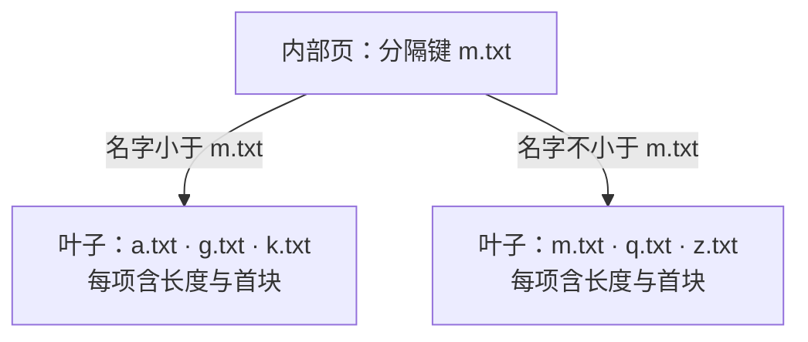

+++
title = "11. 文件变多、内容变长：独立实现 B+ 树文件系统"
date = 2026-10-29T11:45:00+08:00
slug = "bplus-tree-filesystem"
description = "把文件名索引、块分配与文件内容分开，用 B+ 树、两张位图和数据块链取代固定目录与固定区段，并验证分裂、回收、整理和重启。"
tags = ["RISC-V", "QEMU", "B+树", "文件系统"]
draft = true
+++

## 上一课已经能保存文件，为什么还要重写

[第 10 课](/posts/block-device-minimal-filesystem/)把文件名、逻辑长度、句柄、真实设备刷新与重启读回接成了闭环。它不是假的文件系统，但它故意做了一个很强的限制：十六个目录槽，每个文件预留一个固定大小的区段。

这让每个文件的数据地址几乎不用计算，也让两种浪费同时出现：

- 文件很短时，自己的区段里有空间没用上，其他文件却拿不到。
- 文件很多或某个文件变长时，即使整张磁盘还有空闲，也会先碰到固定槽位或固定区段上限。

这一次不覆盖旧实现，也不把旧盘直接换个 magic 继续使用。第 10 课仍能单独构建、运行和测试；第 11 课在新的目录和运行盘上，引入一个独立的[B+ 树（B-plus tree）](/terms/#bplus-tree)文件系统。

本稿仍处于实现与审查阶段。下面先讲清设计问题；本课实际格式、接口、固定提交和执行记录会在验收后补齐，未完成前不发布。

## 三个问题，别塞进同一种结构

“有了 B+ 树”并不能解释整个文件系统。这里有三个不同的问题：

| 问题 | 本课使用的结构 |
|---|---|
| 根据名字找到文件记录 | B+ 树目录索引 |
| 哪个节点页或数据块可以分配 | 两张[位图（bitmap）](/terms/#bitmap) |
| 一个文件的所有字节放在哪里 | [数据块链（block chain）](/terms/#block-chain) |

文件名只是在树里比较的键。叶子记录保存文件逻辑长度和数据块位置，不把整段文件内容挤进目录页。数据块链管理的是文件内容，不是“树的下一层”。

也因此，本篇不是把目录名拿来做层级路径。`notes` 和 `notes.txt` 仍然只是平面命名空间里的两个名字，没有多级目录树。

## B+ 树查名字：内部页指路，叶子页给答案

先看一个**只用于说明结构的示意图**，它不是从本课磁盘抓取的真实节点转储：

内部页负责缩小名字所在的范围；到达叶子以后，才在有序记录中确认名字是否相等。查找不到必须返回“不存在”，不能把最后比较过的邻居当作答案。

分隔键的相等情况不能靠感觉处理。例如图里的 `m.txt` 应走右边。如果内部页与叶子页对比较边界使用了不同规则，平时多数名字都能找到，却可能恰好漏掉分裂边界上的文件。

B+ 树的另一个特点是所有文件记录都在叶子上。叶子之间有后继链接，按名字列目录可以沿这条链向后走，而不是每输出一条记录都从树根重新查一次。

本课的树是一个有界的磁盘结构，不是数据库索引实现的移植。可以借[PostgreSQL 对索引页与分裂的解释](https://www.postgresql.org/docs/17/btree.html#BTREE-STRUCTURE)理解机制，但这里没有实现它的并发索引协议、磁盘格式或事务体系。

## 一页放满以后，为什么树根也可能变化

在固定目录里，找到一个空槽就能插入。B+ 树还要维持有序范围。

当一个叶子页没有位置容纳新记录时，典型过程是：

1. 把新记录与旧记录按名字放到临时有序集合。
2. 分配一个新叶子，把记录分成左右两组。
3. 修正叶子后继，让枚举仍然能走过原范围与新范围。
4. 把新范围的分隔信息与新子页位置插入父页。

如果父页也满了，分裂会继续向上。根页没有父页时，需要分配新的根，增加一层，并把新的根位置保存到文件系统的固定入口。

这里至少有三种不同的正确性条件：

- **查找条件**：每条记录能从根按比较规则走到。
- **枚举条件**：沿叶子后继恰好访问每条记录一次，顺序正确，没有环。
- **持久化条件**：重新启动后，新的内核知道树根在哪里，也能验证分裂后的页与分配状态。

只创建两个文件，或者只验证一次叶子分裂，并不能覆盖内部页分裂和根升高。测试需要让树真正长出更多层，再按升序、逆序和混合顺序的名字核对结果。

## 两张位图：目录页和文件数据不能共用一套编号

文件系统需要分配新叶子，也需要给增长的文件分配数据块。两者的格式、位置和容量并不相同，所以使用两张位图：

- **节点位图**：这一位对应一个可作为内部页或叶子页的元数据页。
- **数据位图**：这一位对应一个可装文件内容的数据块。

位图中的编号不是任意扇区地址。把编号换算成设备的[逻辑块地址（Logical Block Addressing，LBA）](/terms/#lba)之前，要检查对应池的边界与几何。不能把数据块编号当成节点编号，也不能让错误编号落回启动记录或内核镜像。

分配成功还不等于整个修改已经成功。创建一个文件可能同时涉及目录叶子、父页、根位置和节点位图；文件增长又会涉及数据位图、链指针与逻辑长度。本课需要把它们写对、刷新并检测错误，但没有因此自动获得故障中途的原子性。

## 从固定区段改成块链：文件才能按需增长

数据块不必彼此相邻。文件记录给出入口，每个块记录下一个块的编号，链尾使用明确的结束标记。某个块里保存链信息的字节，不能再当作用户内容返回。

一段连续读取可能跨过三种边界：用户本次请求的长度、设备扇区边界、文件数据块的有效载荷边界。它们不一定重合。

逻辑长度依然决定[文件结尾（End of File，EOF）](/terms/#eof)。即使最后一块还有空余字节，也不能继续返回；如果链比长度要求的块数更短、更长，或者绕成一个环，就不应该把它当成正常文件默默读下去。

挂载时不能只检查“每个编号都没越界”。两个文件共同指向同一块、链指向未分配块、位图标为使用但没有任何结构引用，都是另一类不一致。独立磁盘检查器需要检查整张图的关系，而不只是逐字段取值范围。

## seek、append、truncate：先讲清游标，才能测试文件

上一课的 `write` 是完整替换。这一课要支持在较长文件里移动位置，就必须把接口合同说得更细。

- **seek**：移动句柄的当前游标；是否允许游标超过 EOF、上限是多少，要明确。
- **write**：从哪里开始改内容、是否允许部分写入、增长后的新长度与新游标是多少，要明确。
- **append**：是打开时的一次定位，还是每次都按当前文件末尾写入？旧游标不能含糊地决定结果。
- **truncate**：参数是目标长度，不是“删除最后一个块”；缩短与增长都会影响分配状态。

尤其要检查一个容易漏掉的状态：截断缩短了文件，但接口选择保留句柄游标。此时 `cursor > size` 是可达的正常状态，读取应该返回 EOF，不能直接用无符号 `size - cursor` 得到一个巨大数字。

写入跳过 EOF 的位置时，间隙如果按合同应为零，就必须实际补零。增长式截断也一样：新暴露出来的区域不能残留别的文件曾经写过的内容。

缩短时则要分别处理仍保留的最后一块、被释放的后续块和文件记录。截到零字节应没有数据块；恰好截到有效载荷边界时，不能多保留一个已经不属于文件的块。逻辑释放与安全擦除仍然不是同一个承诺。

## 列目录需要分页，不是一条无限增长的打印

文件数量变多以后，一次输出所有名字既不利于交互，也不能把结果安全地放进任意大小的用户缓冲区。

分页接口需要一个有界输出数组与继续位置。一次返回多少条，下一次从哪里继续，什么时候表示结束，都必须由返回值与游标表达。用户态 shell 负责循环，而不是内核忽略容量一直写。

最容易蒙混过关的错误有三种：重复输出第一个名字，漏掉刚跨叶子边界的一项，最后一页永远不结束。因此测试既要核对名字集合，也要核对顺序、重复项、每页数量和最终结束状态。

枚举期间如果目录被修改，原来的继续位置是否还有效，同样需要明确合同。不能把一个内核指针当作可跨调用长期信任的用户游标。

## 删除后还有空闲，为什么还需要 defrag

释放一个位图位，可以让之后的写入复用那个块。但这不意味着所有空闲块已经连在一起。

本课的[空间整理（defragmentation，defrag）](/terms/#defrag)针对数据块分布：让现存块向前紧凑排列，并同步修改链信息与文件记录。它不是“把碎片数字改成零”的统计操作，也不等于把 B+ 树节点全部压缩重建。

下面仍是概念示意：只有编号 0、3、5 的旧块在用，新编号应变成 0、1、2。

搬运顺序不能随文件名排序。如果先把一个文件搬到另一个尚未读取的文件块上，后续读到的就不是原数据了。实现需要先设计不会覆盖未读源的顺序，或者为源数据准备足够的独立暂存空间。

打开句柄里如果缓存了数据块位置，也需要处理：要么整理时拒绝有活跃句柄，要么保证更新与缓存失效规则正确。只更新磁盘目录、不更新打开状态，可能让下一次访问沿着旧链继续读。

整理前后要比较的是同一组文件的全部内容、逻辑长度与分配关系。空间统计还要区分逻辑有效字节、实际分配块、最高占用位置以下的空洞，以及尾部连续空闲；数据块的物理大小与可放用户字节的有效载荷不能混用单位。

## 删掉一个文件，不意味着已经实现完整的树删除算法

B+ 树的插入分裂和删除再平衡不是对称地删几行代码。

完整删除还可能借用相邻节点、合并节点、调整父页边界甚至收缩根。本课允许选择不做完整合并的有界版本，但必须说清楚保留了什么：例如空叶子是否仍在树里，节点位图的空间是否回收，内部页的分隔键如何继续正确定位名字。

这不是坏事的遮羞布，而是可验证的取舍。测试应该让删除、重新插入与跨叶子枚举真的发生，并验证路由仍然正确，而不是因为当前只有两个文件就永远碰不到空页。

## 重启与原始磁盘检查，仍然是两条观察路径

第 10 课建立的验收方式继续使用：真实[用户态（User mode，U-mode）](/terms/#u-mode)程序发系统调用，真实[QEMU（Quick Emulator，快速仿真器）](/terms/#qemu)进程读写同一张可写盘，再由另一个新进程挂载并读回。

宿主侧的独立解码器不需要理解系统调用，只需要按书面格式检查：

- 从固定入口能否找到根，内部页是否有序、孩子范围是否满足分隔约束。
- 所有叶子是否在同一深度，沿后继是否按顺序覆盖相同记录，没有重复、遗漏和环。
- 节点位图是否与可达节点一致；数据位图是否与所有文件的链恰好一致。
- 每个文件的块数、末块、长度、实际字节和末尾规则是否相符；两个文件有没有共享块。
- 旧启动保留区有没有被文件操作覆盖，错误挂载是否保持输入盘不变。

两边都通过，仍然不代表任意时间断电都安全。一次插入、增长或整理会修改多个扇区；没有日志，就没有“失败以后自动恢复到之前或之后”的保证。下一课再把这些修改放进一个清楚的恢复协议里。

## 读完以后，自己解释一遍

1. 树的叶子、数据块和两张位图分别管理什么？为什么不能把它们当成一种页？
2. 内部页分裂为什么需要向上更新，根位置为什么要持久化？
3. 为什么一份名字集合正确的 `ls` 结果仍然可能漏掉分页错误？
4. truncate 后游标超过 EOF，为什么不能直接计算 `size - cursor`？
5. defrag 为什么要改链指针与文件记录，不能只移动字节？
6. 普通重启能读回与写入中途崩溃能恢复，分别需要什么证据？

## 规范与背景

- [PostgreSQL 17：B-Tree Structure](https://www.postgresql.org/docs/17/btree.html#BTREE-STRUCTURE)：用实际数据库实现解释内部页、叶子页和分裂向上传播；不是本课磁盘格式。
- [VirtIO 1.2 规范](https://docs.oasis-open.org/virtio/virtio/v1.2/virtio-v1.2.html)：本课底层块设备请求与刷新合同的依据；树和分配协议由本课自行定义。
- [系列总览](/series/)与[术语表](/terms/)继续记录固定课程、范围与常见名词。
