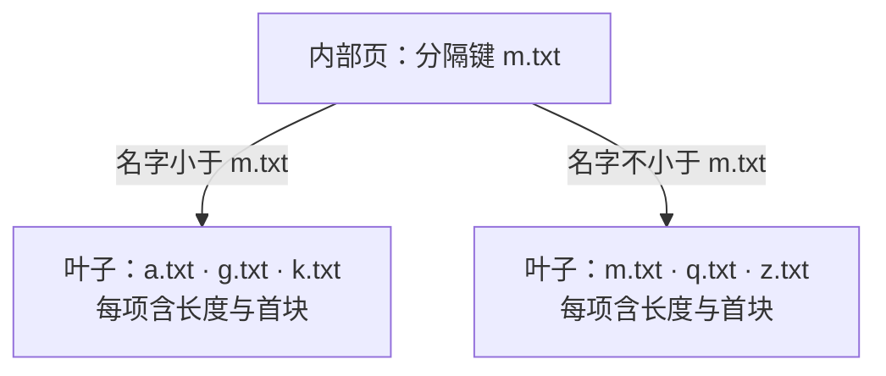

+++
title = "11. 文件变多、内容变长：独立实现 B+ 树文件系统"
date = 2026-10-29T11:45:00+08:00
slug = "bplus-tree-filesystem"
description = "把文件名索引、块分配与文件内容分开，用 B+ 树、两张位图和数据块链取代固定目录与固定区段，并验证分裂、回收、整理和重启。"
tags = ["RISC-V", "QEMU", "B+树", "文件系统"]
draft = false
+++

## 上一课已经能保存文件，为什么还要重写

[第 10 课](/posts/block-device-minimal-filesystem/)把文件名、逻辑长度、句柄、真实设备刷新与重启读回接成了闭环。它不是假的文件系统，但它故意做了一个很强的限制：十六个目录槽，每个文件预留一个固定大小的区段。

这让每个文件的数据地址几乎不用计算，也让两种浪费同时出现：

- 文件很短时，自己的区段里有空间没用上，其他文件却拿不到。
- 文件很多或某个文件变长时，即使整张磁盘还有空闲，也会先碰到固定槽位或固定区段上限。

这一次不覆盖旧实现，也不把旧盘直接换个 magic 继续使用。第 10 课仍能单独构建、运行和测试；第 11 课在新的目录和运行盘上，引入一个独立的[B+ 树（B-plus tree）](/terms/#bplus-tree)文件系统。

本课使用独立格式 `BPTFS11`。实现、字节布局与接口合同分别放在[第 11 课代码目录](https://github.com/xueliangliang/riscv-hello/tree/lesson-11/lessons/11)、[FORMAT.md](https://github.com/xueliangliang/riscv-hello/blob/lesson-11/lessons/11/FORMAT.md) 与 [README.md](https://github.com/xueliangliang/riscv-hello/blob/lesson-11/lessons/11/README.md)。这里先建立能解释、能验证的有界实现，不把它包装成生产文件系统。

## 固定版本与最短复现路径

本课固定标签为 `lesson-11`，对应提交：

```text
53a1603d4febd9d04bfdb997160099a0f7e7b914
```

工具准备沿用[第 01 课](/posts/environment-and-first-entry/)。从累计仓库复现：

```sh
git clone https://github.com/xueliangliang/riscv-hello.git
cd riscv-hello
git switch --detach lesson-11
git rev-parse HEAD
make clean all test inspect
make test-lesson11-gdb
make run-lesson11
```

最后进入 `11> ` 提示符。可选的 [GNU 调试器（GNU Debugger，GDB）](/terms/#gdb)检查仍需要 `gdb-multiarch`。提供给模拟器的 `-kernel` 仍然是引导程序，内核和用户程序都从磁盘加载，不绕过第 03 课的装载链。

在一张**新鲜的本课运行盘**上输入以下命令。这段输出来自实际串口操作，不是测试脚本模拟的 shell：

```text
11> fwrite notes hello
fwrite target=0 result=5
11> fappend notes -tree
fappend target=0 result=5
11> fseek notes 1 A
fseek target=0 result=1
11> cat notes
hAllo-tree
cat target=0 result=0
11> ftruncate notes 5
ftruncate target=0 result=0
11> cat notes
hAllo
cat target=0 result=0
11> fwrite gone temporary
fwrite target=0 result=9
11> rm gone
rm target=0 result=0
11> ls
file: notes size=5
11> shutdown
```

再次执行 `make run-lesson11`，`cat notes` 仍返回 `hAllo`，目录里没有 `gone`。宿主侧也独立检查了保存盘中的完整字节、逻辑长度、块链和启动保留区。

`build/lesson11/disk.img` 是可重建的测试底盘；默认保存盘是 `state/lesson11/disk.img`，不存在时才复制一次。`make clean` 不删除保存盘，已有损坏盘不会自动格式化。保存盘同时包含启动和程序镜像，重新编译也不会偷偷升级其中的内核。想试新编译的程序而保留旧数据，可以另选新盘：

```sh
make run-lesson11 LESSON11_ARGS='--disk state/lesson11/another.img'
```

`make reset-lesson11` 会**销毁本课默认保存盘的数据**并安装当前测试底盘，不能当作普通启动命令。第 10 课的盘不会被自动迁移或覆盖。

## 三个问题，别塞进同一种结构

“有了 B+ 树”并不能解释整个文件系统。这里有三个不同的问题：

| 问题 | 本课使用的结构 |
|---|---|
| 根据名字找到文件记录 | B+ 树目录索引 |
| 哪个节点页或数据块可以分配 | 两张[位图（bitmap）](/terms/#bitmap) |
| 一个文件的所有字节放在哪里 | [数据块链（block chain）](/terms/#block-chain) |

文件名只是在树里比较的键。叶子记录保存文件逻辑长度和数据块位置，不把整段文件内容挤进目录页。数据块链管理的是文件内容，不是“树的下一层”。

也因此，本篇不是把目录名拿来做层级路径。`notes` 和 `notes.txt` 仍然只是平面命名空间里的两个名字，没有多级目录树。

## B+ 树查名字：内部页指路，叶子页给答案

先看一个**只用于说明结构的示意图**，它不是从本课磁盘抓取的真实节点转储：



内部页负责缩小名字所在的范围；到达叶子以后，才在有序记录中确认名字是否相等。查找不到必须返回“不存在”，不能把最后比较过的邻居当作答案。

分隔键的相等情况不能靠感觉处理。例如图里的 `m.txt` 应走右边。如果内部页与叶子页对比较边界使用了不同规则，平时多数名字都能找到，却可能恰好漏掉分裂边界上的文件。

B+ 树的另一个特点是所有文件记录都在叶子上。叶子之间有后继链接，按名字列目录可以沿这条链向后走，而不是每输出一条记录都从树根重新查一次。

本课的树是一个有界的磁盘结构，不是数据库索引实现的移植。可以借[PostgreSQL 对索引页与分裂的解释](https://www.postgresql.org/docs/17/btree.html#BTREE-STRUCTURE)理解机制，但这里没有实现它的并发索引协议、磁盘格式或事务体系。

## 一页放满以后，为什么树根也可能变化

在固定目录里，找到一个空槽就能插入。B+ 树还要维持有序范围。

当一个叶子页没有位置容纳新记录时，典型过程是：

1. 把新记录与旧记录按名字放到临时有序集合。
2. 分配一个新叶子，把记录分成左右两组。
3. 修正叶子后继，让枚举仍然能走过原范围与新范围。
4. 把新范围的分隔信息与新子页位置插入父页。

如果父页也满了，分裂会继续向上。根页没有父页时，需要分配新的根，增加一层，并把新的根位置保存到文件系统的固定入口。

这里至少有三种不同的正确性条件：

- **查找条件**：每条记录能从根按比较规则走到。
- **枚举条件**：沿叶子后继恰好访问每条记录一次，顺序正确，没有环。
- **持久化条件**：重新启动后，新的内核知道树根在哪里，也能验证分裂后的页与分配状态。

只创建两个文件，或者只验证一次叶子分裂，并不能覆盖内部页分裂和根升高。测试需要让树真正长出更多层，再按升序、逆序和混合顺序的名字核对结果。

本课叶页最多七条记录，内部页最多八个孩子。内部条目不是简单的“一个分隔键加两个指针”，而是 `lower_fence + child_id`：选择下界不大于目标名字的最后一个孩子。最左路径使用空下界，其他范围沿父页继承。插入前先计算这条路径可能需要的分裂页数，节点不足时在改动前返回 `F_FULL`，不拆到一半才发现新根无处可放。

## 两张位图：目录页和文件数据不能共用一套编号

文件系统需要分配新叶子，也需要给增长的文件分配数据块。两者的格式、位置和容量并不相同，所以使用两张位图：

- **节点位图**：这一位对应一个可作为内部页或叶子页的元数据页。
- **数据位图**：这一位对应一个可装文件内容的数据块。

位图中的编号不是任意扇区地址。把编号换算成设备的[逻辑块地址（Logical Block Addressing，LBA）](/terms/#lba)之前，要检查对应池的边界与几何。不能把数据块编号当成节点编号，也不能让错误编号落回启动记录或内核镜像。

分配成功还不等于整个修改已经成功。创建一个文件可能同时涉及目录叶子、父页、根位置和节点位图；文件增长又会涉及数据位图、链指针与逻辑长度。本课需要把它们写对、刷新并检测错误，但没有因此自动获得故障中途的原子性。

实际磁盘必须恰好为 8 MiB，扇区为 512 字节。重要区域如下；完整保留字段与零填充规则见格式文档：

| 区域 | 实际布局 |
|---|---|
| 启动保留区 | LBA 0–256，文件操作不得覆盖 |
| 固定入口 | LBA 512，包含 magic、几何、根编号、文件数与枚举 epoch |
| 节点位图、数据位图 | 分别在 LBA 513、514 |
| 节点池 | LBA 515–1026，共 512 个 512 字节页 |
| 数据池 | 从 LBA 2048 开始，共 1024 个 4096 字节块 |

节点与数据块的真实编号都从 1 开始，0 表示空引用。磁盘整数按小端序逐字段编码，不直接把原生 C 结构体写入磁盘。缓存节点页与位图使用内核静态内存，并不是给用户堆扩容。

## 从固定区段改成块链：文件才能按需增长

数据块不必彼此相邻。文件记录给出入口，每个块记录下一个块的编号，链尾使用明确的结束标记。某个块里保存链信息的字节，不能再当作用户内容返回。


一段连续读取可能跨过三种边界：用户本次请求的长度、设备扇区边界、文件数据块的有效载荷边界。它们不一定重合。

逻辑长度依然决定[文件结尾（End of File，EOF）](/terms/#eof)。即使最后一块还有空余字节，也不能继续返回；如果链比长度要求的块数更短、更长，或者绕成一个环，就不应该把它当成正常文件默默读下去。

挂载时不能只检查“每个编号都没越界”。两个文件共同指向同一块、链指向未分配块、位图标为使用但没有任何结构引用，都是另一类不一致。独立磁盘检查器需要检查整张图的关系，而不只是逐字段取值范围。

本课每个物理块的前四字节保存 `next`，真正的有效载荷只有 **4092 字节**。单文件上限为 65536 字节，最多占 17 个数据块；目录上限为 512 个文件。文件尾块中逻辑结尾之后的字节必须为零，但已释放块的旧内容不承诺安全擦除。

## seek、append、truncate：先讲清游标，才能测试文件

上一课的 `write` 是完整替换。这一课要支持在较长文件里移动位置，就必须把接口合同说得更细。

- **seek**：移动句柄的当前游标；是否允许游标超过 EOF、上限是多少，要明确。
- **write**：从哪里开始改内容、是否允许部分写入、增长后的新长度与新游标是多少，要明确。
- **append**：是打开时的一次定位，还是每次都按当前文件末尾写入？旧游标不能含糊地决定结果。
- **truncate**：参数是目标长度，不是“删除最后一个块”；缩短与增长都会影响分配状态。

尤其要检查一个容易漏掉的状态：截断缩短了文件，但接口选择保留句柄游标。此时 `cursor > size` 是可达的正常状态，读取应该返回 EOF，不能直接用无符号 `size - cursor` 得到一个巨大数字。

写入跳过 EOF 的位置时，间隙如果按合同应为零，就必须实际补零。增长式截断也一样：新暴露出来的区域不能残留别的文件曾经写过的内容。

缩短时则要分别处理仍保留的最后一块、被释放的后续块和文件记录。截到零字节应没有数据块；恰好截到有效载荷边界时，不能多保留一个已经不属于文件的块。逻辑释放与安全擦除仍然不是同一个承诺。

落实到本课接口，规则是：

| 操作 | 本课合同 |
|---|---|
| 只读打开 | 文件必须存在；初始游标为零 |
| REPLACE 打开 | 创建，或立即把已有文件截到零；后续写失败不会撤销这一步 |
| RW 打开 | 文件必须存在；可读写，不自动截断 |
| seek | 绝对位置 0–65536，允许超过当前 EOF |
| write | 从当前游标写，必要时补零间隙；成功后游标前进 |
| append | 每次从实际 EOF 开始，成功后游标到新 EOF，不依赖旧游标 |
| truncate | 参数是目标长度 0–65536；保留原游标，增长补零，缩短回收块 |

一次读写最多 4096 字节。容量不足的预检返回 `F_FULL`，文件与游标不改；本课不把它伪装成短写。设备错误则不同：已经发生的多扇区写不能回滚，后端进入持续失败状态，不能把错误返回解释成“没有任何字节被改过”。

`fseek` 命令在一次调用里打开、定位、可选写入、关闭，所以不跨命令保存句柄。需要观察同一游标的连续变化，应看用户态测试程序，而不是把两条 shell 命令当作同一个打开实例。

文件调用沿用 `a7` 放操作号、`a0/a1/a2` 放参数的[应用程序二进制接口（Application Binary Interface，ABI）](/terms/#abi)。新增的 append、seek、truncate、分页枚举与 defrag 分别使用 25–29；23 在本课保留并拒绝，不能照搬第 10 课的 LIST 调用。所有未使用参数必须显式为零，双参数包装器也明确清零第三个参数，不依赖编译器偶然留下的寄存器值。

四个带代数的句柄限制一文件单开，文件接口仍只允许 shell 任务调用，先检查任务所有权再碰用户指针。名字的整个前缀与缓冲区必须放在一个准入区域内，不能靠逐字节检查把相邻区域拼起来。这是有界接口检查，不是进程内存隔离。

## 列目录需要分页，不是一条无限增长的打印

文件数量变多以后，一次输出所有名字既不利于交互，也不能把结果安全地放进任意大小的用户缓冲区。

分页接口需要一个有界输出数组与继续位置。一次返回多少条，下一次从哪里继续，什么时候表示结束，都必须由返回值与游标表达。用户态 shell 负责循环，而不是内核忽略容量一直写。

最容易蒙混过关的错误有三种：重复输出第一个名字，漏掉刚跨叶子边界的一项，最后一页永远不结束。因此测试既要核对名字集合，也要核对顺序、重复项、每页数量和最终结束状态。

枚举期间如果目录被修改，原来的继续位置是否还有效，同样需要明确合同。不能把一个内核指针当作可跨调用长期信任的用户游标。

这里的输出项是 `name[32] + size`，共 36 字节；容量为 1–16 项。游标是两个 32 位数 `{epoch, index}`，第一次均为零。每次返回实际项数并推进 index，返回零表示 EOF。任何内容或目录修改都会改变 epoch，使旧游标失效；数组与游标必须完整准入且互不重叠。shell 每次取七项，循环在用户态完成。

epoch 也有上限。本课不允许它回绕：到 `0xffffffff` 后拒绝新的文件修改，但仍能读取、定位与关闭。这里审查发现过一个真实错误：先检查“epoch 已耗尽”，再判断写入长度是否为零，导致零字节 write/append 也返回 `F_FULL`。正确顺序是先完成句柄、模式、指针、长度与后端健康检查，再让合法的零字节操作返回零；只有真正修改时才检查 epoch 与增长容量。零字节追加也不能偷偷把游标移到 EOF。

回归不需要执行几十亿次写入：先在可丢弃盘中设置有效的倒数第二个 epoch，再由真实用户态写入推进到最大值，冷启动后分别测试 write 和 append。检查成功返回、原游标、旧枚举游标及整盘字节都不变；同时确认非零写入仍被拒绝，错误指针、只读句柄和设备失败状态不会被“零字节”绕过。

这个教学实现的 index 是全局记录序号，不是叶页位置。**每一页调用仍从首叶开始跳过前 index 条记录**，再沿叶链取本页；它没有实现高效的跨调用叶游标。节点也全部缓存在内存，修改时写回全部已分配节点，而非只写脏路径。因此本课验证的是索引结构与接口正确性，不宣称已经取得数据库式的查找、枚举或写入性能。

## 删除后还有空闲，为什么还需要 defrag

释放一个位图位，可以让之后的写入复用那个块。但这不意味着所有空闲块已经连在一起。

本课的[空间整理（defragmentation，defrag）](/terms/#defrag)针对数据块分布：让现存块向前紧凑排列，并同步修改链信息与文件记录。它不是“把碎片数字改成零”的统计操作，也不等于把 B+ 树节点全部压缩重建。

下面仍是概念示意：只有位置 0、3、5 在用，整理成位置 0、1、2。图中使用从零开始的数组位置，**不是实际磁盘块 ID**；真实块 ID 从 1 开始，0 专门表示空引用。


搬运顺序不能随文件名排序。如果先把一个文件搬到另一个尚未读取的文件块上，后续读到的就不是原数据了。实现需要先设计不会覆盖未读源的顺序，或者为源数据准备足够的独立暂存空间。

打开句柄里如果缓存了数据块位置，也需要处理：要么整理时拒绝有活跃句柄，要么保证更新与缓存失效规则正确。只更新磁盘目录、不更新打开状态，可能让下一次访问沿着旧链继续读。

整理前后要比较的是同一组文件的全部内容、逻辑长度与分配关系。空间统计还要区分逻辑有效字节、实际分配块、最高占用位置以下的空洞，以及尾部连续空闲；数据块的物理大小与可放用户字节的有效载荷不能混用单位。

实际实现先建立旧 ID 到紧凑新 ID 的映射，再按旧 ID 升序读取和写入。新位置不大于对应旧位置，所以不会提前覆盖后面尚未读取的源块。随后翻译每个 `next`、每个叶记录的 `head/tail`，重建数据位图并持久化。只要还有打开句柄，整理就返回 `F_BUSY`。

对最高占用 ID 记为 high、已占用块数记为 used，本课统计定义为：

- `logical_bytes`：文件逻辑长度之和。
- `allocated_capacity`：`used × 4092`，不是物理块总字节数。
- `free_bytes`：`(1024 - used) × 4092`，不含每块的链指针。
- `holes`：`high - used`，单位是块。
- `contiguous_tail`：`1024 - high`，同样以块计。

整理不增加总空闲有效载荷，而是把分散空洞归并到连续尾部；块链原本就允许使用不连续空闲块，不能说“不整理就完全无法增长”。

## 删掉一个文件，不意味着已经实现完整的树删除算法

B+ 树的插入分裂和删除再平衡不是对称地删几行代码。

完整删除还可能借用相邻节点、合并节点、调整父页边界甚至收缩根。本课选择惰性删除：叶内记录前移，整条空出的记录清零，文件数据块归还位图；空叶子和内部节点仍保留，不合并、不缩根，也不回收节点位图。原有下界仍表示安全的路由范围，不要求始终等于当前第一条记录。

这不是坏事的遮羞布，而是可验证的取舍。测试应该让删除、重新插入与跨叶子枚举真的发生，并验证路由仍然正确，而不是因为当前只有两个文件就永远碰不到空页。

它也有真实代价：反复删除旧键、向新范围插入，即使当前文件很少，也可能把 512 个元数据节点全部耗尽。数据 defrag 不回收这些节点。测试专门把这个边界逼出来，不能把“最多 512 文件”误读为“任何历史操作之后都保证还能创建到 512 文件”。

## 重启与原始磁盘检查，仍然是两条观察路径

第 10 课建立的验收方式继续使用：真实[用户态（User mode，U-mode）](/terms/#u-mode)程序发系统调用，真实[QEMU（Quick Emulator，快速仿真器）](/terms/#qemu)进程读写同一张可写盘，再由另一个新进程挂载并读回。

宿主侧的独立解码器不需要理解系统调用，只需要按书面格式检查：

- 从固定入口能否找到根，内部页是否有序、孩子范围是否满足分隔约束。
- 所有叶子是否在同一深度，沿后继是否按顺序覆盖相同记录，没有重复、遗漏和环。
- 节点位图是否与可达节点一致；数据位图是否与所有文件的链恰好一致。
- 每个文件的块数、末块、长度、实际字节和末尾规则是否相符；两个文件有没有共享块。
- 旧启动保留区有没有被文件操作覆盖，错误挂载是否保持输入盘不变。

两边都通过，仍然不代表任意时间断电都安全。一次插入、增长或整理会修改多个扇区；没有日志，就没有“失败以后自动恢复到之前或之后”的保证。下一课再把这些修改放进一个清楚的恢复协议里。

## 这次真正验证到了哪里

验收在精确提交的全新归档里重新执行 `make all test inspect`，并执行第 07–11 课的 GDB 检查。前文短命令示例另外使用两次全新模拟器进程与宿主解码器复验。大规模测试则使用另一张盘，避免把演示盘、保存盘和可重建底盘混在一起。

主场景依次经历创建、删除、重建、整理与两次只读冷启动，共六个独立模拟器进程；不是同一进程卸载后再挂载。主机参考模型用字节数组独立计算预期内容，原始磁盘解码器不导入格式化器或内核代码。创建阶段插入 224 个编号文件，另加 edge、max。下面各阶段树高都为 4、节点数都为 68；表中块数与文件数使用十进制，`fsinfo` 本身以十六进制打印：

| 阶段 | 文件数 | 数据块 | 空洞块 | 尾部空闲块 |
|---|---:|---:|---:|---:|
| 创建 | 226 | 692 | 0 | 332 |
| 删除 | 181 | 557 | 135 | 332 |
| 重建 | 204 | 580 | 112 | 332 |
| 整理 | 204 | 580 | 0 | 444 |

整理前后逻辑字节都是 1615410，空闲有效载荷都是 1816848 字节，数据链的真实 ID 则发生了变化。宿主检查器核对全部文件内容、长度和位图；后两次只读冷启动还要求整张盘逐字节不变。不是看到 `defrag` 打印成功就算通过。

额外的独立测试盘还覆盖：

- 512 个文件、1024 个数据块，以及惰性删除历史导致 512 个节点耗尽；预检失败不能留下半次分配。
- 512 字节扇区边界、4092 字节有效载荷边界、65536 字节上限、含零与高位字节的内容；按 4093 字节写、257 字节读，故意不让测试粒度与块边界重合。
- seek 留空洞、append 忽略旧游标、truncate 的零长、部分块、整块边界与增长，以及缩短后游标仍在 EOF 之外。
- 分页的顺序、完整名称和长度、重复项、容量与 EOF；错误指针、保留参数、过期句柄、打开冲突与非 shell 调用。
- 34 种格式损坏：节点环、重复归属、错误分隔范围、叶链不一致、数据交叉引用、位图不符和尾块非零等；宿主解码器与真实内核都拒绝，前后输入盘哈希相同。
- 只读设备、缺少刷新特性的故障注入、不同格式互相拒绝，以及真正的元数据/数据 READ、WRITE 和 FLUSH 设备错误。

最后一项通过 QEMU 的块设备错误注入发生，不是让 C 函数直接返回失败。测试核对请求类型和设备的 `IOERR` 状态，一次性故障用完以后仍持续拒绝写入，最终 shutdown 必须报告刷新失败。底层继续使用[虚拟输入输出设备（Virtual I/O，VirtIO）](/terms/#virtio)的真实刷新请求；内存屏障不是设备落盘承诺。

证据位于 `build/lesson11/` 的 `test-result.json`、`raw-decoder.json`、`epoch-result.log`、`evidence-*.img` 与串口日志中。也可以直接查看一个阶段快照：

```sh
python3 lessons/11/decode.py build/lesson11/evidence-defrag.img
```

GDB 单独停在设备完成检查点，验证 FLUSH 的 16 字节请求头直接连接一字节可写状态，没有可达的数据描述符；通过后 detach，再执行中断唤醒的 echo 和正常关闭。检查日志在构建之前清空，构建或调试失败不能留下上一次的 PASS。

这些仍然是模拟器里的功能与持久化验证，不是实板性能或掉电认证。同步存储操作会持调度锁轮询设备，延迟两个 hart 的调度与串口中断；接收环只有 128 字节，不能向忙碌系统无限灌入命令。本课没有日志、事务回滚或写入中途失败后的自动恢复，写入过程中退出模拟器也不能冒充真实设备的断电模型。共同的系列边界见[总览](/series/)。

## 读完以后，自己解释一遍

1. 树的叶子、数据块和两张位图分别管理什么？为什么不能把它们当成一种页？
2. 内部页分裂为什么需要向上更新，根位置为什么要持久化？
3. 为什么一份名字集合正确的 `ls` 结果仍然可能漏掉分页错误？
4. truncate 后游标超过 EOF，为什么不能直接计算 `size - cursor`？
5. defrag 为什么要改链指针与文件记录，不能只移动字节？
6. 普通重启能读回与写入中途崩溃能恢复，分别需要什么证据？

## 规范与背景

- [PostgreSQL 17：B-Tree Structure](https://www.postgresql.org/docs/17/btree.html#BTREE-STRUCTURE)：用实际数据库实现解释内部页、叶子页和分裂向上传播；不是本课磁盘格式。
- [VirtIO 1.2 规范](https://docs.oasis-open.org/virtio/virtio/v1.2/virtio-v1.2.html)：本课底层块设备请求与刷新合同的依据；树和分配协议由本课自行定义。
- [系列总览](/series/)与[术语表](/terms/)继续记录固定课程、范围与常见名词。
