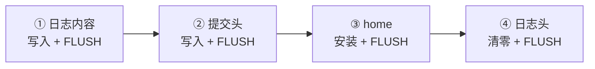
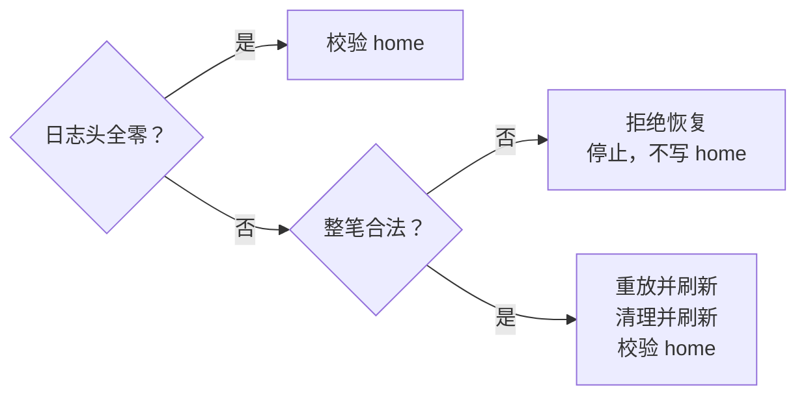

+++
title = "12. 写到一半就重启：给 B+FS 加 redo journal"
date = 2026-10-29T13:52:00+08:00
slug = "redo-journal-crash-recovery"
description = "用完整扇区 after-image、严格刷新顺序与可重复重放，把正常重启能读回推进到有明确假设的崩溃恢复，并区分模拟器故障点与设备持久性模型。"
tags = ["RISC-V", "文件系统", "日志", "崩溃恢复"]
draft = true
+++

## 上一课的保存成功，为什么还不够

[第 11 课](/posts/bplus-tree-filesystem/)已经能分裂 B+ 树、分配数据块、跨块读写、截断和整理文件。正常关闭，再启动一个新的内核，文件内容也能被独立读回。

但一次文件修改，往往不是一次扇区写。

假设给一个文件追加内容，需要分配新块、把旧尾块接过去、改变数据位图，再更新叶记录里的长度与末块位置。如果只写完其中一部分就停止执行，重启后可能看见“位图说已分配，文件却没有引用”，或者“长度变大，块链还没接好”。这些扇区单独看都可能合法，合起来却不是任何一次完整操作的结果。

**一次正常重启验证的是已经完成的保存；恢复协议要回答的是尚未完成时怎么办。**

本稿仍在实现与独立验收阶段。以下说明恢复合同、候选布局与观察路径；固定版本与最终门禁结果会在验收后补齐，未完成前不发布。预留固定提交位置如下：

```text
LESSON12_COMMIT_PENDING
```

## 固定版本与复现入口

本课标签将在审查通过后固定为 `lesson-12`。工具链沿用[第 01 课](/posts/environment-and-first-entry/)，另外需要一个宿主 C 编译器供持久性模型编译真实文件系统代码；默认命令为 `cc`，可通过 `HOSTCC` 指定。

```sh
git clone https://github.com/xueliangliang/riscv-hello.git
cd riscv-hello
git switch --detach lesson-12
git rev-parse HEAD
make clean all test inspect
make test-lesson12-gdb
make run-lesson12
```

独立运行本课验收可以使用 `make test-lesson12`；它在构建之前先清掉本课上一次的日志与结果文件，再运行原生模型、协议变异、真实用户态、epoch 边界与 QEMU 故障矩阵。可选的 [GNU 调试器（GNU Debugger，GDB）](/terms/#gdb)门禁需要 `gdb-multiarch`。

内核和用户程序仍由第 03 课的引导程序从磁盘加载。默认保存盘是 `state/lesson12/disk.img`，与可重建的 `build/lesson12/disk.img` 分开；旧第 11 课的盘不会自动迁移。普通构建与 `make clean` 保留保存盘，`make reset-lesson12` 则会**销毁本课保存盘的数据**。

## 日志放在哪里，保护哪些字节

`BPTFS12` 使用独立格式身份，不直接修改 `BPTFS11` 的磁盘。候选实现保留 8 MiB 设备与原有 home 几何，把日志放进不重叠的预留尾部；完整字节合同见 [FORMAT.md](https://github.com/xueliangliang/riscv-hello/blob/lesson-12/lessons/12/FORMAT.md)。下面的[逻辑块寻址（Logical Block Addressing，LBA）](/terms/#lba)以 512 字节扇区为单位。

| LBA 区间 | 用途 |
|---|---|
| 0–256 | 启动记录、内核与用户程序，不得成为日志目标 |
| 512–1026 | super、两张位图与 512 个节点页 |
| 2048–10239 | 1024 个链式数据块 |
| 12288 | 提交头，全零表示干净 |
| 12289–12304 | 目标地址和镜像校验值组成的描述表 |
| 12305–13328 | 最多 1024 个完整扇区 after-image |

文件数据块依然是 4096 字节，其中 4092 字节可放用户内容。不能把“1024 个日志镜像”理解成“1024 个文件数据块”。启动区、home 中间的空洞、日志自身以及设备外地址都不在日志目标白名单里。

格式整数逐字段按小端序编码。描述项为目标 LBA 与对应镜像的[循环冗余校验（Cyclic Redundancy Check，CRC）](/terms/#crc)；完整描述表、每份镜像、提交头各有明确的校验覆盖范围。super 新增自己的校验，挂载先检查它的身份、固定几何与校验，而不是先要求整棵 home 树已经一致。

## 先决定原子边界，不要先给函数起名

这一课要保护的单位，是一次文件系统修改接口。创建或替换打开、一次 write、一次 append、一次 truncate、一次 remove，以及一次 defrag，各自需要有明确的开始和结束。

这不等于“一整条 shell 命令是一个事务”。例如 `fwrite` 先以替换模式打开，再调用写入：前一个调用已经把文件截成空文件时，后一个调用尚未发生。两个接口之间停止执行，留下空文件并不违反单接口合同。一个应用分多次写入长文件，也不会因为它们来自同一个循环就自动合成一个事务。

本课只讨论这个边界内的原子性与持久性，不声称获得了数据库式的并发事务隔离。参数错误、容量不足、设备错误和已经提交后的失败，也不能混为一谈。

## redo 记录的不是“反悔办法”，而是“最终应写成什么”

[恢复日志（journal）](/terms/#journal)不是一份给人看的操作记录。为了让重启后的新内核能够完成修改，日志要保存足以恢复磁盘状态的信息。

本课选择物理 redo：为每个待修改扇区记录目标位置和该扇区修改后的完整内容，即[修改后镜像（after-image）](/terms/#after-image)。重放时把这份内容写回目标扇区，不需要再次执行“追加几个字节”这种业务操作。

为什么不只记“给文件追加 hello”？因为再次执行追加可能分配另一批块，或者在恢复再次中断后把 hello 追加两遍。完整扇区镜像则表达“这个扇区应该等于这些字节”，重复安装同一份镜像，不会重复增加文件长度。

文件原本所在的元数据与数据区域，下面称为 **home 区域**。日志区域保存提交依据和 after-image；home 区域保存文件系统平时使用的正式布局。它们不能重叠，更不能覆盖启动记录和程序镜像。

这里的[预写日志（Write-Ahead Logging，WAL）](/terms/#wal)原则是：依赖日志恢复的 home 修改，不能先于相应的日志提交依据持久化。这个思想不意味着本课格式与 PostgreSQL、ext4 或 xv6 的格式兼容。

## 同一扇区写三次，为什么只占一个日志位置

一个修改接口内部，可能多次接触同一个扇区：先初始化新块，再补链指针，最后放入用户数据。日志容量不能简单按“调用了几次写函数”计算。

本课采用有界暂存：

- 第一次修改某个 home 扇区时，为它分配一个 after-image 槽。
- 再次修改相同扇区时，更新同一个槽里的最终镜像。
- 接口内部读到已经修改的扇区时，先读暂存镜像，而不是回到磁盘读旧内容。

最后一点叫 **read-your-writes**：同一次修改必须能读到自己刚写的结果。如果增长先把新区域清零，随后又读回旧扇区去覆盖用户数据，前面做对的链指针仍可能被旧内容覆盖。

暂存期不允许偷偷把 home 写出去，否则“接口最终因为日志容量不足而失败”时，磁盘上已经留下半次修改，单纯丢弃内存日志也救不回来。

## 四次刷新，分别保护四个不同的承诺

[设备刷新（FLUSH）](/terms/#flush)不是处理器内存屏障，也不是函数名字里带有 flush 就算数。这里需要底层块设备真正完成相应请求，并按约定解释完成状态。

协议的顺序如下：

1. 把描述表和所有 after-image 写入日志区域，刷新日志内容。
2. 写入提交头，再刷新提交头。
3. 把已经提交的 after-image 安装到 home，刷新 home。
4. 清空提交头，再刷新清理结果，才允许复用日志。



第一道屏障避免“提交头已经落盘，镜像还没有留下”。第二道屏障确认恢复所需的提交依据已经可靠留下，之后才开始触碰 home。第三道屏障保证清理日志之前，正式位置已经有完整新状态。最后一道屏障避免新事务开始复用镜像时，旧提交头仍有可能在重启后出现。

这个教学实现选择同步完成整条路径，不把 checkpoint 放到后台。其他系统可以在提交后更早返回、稍后再安装 home，但必须有不同的日志保留、并发和错误处理合同，不能删掉几次刷新就声称完成同一种优化。

## checkpoint 不是“又保存了一份日志”

本课的[检查点安装（checkpoint）](/terms/#checkpoint)是把已提交镜像复制到 home。它不改变这笔修改是否已经提交；提交以后，即使 home 只安装了一半，日志仍应足以把它补全。

由此得到一个容易反直觉的状态：**home 暂时不满足文件系统完整性，不一定表示无法恢复。**

如果内核一启动就先要求 home 中的整棵树、位图和块链都一致，可能在看到有效提交日志之前，就把一张可恢复的盘拒绝了。恢复入口必须先识别自己的格式与固定日志位置，再验证日志并完成重放，最后才加载和完整校验 home 中的文件系统。

反过来，也不能看到一段像日志的数据就随便重放。旧课的磁盘、未知版本或者错误几何都不能被当成当前格式写入。

## 重放之前，先把整笔日志检查完

提交头不能只存一句“完成了”。恢复还需要知道镜像数量、对应的目标地址，以及日志内容是否完整。

这里使用 [CRC](/terms/#crc) 探测意外损坏。具体算法、字段顺序、字节序和覆盖范围都属于磁盘合同：同样叫 CRC，不同参数或覆盖范围也可能得到不同结果。

CRC 通过后，还要检查：

- 数量在界限内，描述表与镜像都能完整读取。
- 每个目标都落在明确允许的 home 范围内。
- 没有重复目标，不把日志、启动区、空洞或设备外地址当作正式目标。
- 版本、保留字段和固定几何符合本课格式。

必须先验证整笔提交的所有描述项和镜像，再写任何一个 home 扇区。边读边恢复的危险在于：前半笔已经覆盖正式数据，后半笔才发现目标非法或校验失败。



CRC 不是防篡改签名，也不证明文件操作本身的业务逻辑正确。合法地址也可能带着错误内容；协议验证、文件系统结构验证和独立的预期内容模型，仍然是不同层的检查。

## 恢复到一半，再停止一次怎么办

恢复代码同样可能被打断。不能因为“已经进入恢复流程”就假设这次一定能执行完。

完整 after-image 的作用就在这里：一份已经提交的镜像可以再次安装。[幂等（idempotence）](/terms/#idempotence)不是“第二次不执行”，而是重复执行仍得到同一个目标状态。

假设第一次恢复只写回前几个扇区就停止，提交头还没有清理。第二次启动重新验证原日志，再安装全部镜像，结果仍应是同一份完整新状态。已经写过的扇区被相同内容覆盖，不会让文件再增长一次。

日志只能在 home 的持久化已经确认后清理。否则，第一次恢复把提交头清掉、home 却尚未完整留下，第二次启动就再也找不到补齐它所需的依据。

## 错误返回，不等于磁盘没有改变

“设备返回失败”和“设备什么也没做”不是同一句话。

尤其是提交头写入或刷新返回错误时，调用者不能据此判断提交标记一定没有到持久层。有些字节可能已经留下，只是完成状态不确定。继续复用日志、再发一笔修改，可能把唯一能恢复前一笔修改的证据覆盖掉。

因此需要区分以下状态：

| 已知阶段 | 恢复要求 |
|---|---|
| 尚未发出提交头写入 | home 保持完整旧状态 |
| 提交写已发出，持久化结果不确定 | 由实际持久日志判断；不能仅凭错误返回认定旧状态 |
| 提交刷新已确认，home 尚未写完 | 用日志恢复完整新状态 |
| home 刷新已确认，日志清理未确认 | 可能再重放，也可能已经干净；结果仍须是完整新状态 |

发生真实输入输出错误以后，本课采用持续失败、等待新挂载的保守政策，而不是在不确定状态中继续接受写入。这里恢复的是下一次启动看到的持久状态，不承诺把所有已经发出的设备写撤回。

参数或日志容量预检失败则不同：在还没有触碰持久 home 的阶段，可以放弃暂存并还原内存工作状态，让系统继续使用。

### 两个边界缺陷，为什么普通成功路径看不见

独立复核曾抓到两处真实错误。第一处是容量拒绝后，内存快照虽已还原，日志层却还保留 `J_LIMIT`。随后直接 shutdown，本应刷新的健康设备被错误地报告为刷新失败。如果测试先打开另一个文件，新事务会清掉错误，反而把问题遮住。

修正后只清理可恢复的容量错误，不清硬件错误造成的持续失败标记。回归要求在拒绝后**不插入新的 open 或修改**，立即调用同步并观察真正的 type4 FLUSH，再让真实用户态 shell 正常关闭；磁盘、游标和枚举状态保持原样。

第二处是设备已经成功复位并重新建立队列，驱动却仍保留上一次的失败标记，导致同次启动中的再次挂载总是失败。清除标记也不能过早：只有确认复位已结束、旧队列不再拥有[直接内存访问（Direct Memory Access，DMA）](/terms/#dma)缓冲区，并完成新队列、特性和容量校验后，才可恢复请求；复位超时或重新初始化失败仍要保持隔离。

这里不仅跑了原生模型。专用 RISC-V 探针用真实设备驱动触发一次性 WRITE 错误，再调用同一个挂载入口：

| 真实故障位置 | 再次挂载后的结果 |
|---|---|
| LBA 12305 的日志镜像写入 | 完整旧状态，之后可继续修改 |
| LBA 513 的 home 位图写入 | 重放得到完整新状态，之后可继续修改 |

两种情况都另外执行冷启动、原始内容校验和幂等检查。原生传输替身则补查初始化失败和缓冲区过早复用，不能把它说成真实硬件 DMA 试验。正常 shell 没有新增 remount 命令，应用也不能靠再 open 一次来绕过设备失败。

## 日志满了，不能只把镜像计数清零

有界日志意味着某些修改装不下。这不是靠“磁盘还很空”就能解决的问题：空闲文件块数量和一次事务可以容纳多少个不同目标扇区，是两个容量。

尤其是 defrag。上一课可以搬动大量数据；加入完整数据日志以后，同样的整理可能超过单事务容量。不能一边搬、一边提交小段，最后却仍把整个整理称为原子操作。

本课选择明确拒绝超限操作，而不是悄悄改变原子边界。拒绝以后，需要恢复的不只是日志计数：缓存里的节点、位图、根位置、文件数、枚举版本以及打开句柄的游标，都必须回到调用前。否则磁盘虽没动，接下来的内核却会沿着一份虚假的内存状态继续工作。

测试要同时包含能够完整提交的小规模整理和超过界限的整理；后一种要求内容、元数据、游标及可用状态都没有被半次修改污染。

## 两种故障试验，回答的是不同问题

第一条观察路径，是在真实[QEMU（Quick Emulator，快速仿真器）](/terms/#qemu)执行流里，于选定持久化边界停止，再用新的模拟器进程重启同一张盘。它可以检验恢复入口、实际文件系统代码、磁盘字节和重放顺序有没有接通。

但退出模拟器，并不自动丢弃宿主已经接收的未刷新写入。把“退出了进程”直接写成“模拟了设备断电”，证据就越界了。

第二条路径，是让**实际的 C 日志核心**连接一个区分易失层和持久层的测试设备：写入先改变易失层，成功刷新才形成已确认的持久边界；模拟掉电丢弃未持久差异。不能只用另一份 Python 日志算法证明它自己正确。


错误注入还要分别尝试“报错且没有持久化”和“报错但实际持久化了”。特别是提交头写入、提交刷新、home 刷新与清理刷新，不能只挑对实现最方便的一种结果。

宿主模型依然有假设：单扇区原子写、约定的刷新顺序、存储设备不谎报完成。本课不会因此宣称验证了真实介质扇区撕裂、控制器掉电行为或任意固件。

## 不能只让独立测试内核成功

单 hart 的专用故障内核可以让停止位置更可控，但它绕过了不少原系统路径。

最终仍要回到双 hart 的真实用户态 shell：系统调用、句柄、游标、串口中断、等待与任务生命周期必须继续工作。保存、重启、重放和再次读回，也要由真正的文件接口完成。

原始磁盘检查器则提供另一条观察路径：独立解析日志与文件系统，核对完整文件名、顺序、长度、块链、位图、全部字节以及启动保留区。只检查文件数，或让同一个内核打印三句 PASS，都不能替代这些关系。

## 归档复跑看到的边界

当前归档的本课门禁已经真实执行过。最终标签仍待独立审查完成；下面的运行统计不代替该门禁。

八种修改分别覆盖触发分裂的创建、游标覆盖、追加、缩短、删除、实际数据整理、替换打开与增长截断。它们调用同一份 C 文件系统接口；宿主参考模型另外计算预期字节，不从客体的 PASS 字符串推断文件内容。

| 观察路径 | 实际覆盖 |
|---|---|
| 原生 C 核心与持久性模型 | 176 个中断或错误结果 |
| 恢复过程本身的设备错误 | 8 个持久化与未持久化结果 |
| 非法日志 | 13 类，要求拒绝且不发出写入或刷新 |
| RISC-V 软件中断矩阵 | 64 个操作与阶段组合 |
| 系统集成 | 双 hart 磁盘启动的 U shell 重放、完整二进制读取，再次冷启动整盘不变 |

例如对 `alpha` 的游标覆盖，旧内容长 5000 字节；从偏移 4900 写入 4096 字节后，新状态长 8996 字节。下面是这一次操作在部分停止点的实际结果。PRE、POST 分别表示与完整旧状态、完整新状态逐字节相同：

| 停止点 | 原生模型 | 本轮 QEMU |
|---|---|---|
| 日志内容已刷新，提交头尚未写 | PRE | PRE |
| 提交头已写，提交刷新尚未完成 | PRE | POST |
| 提交刷新完成，home 尚未安装 | POST | POST |
| home 只安装了一个前缀 | POST | POST |

第二行不是两个测试互相矛盾。原生模型明确丢弃未刷新提交头；本轮 QEMU 在进程退出后能读到该头，所以恢复到 POST。换一种宿主缓存行为，这个不确定窗口也可能留下 PRE；测试按实际留下的有效提交标记判定，不能把这行结果当成 QEMU 证明了设备掉电丢写。

故障矩阵之外，还要核对独立解析日志得到的镜像：把它们安装到旧盘副本，必须恰好得到参考新状态。恢复自己被中断后再启动，也必须得到同一个 POST；只读的第二次启动则不得改变整张镜像。

### 测试工具自己也可能制造假安全感

这次验收曾被宿主 C/Python 接口的有符号、无符号返回类型错误打断。更危险的版本不是直接失败，而是 I/O 跟踪缓冲区满了以后静默丢掉后面的写入，让“没有写盘”的断言只看见一段不完整记录。

因此测试显式声明原生接口类型、读取实际记录数，并把跟踪饱和作为证据不完整而失败。它还真的在 32768 条之后写入一条 WRITE，检查仍能看见；达到有界容量后，调用与证据读取都必须拒绝成功。

另一组隔离副本故意去掉真正 C 核心里的提交 FLUSH，要求故障模型抓住它；再分别破坏跟踪溢出报告与无符号类型，要求对应断言失败。不是把一份自己生成的漂亮结果改个数字，再声称协议已经接受了挑战。

证据位于 `build/lesson12/` 的 `results.json`、`model-results.json`、`crash-results.json`、`recovery-all-results.json`、`protocol-mutation.json` 和串口日志中。可以单独重跑：

```sh
python3 lessons/12/model-test.py
python3 lessons/12/crash-test.py
python3 lessons/12/gate-evidence-test.py
```

最后一个检查先复制实际成功证据到可丢弃源码目录，再通过坏编译器和早期设置失败验证旧 PASS 不会残留；不会对读者的保存盘执行清理。它不是另一份文件系统正确性证明，而是保证“这次失败”不会被误读成“上次成功”。

## 读完以后，自己解释一遍

1. 为什么 home 的多个扇区各自写成功，不等于一次文件修改具有原子性？
2. after-image 为什么比“再追加一次内容”更适合重复恢复？
3. 提交头为什么必须在日志内容之后持久化，清理为什么必须在 home 之后持久化？
4. 为什么设备错误返回不能证明事务没有提交？
5. 日志容量不足时，为什么既要放弃暂存，也要恢复内存中的句柄与位图？
6. QEMU 故障点与易失/持久设备模型，各自验证什么，又没有验证什么？

## 规范与背景

- [PostgreSQL 17：Write-Ahead Logging](https://www.postgresql.org/docs/17/wal-intro.html)：理解先写日志与重做恢复；不是本课的日志格式或事务调度方式。
- [Linux 内核文档：ext4 Journal](https://docs.kernel.org/filesystems/ext4/journal.html)：区分元数据日志与完整数据日志，了解提交记录、安装和校验。本课不实现 ext4/JBD2 兼容性。
- [xv6 的日志实现，固定源码版本](https://github.com/mit-pdos/xv6-riscv/blob/e93dabeb98431235c6e1a101cb96c73c923fdbc4/kernel/log.c)：观察写日志、提交头、安装与清理；它可以合并并发文件调用，本课不照搬这一事务边界或其设备假设。
- [VirtIO 1.2](https://docs.oasis-open.org/virtio/virtio/v1.2/virtio-v1.2.html)：底层块设备刷新与完成状态的依据。
- [系列总览](/series/)与[术语表](/terms/)。
