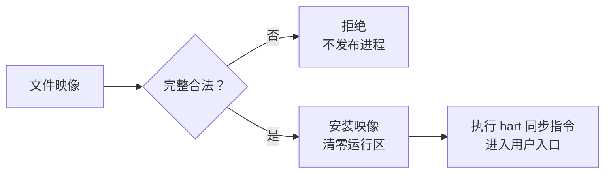
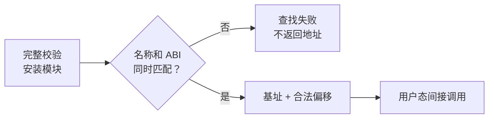

+++
title = "13. 文件里的字节怎样成为程序：加载器与动态 math.dll"
date = 2026-10-30T12:02:49+08:00
slug = "program-loader-dynamic-math-module"
description = "把文件内容、程序入口、位置无关代码和带调用约定的符号查找接起来，并明确代码发布、卸载失效与双 hart 指令可见性的边界。"
tags = ["RISC-V", "加载器", "动态模块", "ABI"]
draft = true
+++

## 文件已经存住了，为什么还不能执行

[第 12 课](/posts/redo-journal-crash-recovery/)解决的是一次文件修改中途停止以后，如何依据完整日志恢复持久状态。它没有顺便获得一个任意程序加载器。

上一课 shell 的 `run spin` 等命令，选择的还是已经编进用户映像的工作函数。磁盘中多出一个文件，不会让调度器自动知道它的入口在哪里、需要清零哪些内存、该使用哪一段栈。

这一次要接通两条不同的路径：

- 把一个文件里的程序映像装进约定的内存区域，建立用户进程并从入口执行。
- 程序运行后，再从另一个文件加载函数代码，按名字查找导出函数，通过函数指针调用。

`math_test` 与 `math.dll` 因此不是同一个东西：前者是可以启动、退出和等待的应用，后者是被应用加载并调用的模块。

本稿仍处于实现与独立验收阶段。下面先说明设计边界和验证方式；最终格式、接口、地址预算、实际串口记录与固定版本在验收后补齐，未完成前不发布。

```text
LESSON13_COMMIT_PENDING
```

## 文件扩展名不负责建立执行环境

看到 `.dll`，很容易联想到桌面操作系统的[动态链接库（Dynamic-Link Library，DLL）](/terms/#dll)。但文件名后缀并没有定义运行时合同。

本课使用自定义的有界模块容器，不把它宣称为 Windows 动态库，也不实现通用的[可执行与可链接格式（Executable and Linkable Format，ELF）](/terms/#elf)动态链接器。宿主工具链生成的 ELF 可以用来链接、反汇编和检查；磁盘里交给教学加载器的格式，则需要单独说明。

至少有三个问题不能藏在文件后缀里：

1. 哪些字节是格式头，哪些是可以安装的指令与常量？
2. 入口和导出地址如何表示，怎样保证它们没有指回格式头或越出文件？
3. 调用者和被调用者对参数、返回值、寄存器及栈作了什么约定？

第三点属于[应用二进制接口（Application Binary Interface，ABI）](/terms/#abi)，不是“函数名字一样”就自然满足。

## 启动一个程序，比跳到一个地址多几步

一个固定地址的平面程序加载器，也应先完整读取和校验文件，再把它发布成可运行进程。



格式头应明确入口、实际文件长度、运行所需内存、加载位置与版本。长度相加要防溢出，入口要落在允许执行的范围，并满足本课使用的指令对齐条件。

未初始化数据还需要被清零。只复制磁盘里存在的字节，不能保证[零初始化数据区（BSS）](/terms/#bss)在运行时真的是零；上一个程序留在同一片内存里的内容，也不会自行消失。

因此失败不能留下“已经分配进程，但映像只复制一半”的中间状态。暂存读取、校验、安装和发布为可运行状态，应该能在代码里分清顺序。

这里仍是有界的固定地址加载，不因为多了一个文件头就变成了通用虚拟内存或进程隔离机制。也不能绕过第 03 课的磁盘启动链，改由模拟器直接装入新内核来代替这条路径。

## 进程槽可复用，不等于程序内存已经可以覆盖

前面的调度器已经区分运行中、退出但尚未回收，以及真正空闲的进程槽。这一课还要把程序映像的所有权放进生命周期。

如果多个进程共用一片固定应用区域，第二次加载就可能覆盖第一个进程下一次还要执行的指令。即使进程已经退出，保留退出记录与释放映像的时机，也需要有明确政策。

教学实现可以选择同一时刻只允许一个文件应用，但要把拒绝第二次启动、退出、等待回收和允许重启的条件写清楚。不能为了让演示顺利，在新接口里悄悄把原来的 wait/reap 语义换成自动回收。

测试也不能只做一次成功启动：应覆盖活进程占用、尚未回收的退出记录、等待后的重新启动，以及文件应用与原有工作任务同时存在的情况。

## 候选实现的实际格式与内存预算

目前实现把应用和模块明确分成两种容器：

- `RVEXEC1`：48 字节头部，记录实际文件长度、负载长度、相对入口、固定加载位置、运行内存长度、代码长度、ABI 与保留字段。文件长度必须恰好等于头部加负载；入口必须完整落在代码中，负载和运行区也有明确的对齐及容量约束。
- `RVDLL01`：32 字节头部，导出表每项 24 字节，其中名称区 16 字节，其余为相对地址和调用类型。完整文件上限 4096 字节，最多 8 个导出；表不能与代码混在一起，名称终止后的填充必须全零，函数地址还要满足代码范围和两字节对齐。

具体字段逐字节按小端序解码，不依赖宿主 C 结构体的布局。容器没有模块重定位、外部导入或模块 BSS 字段；工具链生成模块时就要拒绝这些不支持的构建结果。合法格式也不意味着机器代码经过了安全验证，加载的仍是可信生产者构建的代码。

文件应用的固定区域为 `0x80500000` 到 `0x80510000`，包含它自己的代码、BSS、快照暂存和两个模块 bank。应用沿用独立进程栈，不为每个函数另建一个内核栈。

本次归档实际测得：内核文件 28676 字节，shell 文件 17680 字节，应用文件 5088 字节，模块文件 486 字节。内核 BSS 结束于 `0x80328b50`，未碰到 shell；应用运行内存结束于 `0x80505410`，没有越过保留区。新增的模块 bank 是应用静态 BSS，不是扩容了内核堆。

文件访问也没有把旧接口一股脑开放给应用。`EXEC` 只允许 shell 调用；新的 `READFILE` 只允许实际的文件应用调用，内核临时打开已有文件、完整读取并关闭，成功后才把整个快照复制给应用。旧的句柄式文件接口仍是 shell 专用。失败读、容量不足和不存在的文件不能留下半份输出，也不能意外创建文件。

## 位置无关，指的是不依赖某一个安装地址

[位置无关代码（Position-Independent Code，PIC）](/terms/#pic)要解决的是：同一份模块字节，放到不同的允许位置后，内部的代码和数据引用仍然正确。

这不是把绝对函数地址换成一个整数就结束了。若模块的某个全局指针、外部调用或地址表仍依赖链接时的位置，复制到新地址后仍可能访问错误的地方。

本课把范围收窄为不需要运行时修补外部地址的模块。构建时检查链接结果、外部引用与[重定位（relocation）](/terms/#relocation)情况；运行时则用不同的安装位置实际执行同一份文件字节。两条证据应当相互补充。

导出表保存相对于模块的函数位置。完整校验之后，解析器才能把模块基址与已检查偏移合成一个可调用地址。不能先做地址加法，再拿可能溢出的结果去判断它是否越界。

## 先检查所有导出，再允许第一次调用

模块头部正确，不代表最后一项导出也合法。

加载器需要先检查整个导出表：计数和字节区间、名称是否在界限内终止、是否存在重复名称、函数是否落在代码区域，以及每个导出的调用类型是否受支持。



名称只能回答“找哪一个导出”。一元函数 `double(double)` 和二元函数 `double(double, double)` 不仅参数个数不同，调用点也必须遵守相同的寄存器与返回值约定。

这里保持系列原有的 `lp64` 整数调用约定，不偷偷启用硬件浮点寄存器约定。C 类型里出现 `double`，并不自动意味着参数一定从浮点寄存器传递；这一点需要按实际编译 ABI 检查，而不是凭函数名猜测。

`ceil`、`floor`、`max`、`min` 的数学语义、特殊浮点值政策与测试向量也需要明确。本课要演示加载和调用的真实链路，不借这几个名字声称实现了完整标准数学库。

## 卸载能使句柄失效，不能追回已经交出去的裸地址

模块句柄和函数指针，是两类不同的东西。

句柄是后续查找所需的身份。卸载以后，再用旧句柄查找应该失败；重新加载时，也不能因为复用了同一个内存地址，就让旧身份突然重新有效。


但调用者若把一个函数地址存进了局部变量，普通内存清零和句柄检查并不能追回这个地址。因此合同还必须规定：卸载以后，不得再调用之前取得的函数指针。

本课不把这种约定伪装成安全隔离。没有独立地址空间与访问权限限制，模块和应用仍在前面章节所描述的平坦物理访问环境里。

## 复制了指令字节，为什么还需要 fence.i

文件读取和内存复制解决的是数据到了哪里；处理器接下来把这些位置作为指令获取，又是另一层约定。

RISC-V 的 `fence.i` 用于本 hart 的指令流同步，并不替其他 hart 自动完成同步。写入代码后，还需要正确发布数据；真正执行新代码的 hart 也要满足自己的指令同步要求。

因此，双 hart 系统不能只在负责复制的 hart 上执行一次 `fence.i`，就声称另一边已经可以安全执行。保持固定亲和性可以简化模块运行期间的政策，但应用装载和首次调度仍要检查实际由谁执行。

这里的依据是[固定版本 Zifencei 规范](https://docs.riscv.org/reference/isa/v20260120/unpriv/zifencei.html)。验收需要实际的执行 hart、指令与入口证据；不能因为 QEMU 没有显现真实指令缓存的不一致，就反过来声称同步操作可以删除。

## 怎样证明不是把静态函数换了个打印名字

需要形成一条可以逐层核对的证据链：

1. 构建得到独立应用和模块文件，磁盘解码能核对其完整字节。
2. 应用的入口确实来自文件加载，不是内核里已有的测试函数。
3. 应用通过模块文件查找导出地址，函数地址与模块基址和偏移相符。
4. 调用结果由独立预期值检查，包括不同输入、错误签名与不存在的名称。
5. 换成行为不同的模块文件，保持应用字节不变，运行结果随之改变。
6. 冷启动同一张盘以后再执行；不能每次重启都重新塞回一份默认模块，把保存和替换错误掩盖掉。

同样重要的是负向路径：坏格式不能留下可运行的半份映像，越界指针不能因为“暂时还没用到”就被接受，失败读取不能泄漏文件句柄，未回收的进程不能被下一次加载覆盖。

实际接口、运行命令、故障向量、双 hart 调试记录与冷启动证据将在固定提交验收后填入。当前设计图不是已执行验收的替代品。

### 已执行的父级归档复跑

父级已在候选提交的新归档中执行累计 `make all test inspect`、第 07–13 课实际调试器门禁及本课证据门禁，均返回成功。独立规格与质量审查尚未完成，因此暂不冻结标签。

普通 shell 的这段实际串口摘录省略了调度审计与应用逐项测试行：

```text
13> ls
file: math.dll size=486
file: math_test size=5088
13> ./math_test
exec target=0 result=17
13> exec math_test
exec target=0 result=-13
13> wait 17
wait target=17 result=37
13> ./math_test
exec target=0 result=33
13> wait 33
wait target=33 result=37
13> fwrite saved hello-loader
fwrite target=0 result=12
13> cat saved
hello-loader
```

`-13` 是映像仍被占用时的拒绝。`37` 则是测试应用主动返回、由 wait 取回的约定状态，不是加载错误。第二次启动得到 PID 33，而不是复活已经回收的 PID 17。

同一次应用执行，两次模块加载分别使用 `0x80503410` 与 `0x80504410`。第一处 `ceil` 地址为 `0x80503516`，第二处为 `0x80504516`；是相同文件在两个位置执行，不是第二个地址调用了静态副本。进程结束后再 exec，会重新清零它的 BSS，进程内的模块身份也从新的加载器生命周期开始，不能持久保存为跨进程身份。

下面两条也是客体的实际结果，以完整二进制浮点位型记录；一元调用不使用中间那列第二输入：

```text
CALL ceil c004000000000000 4330000000000000 c000000000000000
CALL floor c004000000000000 4330000000000000 c008000000000000
```

宿主独立解码后，它们分别是输入 -2.5 得到 -2.0 与 -3.0。特殊值另有精确位型合同：舍入保留有符号零、无穷与非数的原位型；max/min 遇到一个非数时选择另一操作数，两个都是非数时选择第二个；零值平局分别选正零与负零。本课不实现浮点异常环境，也不声称符合完整标准数学库。

累计运行还包括两次同盘冷启动、在两个 hart 上启动应用、32 个畸形文件样本，以及 21 种必须被拒绝的串口证据变异。替换模块后，应用文件完整哈希保持不变，模块哈希与 `ceil` 结果一起改变。真实设备错误试验则要求快照目的区不变、模块仍未激活，文件系统保持持续失败，而不是把错误返回伪装成成功。

冷启动校验曾暴露测试本身的一个漏洞：如果先把 `saved` 覆写成预期内容，再读取，就无法证明重启前的内容保存成功。现在先读实际保存内容，再允许后续写入；故意保存错误内容时，旧的覆写优先顺序会放过它，新检查会真实拒绝。这是测试判定器的修复，不是已经证明内核丢失了数据。

这段 shell 示例也由两个独立模拟器进程复跑，第二次启动先读取 `saved`，没有重新格式化或重新安装默认文件。宿主原始磁盘解析同时核对了应用、模块、保存内容、干净日志头和启动保留字节。

## 读完以后，自己解释一遍

1. 文件已经正确持久化，为什么还需要加载器？
2. 启动一个应用，与在已经运行的应用里调用模块函数，分别建立了什么？
3. 为什么符号名称匹配，还不足以保证调用正确？
4. 模块在两个位置执行成功，与只检查没有未解析引用，各能说明什么？
5. 卸载以后，旧句柄和旧函数指针为什么不能混为一谈？
6. 新代码由另一个 hart 执行时，复制、发布和指令同步之间有什么区别？

## 规范与背景

- [RISC-V 调用约定，固定源码快照](https://github.com/riscv-non-isa/riscv-elf-psabi-doc/blob/9b2767e2a8851709608c4e1452998ad232d6278b/riscv-cc.adoc)：基础整数调用约定、浮点参数与命名 ABI。
- [Zifencei 2.0，规范版本 v20260120](https://docs.riscv.org/reference/isa/v20260120/unpriv/zifencei.html)：本 hart 与其他 hart 的指令可见性边界。
- [系列总览](/series/)与[术语表](/terms/)：本课之外的总体范围与后续计划。
