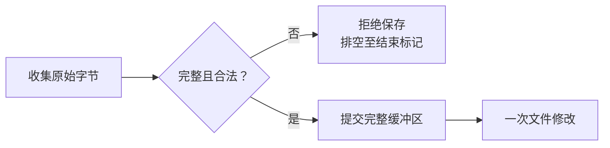
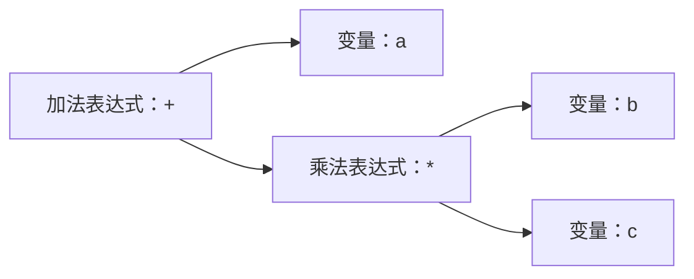

+++
title = "14. 在 console 粘贴源码，再在 OS 里编译它"
date = 2026-10-30T13:56:00+08:00
slug = "guest-source-paste-native-compiler"
description = "把原始源码输入、词法语法检查与 RV64 代码生成接起来，让独立用户态编译器产出真正可装载的程序，并验证失败不会先破坏旧文件。"
tags = ["RISC-V", "编译器", "源码粘贴", "C子集"]
draft = true
+++

## 上一课能装程序，这一次让系统自己生成程序

[第 13 课](/posts/program-loader-dynamic-math-module/)已经把磁盘里的程序文件装进内存，建立用户进程，并调用文件里的动态函数。可是这些可执行字节，仍由宿主机工具链提前生成。

这一课要让我们的[操作系统（Operating System，OS）](/terms/#os)多完成一段工作：接收源码，把源码保存成文件，再由 guest 内的编译器读取它，生成同一个系统能够装载的机器码文件。

关键不是给串口增加一个叫 `cc` 的命令，而是补齐这条可观察的链路：


本稿对应的实现候选已完成，以下命令与结果来自该候选的实际运行；独立审查和最终归档验收仍在进行。固定版本尚未冻结，未完成前不发布。

```text
LESSON14_COMMIT_PENDING
```

## 先走通一次：粘贴、编译、退出、运行

最终代码入口将在验收后补上固定标签。在代码仓库根目录运行：

```sh
make lesson14
make run-lesson14
```

在 `14> ` 提示符下粘贴整个输入块。`END` 必须独占一行；不要把 Markdown 的围栏也粘进去：

```c
fappend odd.c <<END
int main(void) {
    int n = 1;
    int sum = 0;
    while (n <= 9) {
        if (n % 2 != 0) sum = sum + n;
        n = n + 1;
    }
    puts("saved native program:");
    print_int(sum * 123456789);
    print_int(-123 / 7);
    print_int(-123 % 7);
    return 47;
}
END
```

这里保存了 268 字节源码。`fappend` 是追加而不是替换：重复演示前，应明确删除旧 `odd.c` 或选一个新文件名，不要在同一文件里追加第二个 `main`。

接着输入 `./cc odd.c odd`。读取 shell 实际返回的进程编号，再输入 `wait 编号`；只有编译器退出并回收后，才输入 `./odd`，再等待新编号。

一次实际运行的关键输出如下。为突出命令关系，省略了行编辑重绘和调度审计行；编号属于这次运行，不是以后每次都相同：

```text
./cc odd.c odd
exec target=0 result=17
cc: published native RV64 bytes=32848
wait 17
wait target=17 result=0
./odd
exec target=0 result=33
saved native program:
3086419725
-17
-4
wait 33
wait target=33 result=47
```

这些整数不是编译器预先打印的答案。编译器进程已经结束；后面的输出来自独立装载的 `odd`，完整整数也不是退出状态低八位的替代品。

输入 `shutdown`，重新执行 `make run-lesson14`，先运行 `cat odd.c`，再运行 `./odd` 和对应的 `wait`。不要重新粘贴、重新编译，也不要 reset 磁盘。父级验收实际使用同一块盘启动第二个全新 [QEMU（Quick Emulator，快速仿真器）](/terms/#qemu)进程，先通过 guest 读回完整源码与程序字节，再运行旧产物，仍得到同样三个整数和状态 47。

## 在 guest 运行，不等于编译器已经自举

这里有两个不同的编译过程：

- 宿主机上的交叉工具链，把编译器自己的实现构建成 RISC-V 程序。
- 这个编译器在 guest 用户态运行，读取 guest 文件，再输出 RISC-V 程序。

第二步确实把编译工作放进了我们的系统，但还不能叫[编译器自举（self-hosting）](/terms/#self-hosting)。要声称自举，还需要支持编译器自身所用的语言和构建过程，并真正生成它自己。

本篇先做有界的整数 C 子集。浮点运算、动态 math 运行时和完整综合演示留给下一课；不能为了一个简单的程序，把还没有解释的运行时、指令扩展和调用约定全部塞进去。

## 源码不是一条普通 shell 命令

前面章节的行编辑器会处理方向键、历史、补全和退格。把整个 C 源码直接交给它，可能让制表符变成补全，让长行碰到命令长度上限，让反斜杠和引号走进另一套解析规则。

因此需要明确的原始输入模式。设计采用 here-document 一类的结束标记：进入之后，后续行先作为源码收集，只有一整行与约定标记完全相同时才结束。

本课实际语法是 `fappend NAME <<DELIMITER`。正文上限为 8192 字节，结束标记为 1–31 个不含空格的可打印字节；结束标记整行不计入正文。空正文不创建文件。制表符保留，回车（Carriage Return，CR）、换行（Line Feed，LF）及两者组合 [CRLF](/terms/#crlf)统一成 LF，因此容量按规范化后的字节数计算。

原始模式并不等于忽略边界：

- 内容中的制表符、引号、反斜杠和 UTF-8 字节应按合同保留。
- CR、LF 与 CRLF 需要通过同一套输入状态统一成换行，不能在命令和源码模式交界处多出或丢掉一行。
- 正好达到容量上限的源码，后面仍必须有空间识别结束标记。
- 结束标记出现在较长一行里，不应意外截断源码。

本课只借用这种输入外形，不把它冒充成完整 shell 的变量展开、命令替换或预处理器。

## 收集结束以前，不要打开目标文件

如果一进入粘贴模式就以替换方式打开文件，用户稍后取消，旧文件也可能已经被截空。容量检查发生得太晚，也会留下同样的问题。



安全顺序应该是先收集、检查和确认，再进行文件修改。取消、空输入、超限以及被明确拒绝的控制字符，各自是否保存、是否创建新文件，都要有可测试的规定。

失败以后还不能立刻把剩余输入交回命令分派器。否则本来属于源码的 `shutdown` 或 `rm`，可能突然变成真正的 shell 命令。排空和重新同步到结束标记，是输入协议的一部分；取消后的恢复方法也必须讲清楚。

串口接收缓冲区则是另一道边界。增加缓冲只能容纳一个明确范围内的突发，不是流量控制。如果输入已经丢字节，就不能把残缺源码当成完整输入保存；统计丢失的观察窗口还要覆盖整个输入过程，不能在丢失之后才开始取基线。

实现采用 16384 字节接收环，并使用从启动开始的丢失计数：本次启动只要发生过接收丢失，后续原始粘贴都拒绝发布，直到重启。这样不会在识别命令之后才重置观察窗口，把已经发生的丢字节藏起来。

取消也有明确代价：Ctrl-C、Ctrl-D、ESC 和其他不允许的控制字节会让整次输入失败，但仍须输入结束标记才能重新同步。系统返回 `raw: rejected; drained; unchanged` 后才恢复命令模式；这不是一个“按 Ctrl-C 立刻执行后续行”的协议。

## 从字符到语法结构，不靠识别示例文件名

一个真正的编译器至少要能区分几个层次：

1. 词法分析：把源码字节分成名称、整数、字符串、关键字和运算符等词法单元。
2. 语法分析：按照语法和优先级，把这些单元组合成表达式与语句。
3. 名称与类型检查：判断变量是否存在、作用域是否正确、运算和调用是否接受这种值。
4. 代码生成：把已经确定的行为编码成目标处理器指令，并处理分支目标。

[抽象语法树（Abstract Syntax Tree，AST）](/terms/#ast)可以显式表达这种组合关系。例如 `a + b * c` 的优先级结构如下，而不是按从左到右的字符顺序执行：



图表达的是语义关系，不规定必须使用某个外部编译框架。实现应让词法、语法、类型与指令编码的责任可以分开检查；把整篇源码与几个字符串比较，再选择一个预编译结果，不属于这里的编译过程。

还有一类不能被“结果数值相同”掩盖的区别：变量表达式 `x` 可以作为赋值左侧，但一元加法 `+x` 已经是一个值表达式，不能因此允许 `(+x)=42`。如果解析器为了省事直接删除一元加号，后面的检查就可能再也分不出这两种情况。

同样，不支持 `++` 也不等于可以把它拆成两个支持的 `+`。`x + +1` 的两个加号被空白分开，是加法与一元正号；相邻的 `++x` 则属于本课不支持的自增，必须拒绝。独立审查实际发现过这两类错误：编译器能生成可执行文件、程序也能运行，但语义已经被悄悄改写。累计测试通过不能代替针对这种反例的检查。

修复后的候选为一元正号保留独立的值节点，并在词法阶段按最长匹配拒绝不支持的多字符运算符，包括 `++`、`--`。回归也必须同时证明 `(x)=42`、`x + +1` 及用注释分开的正负号仍然合法，不能用“一概禁止加号”来掩盖分类错误。

## C 子集的边界，本身就是实现合同

“能处理一种像 C 的写法”和“支持完整 C”之间差了很多机制。

实现的语言合同见代码仓库 `lessons/14/LANGUAGE.md`，核心范围如下：

| 类别 | 本课支持 |
| --- | --- |
| 入口 | 一个 `int main(void)` 或 `int main()` |
| 局部状态 | `int` 局部声明、嵌套作用域、赋值 |
| 表达式 | 十进制整数、括号、一元 `+ - !`、`+ - * / %`、六种比较 |
| 语句 | 块、空语句、`if/else`、`while`、带表达式的 `return` |
| 输出 | `puts("字面量")`、`print_int(整数表达式)` |
| 文本 | 两种注释、字符串及有限转义 |

`print_int` 是经过类型检查的内建调用，不是实现了 ISO C 的 `printf`。数组、指针、结构体、一般函数、浮点、预处理器、`for`、自增和逻辑短路运算符都不在范围内；例如 `#include <stdio.h>` 会被拒绝，不能照搬普通宿主 C 的头文件开场。

还需要说明目标语言的整数宽度、溢出和除零政策，以及打印函数究竟接收什么类型。处理器有 64 位寄存器，并不自动回答语言中每个类型和运算的语义。若教学整数与常见 C 实现不同，就应直接写出差别，而不是借 C 这个名称把它藏起来。

这里的教学 `int` 是有符号 64 位整数，不是常见实现中的 32 位 `int`。运算按模 2 的 64 次方回绕；操作数从左到右求值，赋值右结合。除法向零截断，余数对应同一次除法，所以例子中 `-123 / 7` 得到 `-17`，`-123 % 7` 得到 `-4`。

不带初始化表达式的 `int x;` 每次执行声明都存入零，包括循环的每一轮。带初始化的声明则禁止在初始化表达式中引用或赋值给正在声明的变量；即使外层也叫 `x`，`int x=x+1;` 也被拒绝，不会偷偷读取上一轮的槽位或退回外层变量。普通的块内遮蔽仍然支持。

本课还明确采用 [RISC-V M 扩展](https://docs.riscv.org/reference/isa/v20260120/unpriv/m-st-ext.html)的边界行为：除零的商为 `-1`、余数为原被除数；最小有符号数除以 `-1` 得到最小有符号数、余数为零。这些是这门教学语言选定的规则，不能称为完整 ISO C 的保证。十进制字面量最多到 `9223372036854775807`，最小值可以写成 `-9223372036854775807-1`。

限制也不能只写在文章里：源码、词法单元、字符串、局部变量、语法节点、嵌套深度、代码、常量区和跳转距离，都需要在实现中检查。过深递归可能先耗尽编译器自己的进程栈，发生在它来得及打印“超过限制”之前，因此栈预算也是前端合同的一部分。

几个重要预算是源码 8192 字节、标识符 31 字节、单个解码后字符串 1024 字节、总局部槽位 256 个、AST 数组 4096 个槽位（零号表示空节点），以及 32768 字节代码区和 8192 字节字符串区。解析、块嵌套、代码生成和生成程序的求值栈分别有自己的深度限制，不能只检查数组没写满。

## 生成的不是汇编文本，而是可装载的指令文件

教学编译器可以直接编码目标指令，不必先实现一个完整汇编器和链接器。但直接编码没有消除格式和边界要求。

立即数、寄存器编号、符号扩展和跳转偏移必须按[固定版本 RISC-V 指令规范](https://docs.riscv.org/reference/isa/v20260120/unpriv/rv32.html)放进正确字段。目标还没确定的分支，需要保留可检查的位置，再在目标确定后修补；目标超出编码范围时应拒绝，不能悄悄丢掉高位。

输出也不是随便一段能跳进去的字节。它要满足加载器已经声明的文件头、入口、代码范围、实际文件长度和运行内存合同；若新增参数或运行时能力，需要明确版本，而不是让编译器和加载器各猜一份格式。

本课保留第 13 课的 48 字节 `RVEXEC1` 文件头，用偏移 32 的[应用程序二进制接口（Application Binary Interface，ABI）](/terms/#abi)字段区分旧 ABI1 与新 ABI2。新 ABI2 接收参数并拥有更大的工作区和专用栈；旧的 `math_test` 仍用 ABI1，`math.dll` 的模块 ABI1 也没有因此变成 ABI2。未知 ABI 和保留字段被拒绝。

上面的 `odd` 实测长 32848 字节，入口在载荷偏移 144，实际代码结束于偏移 1040。为什么简单程序也有三万多字节？生成器把字符串基址固定在载荷偏移 32768，前面不足的部分用零填充，再把整个载荷对齐到 16 字节。填充不是解释器，也不是源码。

入口之前的 144 字节是带 `RVINT14` 版本头的整数输出前缀，负责把完整有符号整数写到控制台。它在宿主构建时核验格式，在 guest 编译时再次检查；`print_int` 发出真正的原生调用。它不是完整 C 运行时，更不是下一课的浮点数学与动态链接集成。

条件控制流使用“反转短条件、跳过一条长跳转”的形式，再修补 `JAL` 的相对目标，避免把整个循环体硬塞进条件分支的短偏移范围。表达式中间值按 16 字节压栈，运算结果放在 `a0`；这些都可以对照 `cc.c` 的指令编码函数和反汇编逐条检查。

本课采用的整数指令语义还要结合 [RV64I 规范](https://docs.riscv.org/reference/isa/v20260120/unpriv/rv64.html)检查；宿主 C 代码、生成器里的整数类型与 guest 指令的宽度，不应被当成同一回事。

## 编译器为什么需要启动参数和自己的工作区

上一课的应用入口不需要接收源码文件名和输出文件名。独立 `cc` 要读取哪个文件、结果保存到哪里，这次必须成为真实的参数传递，而不是让内核把测试文件名写死。

参数还不能放在即将被装载覆盖的应用区域里。加载器需要先验证和复制，再把它们交给新进程；普通工作任务、其他进程的栈和 shell 的粘贴暂存区，也不能因为新增接口就全部变成合法指针范围。

编译器的静态工作区同样会带来实际内存成本：源码、语法结构、符号、待发布映像和递归栈可以同时存在。扩展这些静态保留区域，不等于扩大了内核堆。新增粘贴缓冲还必须避开已经存在的 shell、逐进程数据和栈。

本课把文件上限、内核暂存区、运行内存和进程栈拆开，而不是把同一个 `APP_LIMIT` 一起放大：

| 区域 | 地址或边界 |
| --- | --- |
| 可执行文件与内核读取暂存区 | 仍最多 65536 字节 |
| ABI2 应用运行区 | `0x80500000–0x80600000` |
| ABI2 专用栈 | `0x80410000–0x80420000` |
| shell 专用原始输入工作区 | `0x80420000–0x80424000` |
| 旧工作任务和 ABI1 栈 | 保留原有八个 4 KiB 栈 |

参数最多四个；每个字符串含结尾零最多 48 字节，向量必须对齐、完整终止且属于 shell 的合法区间。内核先把向量和所有字符串复制到对应进程的数据槽，再安装新映像；ABI2 入口通过 `a0/a1` 接收 `argc/argv`。不是把 shell 某个即将变化的指针原样交给新程序。

候选实测内核的[零初始化数据区（BSS，历史名称 Block Started by Symbol）](/terms/#bss)结束于 `0x8032cad0`，shell 工作区实际结束于 `0x80423400`，编译器 BSS 结束于 `0x80539e10`。这些是不同的静态区域；编译器文件只有 12736 字节，不意味着运行时也只需要这么多内存。完整端点与栈预算由 `resource-test.py` 从链接符号和栈使用记录独立核验，写入 `resource-results.json`。

前一课“同一时刻只允许一个文件应用”的限制仍然有意义。编译器不能一边使用共享应用内存，一边用自己的输出覆盖自己；要先完成保存、退出并回收，再由 shell 独立启动结果。

## 错误源码不应该先毁掉旧输出

词法、语法、类型和代码生成检查都应在输出发布之前完成。读不到输入、发现错误或者超过限制时，旧输出应仍是旧输出，原本不存在的输出也不应多出一个空文件。

真正发布时，还要沿用[第 12 课](/posts/redo-journal-crash-recovery/)建立的事务边界。先提交一次“截空文件”，再分几次写数据，不能被包装成一次原子的完整发布。

确定性的参数、容量和资源失败，可以要求完整回滚。真实设备错误则仍可能存在持久化不确定窗口，必须按日志合同进入持续失败与恢复，不能在文章里承诺撤销一笔可能已经提交的修改。

新增 `STORE(32)` 只允许当前文件应用提交完整输出，`APPEND(33)` 只允许 shell 追加收集完的正文。调用者身份先于指针检查，`cc`、`math_test`、`math.dll` 等引导文件名受到保护。编译器还会在打开输出之前拒绝输入、输出同名。

底层 `fs_store` 使用一次外层事务，把创建或替换、截断、按内部块大小写入和关闭组合起来；不能在循环里嵌套会自行提交的公共写接口。检查失败要恢复内存中的元数据、句柄和游标，而不只是保证磁盘上的一个字段看起来没变。

诊断信息也属于观察面：哪一行、什么类别的错误、编译器返回什么状态，应该足以帮助读者修改源码；不能失败以后仍留下上一次的成功提示。

## 怎样证明编译真的发生在 guest 里

验收不是一张 `cc: success` 的截图，而是几条可以交叉核对的路径：

- 通过真实串口原始输入保存源码，宿主独立核对源码完整字节。
- 真正的用户态编译器从文件读取这些字节，退出后仍有独立的机器码文件。
- 改变运算、分支或循环，生成字节和运行结果一起变化，不依赖某个特定文件名。
- 用另一条预期计算路径核对结果，检查机器码和文件头，而不是用编译器自己的结果当标准答案。
- 错误源码逐类保留旧输出的完整字节，取消或超限粘贴不改变文件。
- 冷启动先检查已经保存的源码和程序，不覆写、不重新编译，再独立运行它。

调试器还要能停在编译器自己的用户入口，以及生成程序的入口，核对实际装入的机器字节和执行 hart 的指令同步。模拟器里顺利执行，并不等于验证了真实开发板的缓存或外设行为。

父级另外实际编译了 `puts(3)` 这种类型错误程序，要求它返回 1，并检查既有 `odd` 的全部 32848 字节保持不变；随后重启仍可执行旧产物。不是只检查旧文件“还在”。

代码仓库提供的复验入口是：

```sh
make test-lesson14
make inspect-lesson14
make test-lesson14-gdb
make test-lesson14-evidence
make all test inspect
```

常规门禁实际驱动多组不同程序、全宽整数结果、词法与类型拒绝、输入边界、旧输出保留和冷启动读回；原生存储测试与真实 QEMU 设备错误分开记录。故意破坏减法、分支修补和局部存储的编译器，也必须被相同结果判定器拒绝。调试门禁失败不能沿用上次的 PASS，早期构建失败、伪调试器和超时输出保留也有专门门禁。

最终审查结论、精确提交和累计复验结果仍待签字；本稿不把候选通过的测试数量当成独立审查结论。

## 读完以后，自己解释一遍

1. 宿主构建了 `cc`，为什么仍可以说编译工作发生在 guest？这为什么还不是自举？
2. 原始源码输入为什么不能直接复用命令行的编辑和转义规则？
3. AST 中的优先级，与字符在文件中的先后顺序，有什么区别？
4. 为什么前端限制和机器码容量限制都需要检查，递归栈又是另一种资源？
5. 先截空输出再写入，与一次完整发布，在失败时有什么区别？
6. 编译器退出以后再次启动、以及冷启动不重编译，分别排除了哪些假演示？

## 规范与背景

- [LLVM 官方教程：解析器与 AST](https://llvm.org/docs/tutorial/MyFirstLanguageFrontend/LangImpl02.html)：理解语法结构与运算符优先级；本课不是把 LLVM 移植进 guest。
- [RISC-V v20260120：基础指令与控制转移](https://docs.riscv.org/reference/isa/v20260120/unpriv/rv32.html)：编码与跳转的规范依据。
- [RISC-V v20260120：RV64I](https://docs.riscv.org/reference/isa/v20260120/unpriv/rv64.html)：目标整数宽度和指令区别。
- [RISC-V v20260120：M 扩展](https://docs.riscv.org/reference/isa/v20260120/unpriv/m-st-ext.html)：乘除法、余数及边界行为。
- [系列总览](/series/)与[术语表](/terms/)：第 15 课及后续真机部分仍是独立目标。
