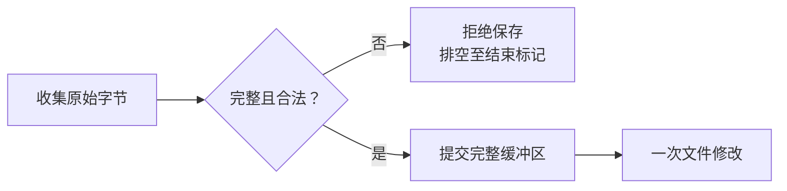
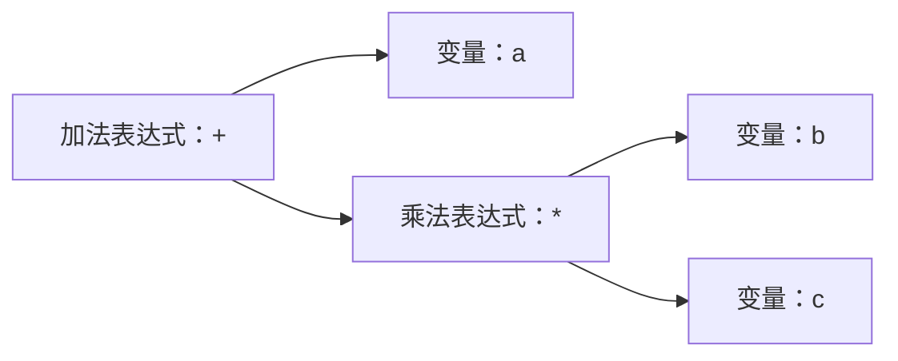

+++
title = "14. 在 console 粘贴源码，再在 OS 里编译它"
date = 2026-10-30T13:56:00+08:00
slug = "guest-source-paste-native-compiler"
description = "把原始源码输入、词法语法检查与 RV64 代码生成接起来，让独立用户态编译器产出真正可装载的程序，并验证失败不会先破坏旧文件。"
tags = ["RISC-V", "编译器", "源码粘贴", "C子集"]
draft = true
+++

## 上一课能装程序，这一次让系统自己生成程序

[第 13 课](/posts/program-loader-dynamic-math-module/)已经把磁盘里的程序文件装进内存，建立用户进程，并调用文件里的动态函数。可是这些可执行字节，仍由宿主机工具链提前生成。

这一课要让我们的[操作系统（Operating System，OS）](/terms/#os)多完成一段工作：接收源码，把源码保存成文件，再由 guest 内的编译器读取它，生成同一个系统能够装载的机器码文件。

关键不是给串口增加一个叫 `cc` 的命令，而是补齐这条可观察的链路：


本稿仍在实现与独立验收阶段。以下先说明设计边界和验证方式，最终语言合同、格式、内存预算、命令与实际串口记录待验收后补齐。未完成前不发布。

```text
LESSON14_COMMIT_PENDING
```

## 在 guest 运行，不等于编译器已经自举

这里有两个不同的编译过程：

- 宿主机上的交叉工具链，把编译器自己的实现构建成 RISC-V 程序。
- 这个编译器在 guest 用户态运行，读取 guest 文件，再输出 RISC-V 程序。

第二步确实把编译工作放进了我们的系统，但还不能叫[编译器自举（self-hosting）](/terms/#self-hosting)。要声称自举，还需要支持编译器自身所用的语言和构建过程，并真正生成它自己。

本篇先做有界的整数 C 子集。浮点运算、动态 math 运行时和完整综合演示留给下一课；不能为了一个简单的程序，把还没有解释的运行时、指令扩展和调用约定全部塞进去。

## 源码不是一条普通 shell 命令

前面章节的行编辑器会处理方向键、历史、补全和退格。把整个 C 源码直接交给它，可能让制表符变成补全，让长行碰到命令长度上限，让反斜杠和引号走进另一套解析规则。

因此需要明确的原始输入模式。设计采用 here-document 一类的结束标记：进入之后，后续行先作为源码收集，只有一整行与约定标记完全相同时才结束。

原始模式并不等于忽略边界：

- 内容中的制表符、引号、反斜杠和 UTF-8 字节应按合同保留。
- CR、LF 与 CRLF 需要通过同一套输入状态统一成换行，不能在命令和源码模式交界处多出或丢掉一行。
- 正好达到容量上限的源码，后面仍必须有空间识别结束标记。
- 结束标记出现在较长一行里，不应意外截断源码。

本课只借用这种输入外形，不把它冒充成完整 shell 的变量展开、命令替换或预处理器。

## 收集结束以前，不要打开目标文件

如果一进入粘贴模式就以替换方式打开文件，用户稍后取消，旧文件也可能已经被截空。容量检查发生得太晚，也会留下同样的问题。



安全顺序应该是先收集、检查和确认，再进行文件修改。取消、空输入、超限以及被明确拒绝的控制字符，各自是否保存、是否创建新文件，都要有可测试的规定。

失败以后还不能立刻把剩余输入交回命令分派器。否则本来属于源码的 `shutdown` 或 `rm`，可能突然变成真正的 shell 命令。排空和重新同步到结束标记，是输入协议的一部分；取消后的恢复方法也必须讲清楚。

串口接收缓冲区则是另一道边界。增加缓冲只能容纳一个明确范围内的突发，不是流量控制。如果输入已经丢字节，就不能把残缺源码当成完整输入保存；统计丢失的观察窗口还要覆盖整个输入过程，不能在丢失之后才开始取基线。

## 从字符到语法结构，不靠识别示例文件名

一个真正的编译器至少要能区分几个层次：

1. 词法分析：把源码字节分成名称、整数、字符串、关键字和运算符等词法单元。
2. 语法分析：按照语法和优先级，把这些单元组合成表达式与语句。
3. 名称与类型检查：判断变量是否存在、作用域是否正确、运算和调用是否接受这种值。
4. 代码生成：把已经确定的行为编码成目标处理器指令，并处理分支目标。

[抽象语法树（Abstract Syntax Tree，AST）](/terms/#ast)可以显式表达这种组合关系。例如 `a + b * c` 的优先级结构如下，而不是按从左到右的字符顺序执行：



图表达的是语义关系，不规定必须使用某个外部编译框架。实现应让词法、语法、类型与指令编码的责任可以分开检查；把整篇源码与几个字符串比较，再选择一个预编译结果，不属于这里的编译过程。

## C 子集的边界，本身就是实现合同

“能处理一种像 C 的写法”和“支持完整 C”之间差了很多机制。

本课将明确列出支持的入口形式、局部声明、作用域、赋值、整数运算、比较、分支、循环、字符串与有限内建调用。未支持的类型、函数定义形式、运算符或预处理语法，应被明确拒绝，而不是跳过以后继续生成程序。

还需要说明目标语言的整数宽度、溢出和除零政策，以及打印函数究竟接收什么类型。处理器有 64 位寄存器，并不自动回答语言中每个类型和运算的语义。若教学整数与常见 C 实现不同，就应直接写出差别，而不是借 C 这个名称把它藏起来。

限制也不能只写在文章里：源码、词法单元、字符串、局部变量、语法节点、嵌套深度、代码、常量区和跳转距离，都需要在实现中检查。过深递归可能先耗尽编译器自己的进程栈，发生在它来得及打印“超过限制”之前，因此栈预算也是前端合同的一部分。

## 生成的不是汇编文本，而是可装载的指令文件

教学编译器可以直接编码目标指令，不必先实现一个完整汇编器和链接器。但直接编码没有消除格式和边界要求。

立即数、寄存器编号、符号扩展和跳转偏移必须按[固定版本 RISC-V 指令规范](https://docs.riscv.org/reference/isa/v20260120/unpriv/rv32.html)放进正确字段。目标还没确定的分支，需要保留可检查的位置，再在目标确定后修补；目标超出编码范围时应拒绝，不能悄悄丢掉高位。

输出也不是随便一段能跳进去的字节。它要满足加载器已经声明的文件头、入口、代码范围、实际文件长度和运行内存合同；若新增参数或运行时能力，需要明确版本，而不是让编译器和加载器各猜一份格式。

本课采用的整数指令语义还要结合 [RV64I 规范](https://docs.riscv.org/reference/isa/v20260120/unpriv/rv64.html)检查；宿主 C 代码、生成器里的整数类型与 guest 指令的宽度，不应被当成同一回事。

## 编译器为什么需要启动参数和自己的工作区

上一课的应用入口不需要接收源码文件名和输出文件名。独立 `cc` 要读取哪个文件、结果保存到哪里，这次必须成为真实的参数传递，而不是让内核把测试文件名写死。

参数还不能放在即将被装载覆盖的应用区域里。加载器需要先验证和复制，再把它们交给新进程；普通工作任务、其他进程的栈和 shell 的粘贴暂存区，也不能因为新增接口就全部变成合法指针范围。

编译器的静态工作区同样会带来实际内存成本：源码、语法结构、符号、待发布映像和递归栈可以同时存在。扩展这些静态保留区域，不等于扩大了内核堆。新增粘贴缓冲还必须避开已经存在的 shell、逐进程数据和栈。

前一课“同一时刻只允许一个文件应用”的限制仍然有意义。编译器不能一边使用共享应用内存，一边用自己的输出覆盖自己；要先完成保存、退出并回收，再由 shell 独立启动结果。

## 错误源码不应该先毁掉旧输出

词法、语法、类型和代码生成检查都应在输出发布之前完成。读不到输入、发现错误或者超过限制时，旧输出应仍是旧输出，原本不存在的输出也不应多出一个空文件。

真正发布时，还要沿用[第 12 课](/posts/redo-journal-crash-recovery/)建立的事务边界。先提交一次“截空文件”，再分几次写数据，不能被包装成一次原子的完整发布。

确定性的参数、容量和资源失败，可以要求完整回滚。真实设备错误则仍可能存在持久化不确定窗口，必须按日志合同进入持续失败与恢复，不能在文章里承诺撤销一笔可能已经提交的修改。

诊断信息也属于观察面：哪一行、什么类别的错误、编译器返回什么状态，应该足以帮助读者修改源码；不能失败以后仍留下上一次的成功提示。

## 怎样证明编译真的发生在 guest 里

验收不是一张 `cc: success` 的截图，而是几条可以交叉核对的路径：

- 通过真实串口原始输入保存源码，宿主独立核对源码完整字节。
- 真正的用户态编译器从文件读取这些字节，退出后仍有独立的机器码文件。
- 改变运算、分支或循环，生成字节和运行结果一起变化，不依赖某个特定文件名。
- 用另一条预期计算路径核对结果，检查机器码和文件头，而不是用编译器自己的结果当标准答案。
- 错误源码逐类保留旧输出的完整字节，取消或超限粘贴不改变文件。
- 冷启动先检查已经保存的源码和程序，不覆写、不重新编译，再独立运行它。

调试器还要能停在编译器自己的用户入口，以及生成程序的入口，核对实际装入的机器字节和执行 hart 的指令同步。模拟器里顺利执行，并不等于验证了真实开发板的缓存或外设行为。

本节的正式命令、支持语法、资源限制、故障用例、生成字节和串口记录将在实现验收后写入。当前不把设计图或宿主构建成功当成已经交付。

## 读完以后，自己解释一遍

1. 宿主构建了 `cc`，为什么仍可以说编译工作发生在 guest？这为什么还不是自举？
2. 原始源码输入为什么不能直接复用命令行的编辑和转义规则？
3. AST 中的优先级，与字符在文件中的先后顺序，有什么区别？
4. 为什么前端限制和机器码容量限制都需要检查，递归栈又是另一种资源？
5. 先截空输出再写入，与一次完整发布，在失败时有什么区别？
6. 编译器退出以后再次启动、以及冷启动不重编译，分别排除了哪些假演示？

## 规范与背景

- [LLVM 官方教程：解析器与 AST](https://llvm.org/docs/tutorial/MyFirstLanguageFrontend/LangImpl02.html)：理解语法结构与运算符优先级；本课不是把 LLVM 移植进 guest。
- [RISC-V v20260120：基础指令与控制转移](https://docs.riscv.org/reference/isa/v20260120/unpriv/rv32.html)：编码与跳转的规范依据。
- [RISC-V v20260120：RV64I](https://docs.riscv.org/reference/isa/v20260120/unpriv/rv64.html)：目标整数宽度和指令区别。
- [系列总览](/series/)与[术语表](/terms/)：第 15 课及后续真机部分仍是独立目标。
