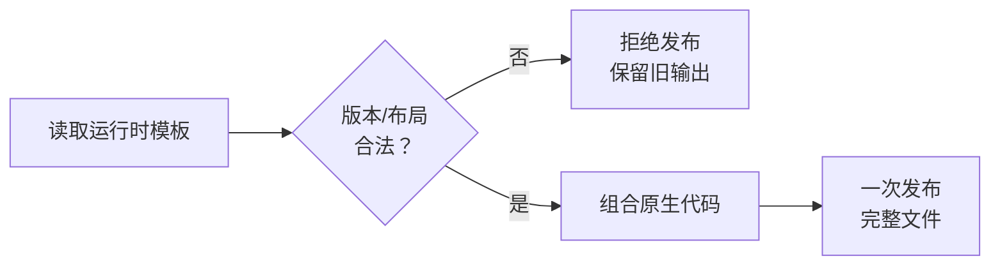
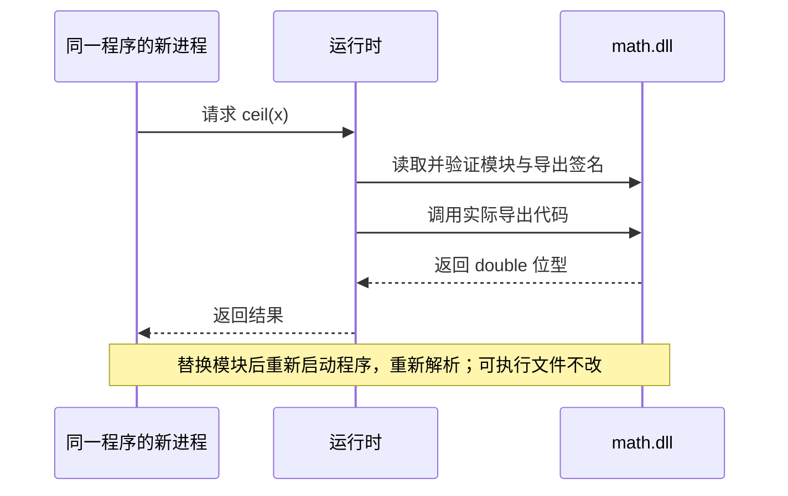

+++
title = "15. 把工具链闭环接完整：浮点、运行时与动态调用"
date = 2026-10-31T01:49:55+08:00
slug = "soft-float-runtime-dynamic-toolchain"
description = "在 guest 内编译浮点表达式，借助版本化运行时调用真正的 math.dll，再用不改可执行文件的动态重绑定与冷启动证明闭环。"
tags = ["RISC-V", "编译器", "软浮点", "运行时", "动态模块"]
draft = false
+++

## 整数程序已经会运行，这次补齐浮点与动态数学

[第 14 课](/posts/guest-source-paste-native-compiler/)已经完成一个真实的整数编译闭环：把源码粘贴进文件，由 guest 里的独立 `cc` 生成机器码，等待它退出并回收，再装载产物运行。关机以后，下一次启动还能直接运行旧产物。

因此，这一课不是再实现一次加载器和参数传递，而是在这条路径上增加两个依赖：浮点运算需要的辅助例程，以及按名字解析数学模块的运行时。

最终要能回答的是：`double` 的一个加法怎样变成当前处理器能执行的指令；`ceil(x)` 怎样在程序运行时到另一个文件里找到代码；换掉模块以后，为什么同一份可执行文件可以产生不同结果。

本课代码已冻结为 [`lesson-15`](https://github.com/xueliangliang/riscv-hello/tree/lesson-15)，精确提交为 [`ed5462b9b0f6100bfce290f950a5cb1a7fedeaf2`](https://github.com/xueliangliang/riscv-hello/commit/ed5462b9b0f6100bfce290f950a5cb1a7fedeaf2)。独立功能规格审查和代码质量审查均通过；父级另在精确提交的全新归档中完成累计构建、测试、检查、07–15 课真实调试器门禁，以及失败证据判定器复验。

```sh
git clone --branch lesson-15 https://github.com/xueliangliang/riscv-hello.git riscv-lesson15
cd riscv-lesson15
git rev-parse HEAD
```

最后一条命令应输出上述完整提交。以下语言、布局、命令与实测结果都对应这份冻结代码，而不是会继续变化的 `main`。

## 先跑一次完整示例

依赖沿用前几课：[GNU 编译器集合（GNU Compiler Collection，GCC）](/terms/#gcc)的 RISC-V 交叉工具链及 binutils、宿主 C 编译器、Python 3 标准库，以及[机器模拟器（Quick Emulator，QEMU）](/terms/#qemu)的系统和用户态模拟器。调试门禁还需要 [GNU 调试器（GNU Debugger，GDB）](/terms/#gdb)的多架构版本 `gdb-multiarch`。固定版本的软浮点源码已经随代码保存，不需要在构建时下载数学库。

在累计代码仓库中构建并启动本课：

```sh
make lesson15
make run-lesson15
```

打开仓库中的 [`lessons/15/demo.c`](https://github.com/xueliangliang/riscv-hello/blob/ed5462b9b0f6100bfce290f950a5cb1a7fedeaf2/lessons/15/demo.c)。在 guest 的 `15>` 提示符下输入 `fappend demo.c <<END15`，粘贴该文件全文，再输入单独一行 `END15`。这是串口原始文本收集，不是让宿主编译器提前生成演示程序。

`fappend` 的语义仍然是追加；如果同名源码已经存在，先明确删除旧源码，再重新粘贴，不能把两份 `main` 拼在一起。运行中的持久磁盘也不会因重新构建而自动重置。

然后编译：

```text
./cc demo.c demo
```

必须按 shell 打印的实际进程编号执行 `wait`，确认编译器退出并被回收，再运行 `./demo` 并等待这个新进程。一次干净启动的实测中，编译器编号是 17，运行产物的编号是 33；这些编号不是编译器接口中的常量。

```text
wait 17
./demo
wait 33
```

示例的用户输出如下；这里省略 shell 回显及调度生命周期日志：

```text
=== Native C + dynamic math.dll demo ===
sum(1..5) = 15
x = 3.250000
ceil(x) = 4.000000
floor(-x) = -4.000000
max(a, b) = 2.250000
min(a, b) = -3.500000
nested math = 3.500000
average = 3.000000
integer test: PASS
dynamic math test: PASS
DEMO_PASS
```

这次粘贴保存的源码为 961 字节，包含末尾换行；生成文件为 53552 字节。生成代码入口相对载荷起点是 20480，实际生成机器码为 5380 字节。文件还包含运行时、固定区域之间的填充以及字符串，所以不能把整个文件大小当成生成代码量。

输入 `shutdown` 后重新运行 `make run-lesson15`，持久磁盘中的源码和产物仍然存在。冷启动验收先读取上次保存的完整源码与二进制，再直接启动 `./demo`；这一轮不执行 `cc`，也不先覆写相同内容。`cat` 二进制会显示不可读字节，自动化门禁检查的是完整原始字节，而不是人工看名字或几个头字段。

## 会传 double，不等于已经能算 double

[第 13 课](/posts/program-loader-dynamic-math-module/)的模块调用已经可以传递 `double`，但那时的数学函数主要通过整数位操作完成取整和选择。能搬运位型、能调用这几个函数，并不等于生成器已经支持任意浮点四则运算。

这里必须分清三层：

- 表示：一个值按什么规则编码成字节。本课针对[二进制浮点格式 binary64](/terms/#binary64)。
- 指令：处理器用什么操作完成运算，是浮点指令，还是由整数指令组成的辅助函数。
- [应用程序二进制接口（Application Binary Interface，ABI）](/terms/#abi)：函数之间用什么寄存器和栈布局传参、返回。

本课沿用 `lp64` 整数调用约定，并继续把目标指令范围限制在已有的整数扩展内，不新增 F/D 浮点指令，也不顺便引入浮点寄存器的中断保存与恢复。这是保留现有执行合同的取舍，不是宣称浮点算术变成了整数算术。

按[固定版本的 RISC-V 调用约定](https://github.com/riscv-non-isa/riscv-elf-psabi-doc/blob/9b2767e2a8851709608c4e1452998ad232d6278b/riscv-cc.adoc)，这里的 binary64 位型通过通用参数寄存器传递。寄存器只是承载这些位；具体如何相加，仍需要实现。

## 软浮点：把一个运算变成一次有约定的调用

[软浮点（software floating point）](/terms/#soft-float)并不是把源码解释一遍。编译器仍然输出真正的原生指令，只是在适当位置调用由整数指令实现的浮点辅助例程。


这也解释了为什么整数和浮点不能只共用一个“不管类型的加法节点”。例如整数与浮点混合运算，要先按声明的语言规则完成转换；浮点比较还要考虑[非数值（Not a Number，NaN）](/terms/#nan)，不能直接套用有符号整数比较位型的结果。

语言合同也必须回答：零除、无穷、带符号零、非规格化数怎样处理；浮点转整数遇到超出范围或非有限值时，是拒绝还是报告运行时错误。不能让编译器实现语言里未定义的转换，替教学语言偷偷作出选择。

本课在第 14 课的有界整数子集上加入 `double` 局部变量、混合四则运算、六种比较，以及 `ceil`、`floor`、`max`、`min`。教学语言中的 `int` 仍是有符号 64 位整数，不等同于常见宿主 C 的 32 位 `int`。

- 整数与浮点混合运算、赋值时，可以将整数转换成 binary64；超过 binary64 连续精确整数范围以后，转换可能舍入。
- 浮点赋给整数或作为整数返回值时，先检查它有限且位于 `[-2^63, 2^63)`，再向零截断；不满足条件就报告运行时错误，而不是把位型交给无定义的转换。
- 条件判断把正零和负零都视为假，其他浮点值包括 NaN 为真。NaN 参与大小比较的规则，与比较两个整数位型完全不同。
- 浮点取模不在子集中；`1.0 % 2` 必须在编译期拒绝，而不是降级成整数运算。

字面量也有单独的合同：要求开头有十进制数字；小数点后必须有数字，或者使用带数字的指数部分。有效数字最多 17 位，指数绝对值最多 308；因此 `.5`、`1.`、`1.0e` 和 `1.0e309` 都不是本课支持的写法。

这里的转换按固定步骤执行：先把整数形式的有效数字转换为 binary64，再反复乘除 `10.0`。每一步都可能舍入，因此不能把它写成“完整、正确舍入的 `strtod`”。溢出、非零值下溢成零会报告编译错误；运算本身仍可产生非规格化数、无穷或 NaN。

## 不要为了链接成功，悄悄换一套 ABI

交叉工具链能编译 `double a + b`，不意味着它随附的 `libgcc` 一定与当前目标匹配。指令集选项与 ABI 选项是两件事；一个使用浮点寄存器传参的辅助库，不能只因为函数名相同就拿来替换当前约定。

本课选择固定来源的 LLVM `compiler-rt` 最小子集，保留源码与许可证，再用当前目标参数构建。来源固定在提交 `cd708029e0b2869e80abe31ddb175f7c35361f90`，而不是构建时临时下载一个会变化的分支。

这组辅助函数提供类似 `__adddf3`、`__muldf3`、`__divdf3` 的运算，以及 `__floatdidf`、`__fixdfdi` 这样的整数转换。教学整数在第 14 课已约定为 64 位，不能误用只处理 32 位输入的转换函数；这些普通符号名应对照实现和文档，不需要另造缩写解释。

验收分成两个层次：先核验上游文件哈希、许可证、未解析符号和目标属性，再实际执行边界向量。只看到链接成功或者没有 `fadd` 字符串，都不足以证明整条调用路径没有混入不匹配的代码。辅助库单独通过，也不代表 guest 编译、文件装载和动态调用集成已经通过。

## 一个运行时模板，为什么也需要版本和布局检查

[运行时（runtime）](/terms/#runtime)在这里不是一个模糊的“标准库”。它是与生成代码明确配合的那部分程序：打印、浮点辅助操作，以及加载并解析动态数学模块的入口。

生成器需要知道哪些入口提供什么签名，它们位于哪个受约束的区域，输出映像需要为它们的状态保留多少内存。因此，版本号、实际长度、入口表、保留字段和内存范围，都属于格式合同。



加载器也不能只检查一个入口地址落在大内存区里。声明依赖本课运行时的映像，必须能与此前的普通应用区分开，并在安装前核验约定的元数据；旧应用不应被误当成新模板来解析。

本课使用新的应用入口 ABI3 表明产物依赖这个模板，旧 ABI1、ABI2 不会被当成新模板解析。外层 `RVEXEC1` 文件头仍是 48 字节，运行时前缀则使用独立的 `RVRT15` 标识和版本 1。

相对应用载荷起点，布局分为三段：

| 区域 | 起始偏移 | 容量 |
| --- | --- | --- |
| 运行时前缀 | 0 | 20 KiB |
| 生成机器码 | 20480 | 32 KiB |
| 字符串 | 53248 | 8 KiB |

前缀的前 64 字节是元数据，后面是 23 个带签名编号的入口。入口目标必须位于声明的函数区，不能指向元数据、表、只读数据或填充区。编译器读取 `c_runtime` 后先验证这些字段，才把前缀和生成代码组合成文件；加载器安装 ABI3 映像之前也要验证。

文件与内存必须分开预算：整个可执行文件、内核暂存区及文件快照接口仍以 64 KiB 为上限，应用运行内存上限则是 1 MiB。运行时的未初始化数据从载荷基址加 65536 的位置开始，不占用对应的文件字节；每次启动由加载路径清零。较大的运行内存绝不能反过来放宽 64 KiB 暂存缓冲区的读取检查。

这里仍然不是一个恶意代码验证器。检查格式和调用合同，不能把当前平面内存模型变成安全隔离。模板、生成代码、字符串区和运行时状态的实际布局，最终都要由链接端点和文件字节证明，不能只在文章里画一张图。

## ceil 的名字，要在运行时解析到文件里的代码

普通浮点加法和动态数学调用不是同一条路径。加法可以由随产物保存的辅助函数完成；`ceil`、`floor`、`max`、`min` 则要通过前面章节的模块格式，找到真实 `math.dll` 中带签名的导出。



关键证据不是一个打印出来的函数名，而是不改生成程序的完整字节，换掉实际模块里的一个导出实现，再重新启动同一程序，观察结果确实变化。若同时重新编译或替换了可执行文件，就无法排除变化来自编译期。

导出缺失、签名不匹配、模块文件损坏与真实读取错误，都需要明确失败；不能退回一份硬编码数学结果，让演示表面上继续成功。

独立复验另外编译了一份小程序：令 `x = 10.125`，依次观察 `ceil(x)`、`floor(-x)`、`9.5 / 4.0`，再把 `-12.75` 转成整数。第一次执行得到 11、-11、2.375，以及整数 -12，退出状态为 47。

第二次启动先读回源码和整个产物，不编译直接执行，结果一致。随后关闭虚拟机，只在这份可丢弃磁盘上通过真实文件系统替换 `math.dll`，让 `ceil` 导出返回 42；第三次启动仍先读回保存内容，再运行同一个产物。

观察用的是完整位型，前后三个浮点结果分别为：

```text
原模块：0x4026000000000000  0xc026000000000000  0x4003000000000000
换模块：0x4045000000000000  0xc026000000000000  0x4003000000000000
```

只有第一个结果从 11 变成 42。替换前后，53312 字节的可执行文件全部相同，完整文件的[安全散列摘要（Secure Hash Algorithm，SHA-256）](/terms/#sha-256)也保持不变：

```text
6264d7e467a60e61c752d19aab3bf5d4cb0fc8bedab9e19f2afbe97b2d1d2e61
```

这不是在普通程序里开放覆写系统文件：guest 的发布接口仍保护 `math.dll` 等系统名。该实验使用测试驱动和可丢弃磁盘，经实际文件系统写入替换模块，既不改生成文件，也不碰读者原有磁盘。

## 格式化输出之前，必须先求完参数

本课的 `printf` 只接受字面量格式、最多 8 个类型匹配的参数：`%d` 对应教学整数，`%f` 对应 double，`%s` 对应字符串字面量，`%%` 不消耗参数。不支持宽度、精度和任意变参调用；`#include <stdio.h>`、`#include <math.h>` 也只是白名单声明，不是真正的头文件或预处理器。

有限范围内的 `%f` 打印六位小数，绝对值达到 `1e9` 时用 `<range>` 提示；它不是完整的标准库格式转换。`printf` 在本课固定返回 0，而不是返回标准 C 的字符数。

即使格式化功能有限，调用求值顺序也不能含糊。本课明确规定参数从左向右求值，并保留每个参数的结果，求完所有参数以后才开始外层格式输出。例如：

```c
int main() {
    printf("A%dB%d\n", print_int(11), print_int(22));
    return 0;
}
```

`print_int` 打印一行后返回 0，所以用户输出应当是：

```text
11
22
A0B0
```

不能把它错误地降低成“输出 A、求第一个参数、打印第一个结果、输出 B……”的流式操作。那样会得到另一种可观察行为，即使最终两个占位符里的数值都是 0。嵌套 `printf`、后续参数修改前一个参数引用的变量，以及浮点辅助调用，都需要验证先前结果没有被覆盖。

这与输出原子性是两回事。`print_int` 和 `print_bits` 的完整一行各用一次写调用；`printf` 可以分成多次写入，不保证与其他 hart 的输出互不穿插。但“不保证整行原子”并不允许改变本进程的参数求值与外层输出顺序。

## 六位小数，也不能靠一次近似乘法蒙混过关

格式化本身也需要独立验证。看似直接的做法是先算 `x * 1000000.0 + 0.5`，截断成整数，再插入小数点；但乘法和加法各自的 binary64 舍入，可能把原本略低于十进制中点的值推到中点，导致最后一位错误。

验收中实际找到了这样的输入：

```c
int main() {
    double x = 8303350407216725;
    x = x / 134217728;
    print_bits(x);
    printf("%f\n", x);
    return 0;
}
```

这里的整数和除以二的幂都能精确表示，不依赖十进制字面量转换。输入位型为 `0x418d7fda6b77be55`；正确的六位小数是 `61864781.433468`，旧实现却打印 `61864781.433469`。这不是“平局究竟选哪边”的争议，因为原值严格小于那个中点。

修复在格式化时拆出 binary64 的有效数字和指数，用足够宽的整数保存精确缩放结果，再根据被丢弃的二进制位只做一次舍入。过大的移位必须先检查，不能让 C 的未定义移位混进边界处理。它没有改变浮点四则运算，也没有引入宿主标准库或硬件浮点指令。

相同回归在旧版本上失败，在修复版上通过：216 个有限值逐个核对输入完整位型和最终字符串，另外检查三个非有限值及两次错误发布。其中包括正负号、中点两侧、真正的平局、进位、正负零、非规格化数和幅值边界；期望字符串由精确有理数算法计算，不再用同一套近似乘加作判定器。

## 浮点测试不能只看小数打印

把一个结果打印成有限位小数，是为了给人阅读，不是完整的位型验证。两个不同的 binary64 值可能显示成相同文本；退出状态又只保留一小部分整数信息，更不能代替算术结果。

因此验收要组合几类证据：

- 有限结果按独立计算路径比较完整位型；NaN 按声明的分类、载荷和符号政策检查，不能随意把所有差异都当正确。
- 覆盖正负零、最小值附近、非规格化数、无穷、非有限输入和整数转换边界。
- 多组源码改变运算、参数、分支和混合类型，要求机器码与观察结果相互对应。
- 嵌套函数调用与格式化参数要核对完整值，避免一次辅助调用破坏先前保留的临时值。
- 错误源码或坏模板，既要保留旧输出全部字节，也要保持原本不存在的输出仍不存在。
- 同一块盘的新虚拟机先读回已有源码和产物，再直接执行，不重新编译，不先覆写相同内容。

最后还要在真实的用户入口和模块导出处停住，检查实际执行字节、调用约定和接收 hart 的本地指令同步。模拟器运行、辅助函数单独验证和真实开发板验证，仍然是不同层次的证据。

求值顺序回归在未修复编译器上实跑得到错误输出，在修复版上得到先打印参数、再打印外层格式的正确输出。新回归还覆盖 10 个正向程序和 12 次错误发布检查，包括嵌套打印、完整 64 位整数、浮点位型、8 个类型化参数、全部 256 个用户局部变量，以及恰好达到 128 个临时槽的表达式。达到边界与越界拒绝必须分开验证，不能靠扩大栈或吞掉错误来让演示通过。

读者可运行本课门禁，也可运行累计回归：

```sh
make test-lesson15 inspect-lesson15 test-lesson15-gdb
make test-lesson15-evidence
make all test inspect
```

每次日志在本次运行开始时失效，假调试器、提前退出、超时或错误工具链都必须失败；不能把上一次成功的文件当成本次证据。独立审查也要针对最终精确提交，不把“旧版本测试全通过”套用到后续修改。

浮点支持不等于完整 C，限定格式打印不等于完整 `printf`，固定舍入规则也不等于实现了完整浮点环境。

## 读完以后，自己解释一遍

1. 为什么把 double 位型放进通用寄存器，并没有自动实现浮点加法？
2. 编译器生成一次辅助函数调用，与在运行时解释源码有什么区别？
3. 同名函数为什么仍然可能有不兼容的 ABI？
4. 一个模板的版本、表长和入口范围检查，为什么需要发生在发布产物之前？
5. 怎样设计实验，排除动态 math 的结果其实来自编译期硬编码？
6. 为什么完整位型、打印文本、退出状态和冷启动是互补证据，而不是互相替代？

## 规范与背景

- [固定版本的 RISC-V 调用约定](https://github.com/riscv-non-isa/riscv-elf-psabi-doc/blob/9b2767e2a8851709608c4e1452998ad232d6278b/riscv-cc.adoc)：整数与硬件浮点调用约定、参数传递和栈要求。
- [GCC：RISC-V 目标选项](https://gcc.gnu.org/onlinedocs/gcc/RISC-V-Options.html)：`-march` 与 `-mabi` 的职责区别。
- [GCC：软浮点辅助函数](https://gcc.gnu.org/onlinedocs/gccint/Soft-float-library-routines.html)：运算与转换入口的约定。
- [固定提交的 LLVM compiler-rt](https://github.com/llvm/llvm-project/tree/cd708029e0b2869e80abe31ddb175f7c35361f90/compiler-rt/lib/builtins)：本课选用辅助函数的源码；不是移植整个 LLVM 编译器。
- [系列总览](/series/)：下一部分转入实际开发板的启动合同与分层验收。
